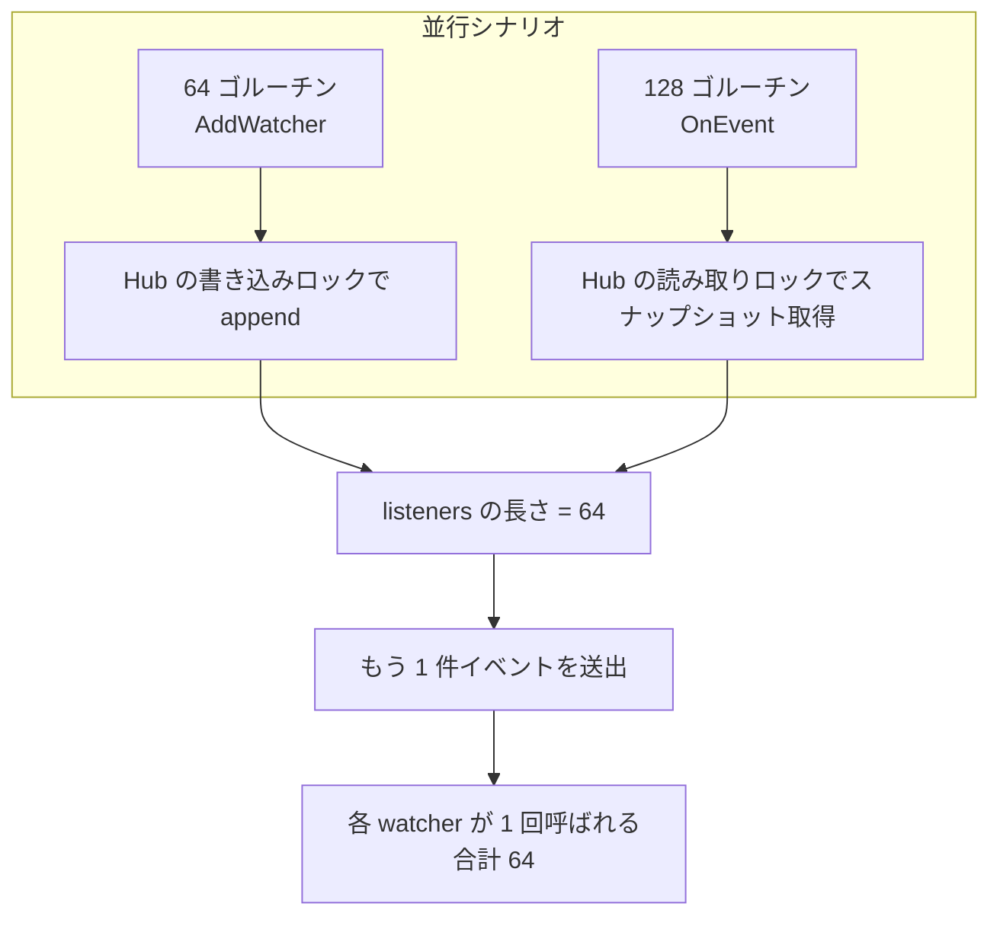

# pkg/scarecrow/hub_test.go

> 📅 最終更新日: 2026/11/13

## 役割

`pkg/scarecrow/hub_test.go` は `Hub` の振る舞いの契約テストです：**配信順序、登録規則、エラーと panic の分離、ネストしたトポロジー、`Find` の検索優先度、および並行登録／配信**をカバーします。これらは [`hub.md`](./hub.md) の各セマンティクスに対する実行可能な証拠そのものです。

## テストの分布

| グループ | テスト | 検証する振る舞い |
|------|------|-----------|
| 配信 | `TestHubFansOutInRegistrationOrder` | 3 つの watcher が登録順 `a, b, c` で呼ばれる（収集スライスはミューテックスで保護） |
| 配信 | `TestHubAllowsDuplicateRegistration` | 同じインスタンスを 2 回登録すると、1 件のイベントで 2 回呼ばれる |
| 配信 | `TestHubWithoutWatchers` | 空の Hub への配信は `nil` を返し、panic しない |
| 配信 | `TestHubIgnoresNilEvent` | `OnEvent(nil)` は `nil` を返し、どの watcher も**呼び出さない** |
| 登録 | `TestHubRejectsNilWatcher` | `AddWatcher(nil)` はエラーを返す |
| 登録 | `TestHubNestsChildHub` | 親 Hub に子 Hub を登録すると、親のイベントが子 Hub の watcher に届き、しかも 1 回だけ届く |
| 登録 | `TestHubRejectsCyclicRegistration` | 自己登録は拒否される。`a→b` の後の `b→a` も拒否される |
| エラー分離 | `TestHubIsolatesWatcherError` | 失敗した watcher が後続の watcher に影響しない。エラーはちょうど 1 回報告され、`errors.Is` がラップを貫通でき、テキストに `scarecrow` の文脈が含まれる |
| エラー分離 | `TestHubRecoversWatcherPanic` | watcher の `panic("kaboom")` が回復され、報告テキストに `kaboom` が含まれ、後続の watcher は通常どおり実行される |
| エラー分離 | `TestHubSurvivesErrorHandlerPanic` | `ErrorHandler` 自身の panic が配信を中断しない（`log` 出力は `io.Discard` へリダイレクト） |
| エラー分離 | `TestZeroValueHubIsUsable` | `&Hub{}` は `NewHub` を呼ばなくても登録・配信でき、既定のエラーハンドラへフォールバックする |
| 検索 | `TestFindFindsDirectWatcher` | `Find[*markerWatcher]` が直属のインスタンスに一致する |
| 検索 | `TestFindSearchesNestedHub` | ネストした子 Hub 内のインスタンスに一致する |
| 検索 | `TestFindPrefersDirectWatcher` | 直属の watcher が、ネストした Hub 内の同型インスタンスより優先される |
| 検索 | `TestFindMissingWatcher` | 空の Hub と `nil` の Hub はどちらも `false` を返す |
| 並行 | `TestHubConcurrentAddAndEmit` | 64 件の並行登録 + 128 件の並行配信の後も登録数が失われない。もう一度配信すると 64 個の watcher がすべて呼ばれる |

## 主要なフロー



`TestHubConcurrentAddAndEmit` は `atomic.Int64` で呼び出し回数を数え、`sync.WaitGroup` ですべてのゴルーチンを待ちます。終了後は（同一パッケージのテストなので）`hub.listeners` を直接読んで登録数を確認し、次に `calls.Store(0)` でカウントをクリアしてイベントを 1 件だけ直列に送出し、呼び出し数が watcher 数と等しいことをアサートします。この手順が**スナップショットの完全性**を検証する鍵です：並行登録中の配信は異なる watcher の部分集合を見る可能性がありますが、最終状態には必ずすべての登録項目が含まれます。

## 重要な詳細

- **エラーアサーションは二層**：`errors.Is(reported[0], boom)`（`%w` のラップがエラー連鎖を保っていること）と、`strings.Contains(..., "scarecrow")`（エラーに文脈が付き、単なる素通しではないこと）の両方を要求します。
- **panic のアサーションは部分文字列のみ**：`Hub.deliver` は panic 値を `%v` で整形するため、テストは報告テキストに `kaboom` が含まれることだけをアサートし、完全な書式は比較しません。
- **ログのリダイレクト**：`TestHubSurvivesErrorHandlerPanic` と `TestZeroValueHubIsUsable` は一時的に `log.SetOutput(io.Discard)` を設定し、`defer` で元に戻します。既定のハンドラがテスト出力へノイズを書き込むのを避けるためです。
- **`markerWatcher` はパッケージ内のテスト型**：`OnEvent` だけを実装し、ジェネリックな `Find` が「具体的なポインタ型」を検索できること（インターフェース型だけでないこと）を検証するために使います。
- **順序のアサーションは `slices.Equal`**：`TestHubFansOutInRegistrationOrder` は収集順を `[]string` にまとめてから全体を比較するため、1 件ずつのアサーションより順序の乱れを検出しやすくなります。
- **`seen` の重複排除分岐は直接カバーされていない**：`rejectCycle` は菱形トポロジー（同じ Hub へ複数経路で到達できる）で `seen` による重複排除に到達し、`Find` の `seen` は異常なトポロジーの防御に使われます。現在のテストは自己ループと連鎖的なネストだけをカバーし、菱形トポロジーは構築していません。

## 実行方法

```bash
# 全量（推荐带竞态检测）
go test ./pkg/scarecrow -race -v

# 只跑 Hub 与 Find
go test ./pkg/scarecrow -race -run 'TestHub|TestFind|TestZeroValueHub' -v
```

## 注意事項

- 並行テストのアサーションは**最終的な一貫性**であり、途中の時系列ではありません：あるイベントがすべての watcher に届くことは保証せず、登録が失われないことと最終的な配信が完全であることだけを保証します。
- テストは非公開フィールド `hub.listeners` と `hub.mu` に直接アクセスするため、同一パッケージ（`package scarecrow`）内で実行する必要があります。外部テストパッケージに変えるとこの能力を失います。
- エラー文言を調整した場合は、`hub_test.go` の `strings.Contains` のアサーションも同期させる必要があります（現在は `scarecrow` プレフィックスと panic 値そのものにのみ依存）。
- Hub をまたぐ循環検出の並行競合はテストでカバーされていません（ソースのコメントがその使い方をサポートしないと宣言済み）。関連するテストを追加する際は、まず実装を厳格化すべきかを確認してください。
