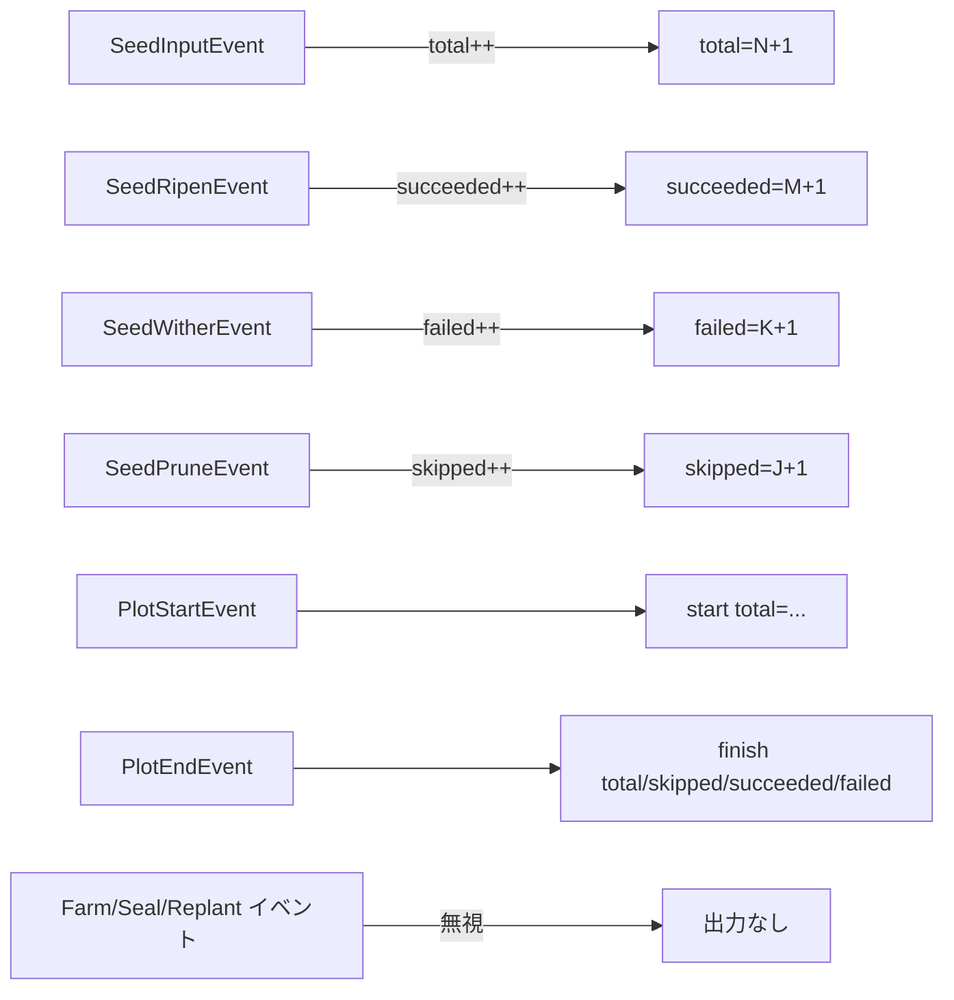

# pkg/scarecrow/print.go

> 📅 最終更新日: 2026/11/13

## 役割

`pkg/scarecrow/print.go` は軽量な端末進捗オブザーバ `PrintWatcher` を提供します：seed の入力、成熟、枯死、剪定と Plot の開始／終了イベントを標準出力へ出力し、ローカルでのデバッグやデモに便利です。**自前でカウントを保持**し、`MetricsWatcher` に依存しないため、任意の Plot や Farm の Hub に単独で接続できます。

## 主要オブジェクト

### `PrintWatcher`

```go
type PrintWatcher struct {
    mu        sync.Mutex
    name      string
    out       io.Writer
    total     int
    succeeded int
    failed    int
    skipped   int
}
```

| フィールド | 説明 |
|------|------|
| `mu` | ミューテックスで、すべてのカウントフィールドと出力呼び出しを保護する。イベントは複数のゴルーチンから来る可能性があるため、カウントと出力は対で直列化する必要がある |
| `name` | 出力プレフィックス。`[harvester] ...` の形になる |
| `out` | 出力先。`NewPrintWatcher` では `os.Stdout` 固定 |
| `total` | 受け取った `SeedInputEvent` の数（外部注入と上流からの配送の両方を含む） |
| `succeeded` / `failed` / `skipped` | それぞれ成熟、枯死、剪定イベントの数 |

### コンストラクタ

| シンボル | シグネチャ | 動作 |
|------|------|------|
| `NewPrintWatcher` | `func NewPrintWatcher(name string) *PrintWatcher` | `os.Stdout` へ出力し、`name` をプレフィックスにする |
| `newPrintWatcher`（未エクスポート） | `func newPrintWatcher(out io.Writer, name string) *PrintWatcher` | 出力先を指定する。パッケージ内テストで `bytes.Buffer` により出力を捕捉するために使う |

### `OnEvent` の出力契約

イベントを 1 件受け取るたびに 1 行を出力し、形式は `[<name>] <内容>\n` です：

| イベント | カウントの変化 | 出力 |
|------|----------|------|
| `PlotStartEvent` | なし | `start total=<total>` |
| `PlotEndEvent` | なし | `finish total=<total>, skipped=<skipped>, succeeded=<succeeded>, failed=<failed>` |
| `SeedInputEvent` | `total++` | `total=<total>(+1)` |
| `SeedRipenEvent` | `succeeded++` | `succeeded=<succeeded>(+1), total=<total>` |
| `SeedWitherEvent` | `failed++` | `failed=<failed>(+1), total=<total>` |
| `SeedPruneEvent` | `skipped++` | `skipped=<skipped>(+1), total=<total>` |
| `FarmStartEvent` / `FarmEndEvent` / `SeedReplantEvent` / `SealInputEvent` / `SealMergeEvent` | なし | **出力しない** |

`total` は `SeedInputEvent` だけを数え、成熟／枯死／剪定は含みません。`succeeded + failed + skipped` と `total` の差が、まだ処理中の seed 数です。

### `printf`（未エクスポート）

```go
func (p *PrintWatcher) printf(format string, args ...any) {
    _, _ = fmt.Fprintf(p.out, "[%s] %s\n", p.name, fmt.Sprintf(format, args...))
}
```

呼び出し側が自分でロックを保持する必要があります。書き込みエラーは明示的に破棄されます（端末出力の失敗が主処理に影響すべきではないため）。

## 主要なフロー



## 重要な詳細

- **カウント範囲は接続位置に依存する**：単一の Plot の Hub に接続すればその Plot のイベントだけを数えます。Farm の Hub に接続した場合は、Farm が自身の Hub を各 Plot の Hub に登録しているため、Farm 全体の累計進捗を数えます。両方の Hub に接続するとそれぞれ別に出力されます。
- **カウントを自前で持ち、メトリクスを再利用しない**：`MetricsWatcher` を登録していなくても `PrintWatcher` は動作します。逆に、`MetricsWatcher` の有無はその出力に影響しません。
- **ノードとタスクの進捗だけに注目する**：Farm の開始／終了、再試行、終了シグナルはすべて無視されます（ソースのコメントは CelestialFlow の `PrintObserver` の振る舞いと一致させていると説明しています）。
- **イベント発生時に即座に出力する**：`SeedInputEvent` の出力は seed が実際に処理される前に起きるため、`total` が先に増え、`succeeded/failed/skipped` が後から追いつきます。
- **出力媒体は固定**：公開コンストラクタは `os.Stdout` にしか書きません。`newPrintWatcher` は未エクスポートのため、パッケージ外から `io.Writer` を差し替えられません。ファイルやバッファへ書きたい場合は独自の `Watcher` を実装してください。
- **ゼロ値は使用不可**：`PrintWatcher{}` の `out` は `nil` なので、どの出力も `fmt.Fprintf` の箇所で panic します（`name` が空なら `[] ` が出力されるだけです）。必ず `NewPrintWatcher` で構築してください（パッケージ内テストでは `newPrintWatcher`）。

## 使用例

### 単一の Plot に接続する

```go
package main

import (
    "github.com/Mr-xiaotian/CelestialGrow/pkg/plot"
    "github.com/Mr-xiaotian/CelestialGrow/pkg/scarecrow"
)

type Seed struct{ ID int }
type Fruit struct{ ID int }

func cultivate(s Seed) (Fruit, error) { return Fruit{ID: s.ID}, nil }

func main() {
    p := plot.NewSinglePlot[Seed, Fruit]("harvester", cultivate)
    if err := p.AddWatcher(scarecrow.NewPrintWatcher("harvester")); err != nil {
        panic(err)
    }

    p.StartAsync()
    p.Seed(Seed{ID: 1})
    p.Seed(Seed{ID: 2})
    p.Seal()
    p.WaitAsync()
}
```

出力は次のようになります：

```text
[harvester] start total=0
[harvester] total=1(+1)
[harvester] total=2(+1)
[harvester] succeeded=1(+1), total=2
[harvester] succeeded=2(+1), total=2
[harvester] finish total=2, skipped=0, succeeded=2, failed=0
```

> この出力はあくまで例示であり、安定した契約にはなりません：`Seed` は呼び出し側のゴルーチンで直接イベントを送出し、`PlotStartEvent` は `StartAsync` のゴルーチン内で送出されるため、両者には競合があります。実際の実行では `start` 行が複数の `total` 行の後に現れることがあり、その `total` がすでに 0 より大きい場合もあります。結果行が交錯することもあります。読み取る際は各行自身の内容を基準にし、行をまたぐ順序に依存しないでください。

### Farm に接続して全 Plot を集計する

```go
package main

import (
    "github.com/Mr-xiaotian/CelestialGrow/pkg/farm"
    "github.com/Mr-xiaotian/CelestialGrow/pkg/plot"
    "github.com/Mr-xiaotian/CelestialGrow/pkg/scarecrow"
)

type Seed struct{ ID int }
type Fruit struct{ ID int }

func cultivate(s Seed) (Fruit, error) { return Fruit{ID: s.ID}, nil }

func main() {
    p := plot.NewSinglePlot[Seed, Fruit]("harvester", cultivate)

    f := farm.NewFarm("garden")
    if err := f.AddPlot(p); err != nil {
        panic(err)
    }
    if err := f.AddWatcher(scarecrow.NewPrintWatcher("garden")); err != nil {
        panic(err)
    }
    if err := f.Run(map[string][]any{"harvester": {Seed{ID: 1}}}, "INFO"); err != nil {
        panic(err)
    }
}
```

Farm レベルの `PrintWatcher` はすべての Plot のイベントを受け取り、`total` は Farm 全体の入力累計になります。`PlotStartEvent` / `PlotEndEvent` の各行はそれぞれ 1 つの Plot に対応しますが、出力に Plot 名は含まれません（プレフィックスは `name` だけです）。複数 Plot の場面では行順と文脈だけで区別することになります。

## 注意事項

- 出力は**イベントごとに 1 行**なので、高頻度の実行（数万 seed）では実行経路を著しく遅らせ、画面を埋め尽くします。本番環境ではログやメトリクスのオブザーバに切り替えてください。
- `os.Stdout` へ出力するため、業務側の標準出力と混ざります。きれいな出力が必要な場合はプロセスの stdout をリダイレクトするか、独自の `Watcher` を実装してください。
- リセット用のインターフェースはありません：カウントはインスタンスとともに単調に増加するため、同じインスタンスを複数回の実行で再利用すると前回の累計を引き継ぎます。
- 出力順はイベントの全順序の信頼できる情報源ではありません。正確な血縁と順序が必要な場合は `pkg/persist` または `MetricsWatcher` を使用してください。
