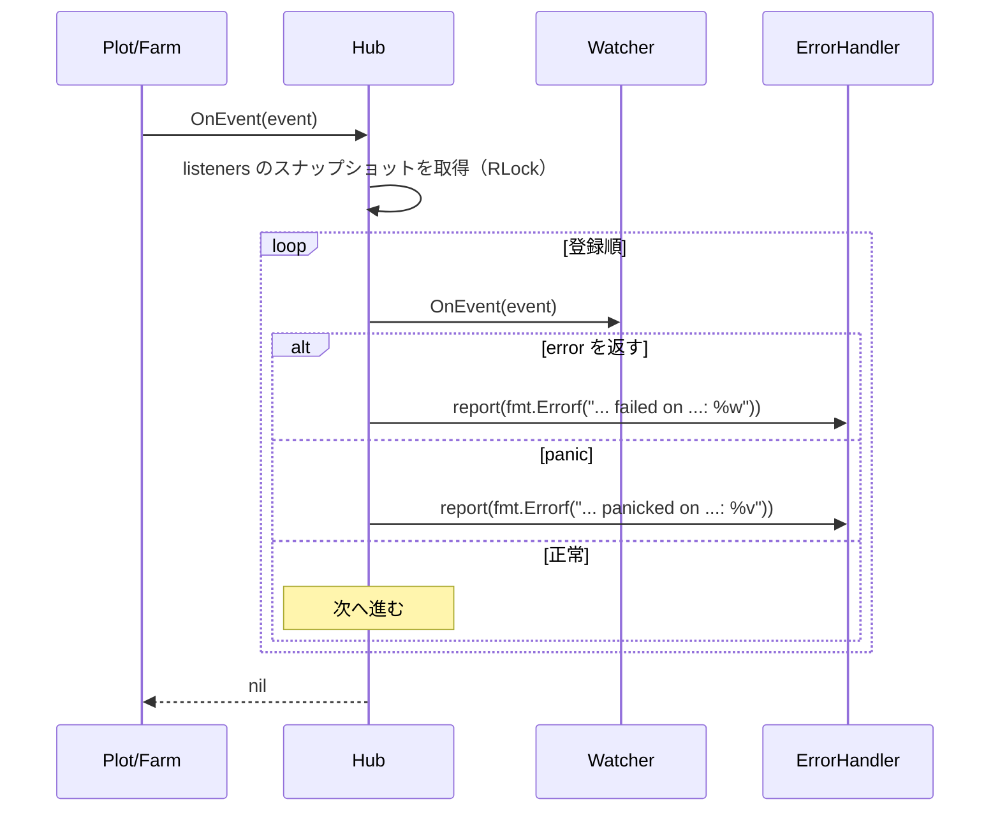

# pkg/scarecrow/watcher.go

> 📅 最終更新日: 2026/11/13

## 役割

`pkg/scarecrow/watcher.go` は `scarecrow` パッケージのファイル入り口（パッケージコメントのあるファイル）であり、同時に実行期イベントの**受信側の契約** `Watcher` と軽量アダプタ `WatcherFunc` を定義します。`Hub` はこの 1 つのインターフェースしか認識しないため、メトリクス集計、ログの永続化、ライフサイクル記録、端末出力を統一的に登録し、統一的に配信できます。

## 主要オブジェクト

### `Watcher` インターフェース

```go
type Watcher interface {
    OnEvent(event Event) error
}
```

| メソッド | 契約 |
|------|------|
| `OnEvent(Event) error` | 1 つのイベントを処理する。返された `error` は `Hub` が捕捉して `ErrorHandler` へ報告し、**他の Watcher を中断せず、実行経路へも戻らない**（`Hub.OnEvent` は常に `nil` を返す） |

実装側が守るべき約束（ソースのコメントが明確に要求）：

1. **並行安全は自己責任**：イベントは複数の並行ゴルーチン（複数 Plot の `tend` ゴルーチン、複数 Plot の Hub）から来る可能性があるため、実装側が自分でロックするかアトミック変数を使う必要があります。`MetricsWatcher` / `PrintWatcher` は内部でどちらもミューテックスにより状態を保護しています。
2. **速やかに返す**：`Hub` は `OnEvent` を同期的に呼ぶため、Watcher の所要時間はそのまま実行経路に直列に加算されます。遅い I/O が必要な実装（`persist.LogWatcher`、`persist.LifecycleWatcher` など）は、記録を `funnel` キューへ投入し、バックグラウンドの Spout に消費させるべきです。
3. **イベントは読み取り専用**：`Event` は値で渡されますが、内部のスライス／マップは生成側と共有されているため、変更してはいけません。

### `WatcherFunc` アダプタ

```go
type WatcherFunc func(event Event) error

func (f WatcherFunc) OnEvent(event Event) error {
    return f(event)
}
```

通常の関数を `Watcher` に適合させます。`http.HandlerFunc` のイディオムに相当し、テスト、単発のコールバック、サンプルコードに適しています。

### 本パッケージとプロジェクト内の実装

| 実装 | 位置 | 説明 |
|------|------|------|
| `Hub` | [`hub.md`](./hub.md) | 自身が `Watcher` を実装し、別の Hub にネスト登録できる |
| `MetricsWatcher` | [`metrics.md`](./metrics.md) | イベント列から各 Plot のメトリクスを再構築する |
| `PrintWatcher` | [`print.md`](./print.md) | 累計進捗を `os.Stdout` へ出力する |
| `persist.LogWatcher` | `pkg/persist/log.go` | 実行ログを非同期で永続化し、`MetricsWatcher` を読んでカウントを補完する |
| `persist.LifecycleWatcher` | `pkg/persist/lifecycle.go` | seed の血縁を SQLite へ書き込む |

## 主要なフロー



## 重要な詳細

- **インターフェースは暗黙的**：`OnEvent(Event) error` を実装した型はすべて `Watcher` を満たし、明示的な宣言は不要です。`plot.AddWatcher` / `farm.AddWatcher` / `hub.AddWatcher` はどれもこのインターフェースをそのまま受け取ります。
- **エラーの意味論**：`Watcher` の `error` は**報告**のためだけに使われ、制御フローではありません。`OnEvent` が `nil` を返したことはすべての Watcher が成功したことを意味せず、配信処理自体が中断しなかったことだけを意味します。
- **`WatcherFunc` が nil の場合**：`var f WatcherFunc; f.OnEvent(...)` は nil 関数の呼び出しで panic します。`Hub` 経由で配信する場合は panic が `Hub.deliver` に捕捉され、`scarecrow: ... panicked on ...` の報告エラーに変換されます。直接呼び出す場合は保護がありません。
- **型が nil のインターフェース値**：`hub.AddWatcher(nil)` は拒否されますが、`var p *PrintWatcher; hub.AddWatcher(p)` が渡すのは**非 nil のインターフェース**（動的型は非空、値は nil）であるため登録は通り、呼び出し時に nil レシーバ上で操作して panic し、最終的にはこれも `Hub` に捕捉されて報告されます。「任意登録」が必要な場合は、ポインタが nil かどうかを明示的に判定してください。

## 使用例

### `WatcherFunc` で単発コールバックを実装する

```go
package main

import (
    "fmt"

    "github.com/Mr-xiaotian/CelestialGrow/pkg/scarecrow"
)

func main() {
    hub := scarecrow.NewHub()

    err := hub.AddWatcher(scarecrow.WatcherFunc(func(event scarecrow.Event) error {
        fmt.Printf("%T\n", event)
        return nil
    }))
    if err != nil {
        panic(err)
    }

    _ = hub.OnEvent(scarecrow.PlotStartEvent{Plot: "harvester", Tenders: 4})
    // 输出：scarecrow.PlotStartEvent
}
```

### 並行安全な独自 Watcher を実装する

```go
package main

import (
    "sync"

    "github.com/Mr-xiaotian/CelestialGrow/pkg/plot"
    "github.com/Mr-xiaotian/CelestialGrow/pkg/scarecrow"
)

// ripenCounter 统计成熟数，可被多个 Plot 协程并发调用。
type ripenCounter struct {
    mu    sync.Mutex
    count int
}

func (c *ripenCounter) OnEvent(event scarecrow.Event) error {
    if _, ok := event.(scarecrow.SeedRipenEvent); !ok {
        return nil
    }
    c.mu.Lock()
    c.count++
    c.mu.Unlock()
    return nil
}

func (c *ripenCounter) Count() int {
    c.mu.Lock()
    defer c.mu.Unlock()
    return c.count
}

type Seed struct{ ID int }
type Fruit struct{ ID int }

func cultivate(s Seed) (Fruit, error) { return Fruit{ID: s.ID}, nil }

func main() {
    counter := &ripenCounter{}

    p := plot.NewSinglePlot[Seed, Fruit]("harvester", cultivate)
    if err := p.AddWatcher(counter); err != nil {
        panic(err)
    }

    p.StartAsync()
    p.Seed(Seed{ID: 1})
    p.Seal()
    p.WaitAsync()

    _ = counter.Count()
}
```

`Farm.AddWatcher` で登録した watcher は、Farm のイベントとすべての Plot のイベントを同時に受け取ります（Farm が自身の Hub を各 Plot の Hub に登録するため）。

## 注意事項

- `OnEvent` の中で長時間ブロックしないでください：イベントの生成側（Plot の `tend` ゴルーチンや Farm の起動／終了経路）を遅らせます。
- `OnEvent` のエラーを再試行の合図として扱わないでください：`Hub` はイベントを再配信せず、エラーを報告するだけです。
- `Watcher` に「登録解除」のメソッドはなく、登録後は実行終了までイベントを受け取り続けます。同じインスタンスを重複登録すると複数回受け取ります。
- 登録済みの Watcher を型で検索したい場合（例えば `MetricsWatcher` を取得してカウントを読む）は、`scarecrow.Find[T](hub)` を使用してください。[`hub.md`](./hub.md) 参照。
