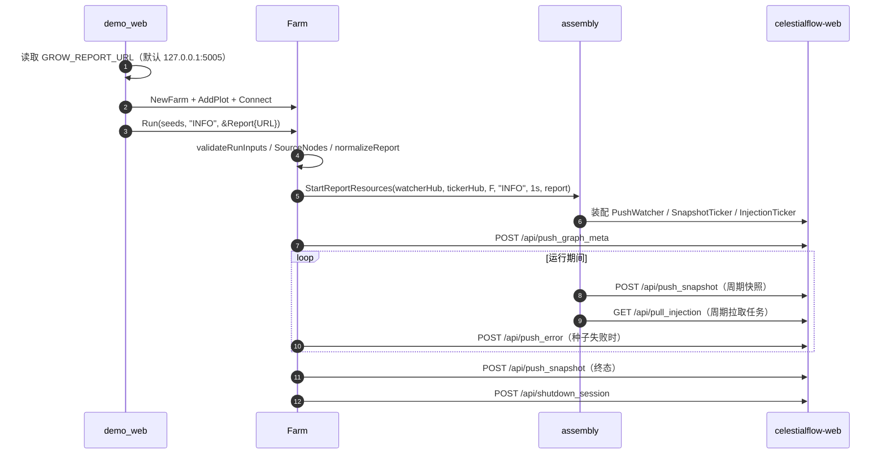

# demo/demo_web/main.go

> 📅 最后更新日期: 2026/11/26

## 作用

`demo/demo_web/main.go` 是 CelestialGrow 的**远程上报示例**：它用 `pkg/api` 搭建一张包含 `SinglePlot`、`SplitPlot`、`RoutePlot` 的混合图，并在 `Farm.Run` 时传入上报配置，把图结构、节点状态、周期快照、任务失败与会话结束推送到 `celestialflow-web`。

与只做本地运行的 [`demo_farm`](../demo_farm/main.md) 相比，本示例额外覆盖：

- `grow.Report`（即 `reporter.Config`）的使用方式与默认 `SessionID` 生成；
- 上报模式下 `pkg/assembly` 对 `PushWatcher`、`SnapshotTicker`、`InjectionTicker` 的装配；
- `SinglePlot` / `SplitPlot` / `RoutePlot` 混用时的 fan-out、拆分与按名路由；
- 故意制造失败，便于在 web 页面观察错误面板。

## 示例拓扑

```mermaid
flowchart LR
    R[root<br/>int→int<br/>失败: 5 的倍数] -->|fruit| SP[split<br/>int→[]int]
    SP -->|seed, seed+1| RT[route<br/>int→map[string]int]
    RT -->|偶数| E[even<br/>int→int]
    RT -->|奇数| O[odd<br/>int→int<br/>失败: 9]

    style R fill:#eef2ff,stroke:#6366f1,stroke-width:2px,color:#1e1b4b
    style SP fill:#f5f3ff,stroke:#8b5cf6,stroke-width:2px
    style RT fill:#ecfeff,stroke:#0891b2,stroke-width:2px
```

- `root`：延迟 2 秒；`seed%5==0` 时返回错误，其余翻倍。
- `split`：延迟 2 秒；把每颗种子拆成 `seed` 与 `seed+1`。
- `route`：延迟 2 秒；偶数路由到 `even`，奇数路由到 `odd`。
- `even`：延迟 2 秒；把种子减半。
- `odd`：延迟 2 秒；把种子乘 3，收到 `9` 时故意失败。

所有 Plot 都用 `grow.WithTenders(3)` 设置 3 个并发 tender。入口种子为 `1..12`，其中 `5`、`10` 会被 `root` 拒绝，`9` 会被 `odd` 拒绝，因此 web 端应能看到 **3 条失败记录**。

## 关键调用

| 调用 | 来源 | 作用 |
|------|------|------|
| `grow.NewSinglePlot` / `grow.NewSplitPlot` / `grow.NewRoutePlot` | `pkg/api` → `plot` | 创建三种节点；三者都实现 `grow.PlotNode`，可在同一张 Farm 中混用。 |
| `grow.NewFarm("demo_web")` | `pkg/api` → `farm.NewFarm` | 创建调度图，内部初始化事件客户端、观察者 Hub 与节拍 Hub。 |
| `farm.AddPlot(root, split, route, even, odd)` | `pkg/farm` | 注册全部节点，名称必须唯一。 |
| `farm.Connect(...)` | `pkg/farm` | 组到组全连接，并校验上游 fruit 类型与下游 seed 类型。 |
| `farm.Run(inputs, "INFO", &grow.Report{URL: reportURL})` | `pkg/farm` | 同步运行并启用远程上报；`SessionID` 留空时自动生成。 |
| `os.Getenv("GROW_REPORT_URL")` | 标准库 | 覆盖默认上报地址。 |

### 上报配置

```go
type Config struct {
    URL             string // 上报服务基础地址
    SessionID       string // 上报会话标识；为空时由运行入口生成
    SnapshotPeriod  int    // 状态快照节拍周期
    InjectionPeriod int    // 注入拉取节拍周期
}
```

示例只设置 `URL`：

- `SessionID` 由 `Farm.normalizeReport` 生成，格式为 `demo_web@<UnixNano>`；
- `SnapshotPeriod` / `InjectionPeriod` 为 0，使用 `pkg/reporter` 的默认周期；
- 节拍基准周期由 `pkg/assembly` 传入 `metronome.DefaultInterval`（1 秒）。

## 运行方式

1. 先启动 `celestialflow-web`（默认监听 `http://127.0.0.1:5005`）。该项目位于本仓库同级目录 `..\celestialflow-web`，按它的 README 启动即可。
2. 本示例**没有命令行参数**，唯一可配置项是环境变量 `GROW_REPORT_URL`；在 CelestialGrow 项目根目录运行：

```bash
go run ./demo/demo_web
```

如需连接其它地址：

```bash
GROW_REPORT_URL=http://192.168.1.10:5005 go run ./demo/demo_web
```

PowerShell 下等价写法：

```powershell
$env:GROW_REPORT_URL = "http://192.168.1.10:5005"
go run ./demo/demo_web
```

启动后终端会先打印：

```text
上报地址: http://127.0.0.1:5005
请先启动 celestialflow-web，并打开对应页面查看实时状态。
```

运行结束后打印：

```text
运行结束：web 端会话已标记为结束，历史快照与错误仍可查看。
```

## 关键流程



- `/api/push_graph_meta` 只在 `FarmStartEvent` 时发送一次，包含节点、边、源节点与 `node_meta`。
- `/api/push_snapshot` 由 `SnapshotTicker` 按周期发送，`FarmEndEvent` 时还会补发一次终态快照。
- `/api/push_error` 由 `SeedWitherEvent` 触发，示例中对应 `root` 的 `5` / `10` 与 `odd` 的 `9`。
- `/api/shutdown_session` 在 `FarmEndEvent` 的终态快照之后发送，标记会话结束；会话历史仍可查看。
- `/api/pull_injection` 由 `InjectionTicker` 周期请求，把 web 端提交的 `tasks` / `terminations` 交回 `Farm.InjectTasks` / `Farm.InjectTerminations`。

## 完整源码

以下代码与 `demo/demo_web/main.go` 源码一致：

```go
package main

import (
	"fmt"
	"os"
	"time"

	grow "github.com/Mr-xiaotian/CelestialGrow/pkg/api"
)

// defaultReportURL 是 celestialflow-web 的默认监听地址。
const defaultReportURL = "http://127.0.0.1:5005"

// rootCultivator 将种子翻倍；部分种子会失败，用于在 web 端展示错误面板。
func rootCultivator(seed int) (int, error) {
	time.Sleep(2 * time.Second)
	if seed%5 == 0 {
		return 0, fmt.Errorf("root 拒绝处理 5 的倍数: %d", seed)
	}
	return seed * 2, nil
}

// splitter 将一颗种子拆成相邻的两个下游任务。
func splitter(seed int) ([]int, error) {
	time.Sleep(2 * time.Second)
	return []int{seed, seed + 1}, nil
}

// router 按奇偶把种子定向到 even / odd 两个下游节点。
func router(seed int) (map[string]int, error) {
	time.Sleep(2 * time.Second)
	if seed%2 == 0 {
		return map[string]int{"even": seed}, nil
	}
	return map[string]int{"odd": seed}, nil
}

// evenCultivator 处理偶数种子。
func evenCultivator(seed int) (int, error) {
	time.Sleep(2 * time.Second)
	return seed / 2, nil
}

// oddCultivator 处理奇数种子；遇到 9 时失败，用于展示叶子节点的错误上报。
func oddCultivator(seed int) (int, error) {
	time.Sleep(2 * time.Second)
	if seed == 9 {
		return 0, fmt.Errorf("odd 节点遇到 9，故意失败")
	}
	return seed * 3, nil
}

// main 演示把 Farm 运行状态上报到 celestialflow-web。
//
// 请先启动 web 服务（默认 http://127.0.0.1:5005），再运行本示例。运行期间可在
// web 页面看到图结构、节点状态、周期快照与失败任务；结束后会话保留并可继续查看。
// 上报地址可通过环境变量 GROW_REPORT_URL 覆盖。
func main() {
	reportURL := os.Getenv("GROW_REPORT_URL")
	if reportURL == "" {
		reportURL = defaultReportURL
	}

	root := grow.NewSinglePlot("root", rootCultivator, grow.WithTenders(3))
	split := grow.NewSplitPlot("split", splitter, grow.WithTenders(3))
	route := grow.NewRoutePlot("route", router, grow.WithTenders(3))
	even := grow.NewSinglePlot("even", evenCultivator, grow.WithTenders(3))
	odd := grow.NewSinglePlot("odd", oddCultivator, grow.WithTenders(3))

	farm := grow.NewFarm("demo_web")
	if err := farm.AddPlot(root, split, route, even, odd); err != nil {
		panic(err)
	}
	if err := farm.Connect([]grow.PlotNode{root}, []grow.PlotNode{split}); err != nil {
		panic(err)
	}
	if err := farm.Connect([]grow.PlotNode{split}, []grow.PlotNode{route}); err != nil {
		panic(err)
	}
	if err := farm.Connect([]grow.PlotNode{route}, []grow.PlotNode{even, odd}); err != nil {
		panic(err)
	}

	fmt.Printf("上报地址: %s\n", reportURL)
	fmt.Println("请先启动 celestialflow-web，并打开对应页面查看实时状态。")

	if err := farm.Run(map[string][]any{
		"root": {1, 2, 3, 4, 5, 6, 7, 8, 9, 10, 11, 12},
	}, "INFO", &grow.Report{URL: reportURL}); err != nil {
		panic(err)
	}

	fmt.Println("运行结束：web 端会话已标记为结束，历史快照与错误仍可查看。")
}
```

## 注意事项

1. **web 服务不是必需的**：`PushWatcher` 的 HTTP 失败只写日志，不会让 `Run` 返回错误。web 未启动时示例仍会跑完，只是页面上没有数据；本地 `logs/` 与 `lifecycles/` 产物照常生成。
2. **URL 必须合法**：`report.URL` 需为 `http://` 或 `https://` 地址，末尾 `/` 会被规范化；非法地址会让 `StartReportResources` 返回错误，`Run` 在 Plot 启动前就失败。
3. **会话标识**：示例未设置 `SessionID`，每次运行都会生成新的 `demo_web@<UnixNano>`；如需在 web 端固定会话名，可显式传入。
4. **路由目标名**：`RoutePlot` 的路由表 key 必须与已连接的下游 Plot 名称一致（`even` / `odd`）；未连接或未注册的 key 会被静默跳过。
5. **耗时**：每个节点处理一颗种子都 `Sleep(2s)`，且每级串行依赖，整轮 12 颗种子的演示通常需要半分钟以上；这是为了让 web 页面有足够时间展示中间状态。
6. **故意失败**：`root` 的 `5` / `10` 与 `odd` 的 `9` 会进入 `SeedWitherEvent`，只上报错误、不向下游转发；其余种子正常完成。
7. **同步阻塞**：`Farm.Run` 会阻塞到所有 Plot 退出并停止上报资源后才返回；不要在 `Run` 返回前关闭 web 服务，否则终态快照与下线请求可能推送失败。
