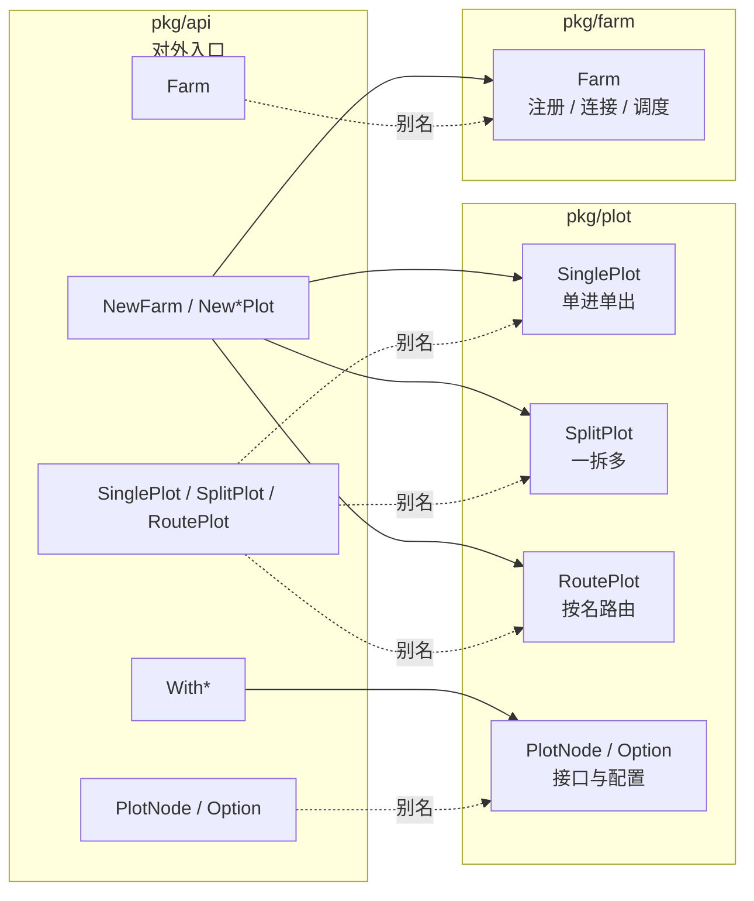
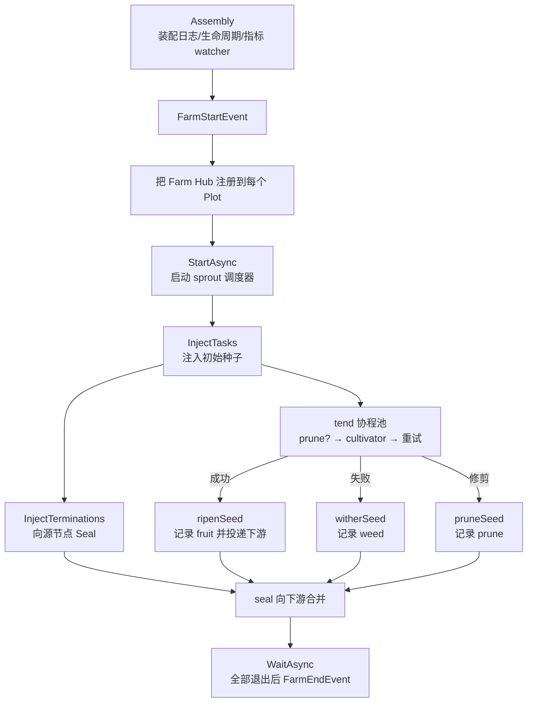

# pkg/api/api.go

> 📅 最后更新日期: 2026/11/13

## 作用

`pkg/api` 是 CelestialGrow 的**对外统一入口包**。它不引入任何新实现，只把底层包的核心类型与常用配置以三种形式重新暴露：

1. **类型别名**（`type X = pkg.Y`）：`Farm`、`SinglePlot`、`SplitPlot`、`RoutePlot`、`PlotNode`、`Option`；
2. **构造函数薄包装**：`NewFarm`、`NewSinglePlot`、`NewSplitPlot`、`NewRoutePlot`；
3. **配置项**：包级变量 `WithTenders`、`WithChanSize`、`WithMaxRetries`、`WithRetryDelay`、`WithRetryIf`，以及泛型函数 `WithPruneIf`。

底层依赖只有两个包：

| 底层包 | 提供内容 |
|--------|----------|
| `pkg/farm` | `Farm`：节点注册、超边式连接、整体调度与外部注入 |
| `pkg/plot` | `SinglePlot` / `SplitPlot` / `RoutePlot` / `PlotNode` / `Option` 及其配置函数 |

> 运行期的事件观察能力（进度打印、指标统计等）由 `pkg/scarecrow` 提供，通过 `AddWatcher` 注入。`pkg/api` 不提供任何观察器构造器；需要输出进度时使用 `scarecrow.NewPrintWatcher` 或自定义 `scarecrow.Watcher`。

由于导出项全部是别名、函数值或一层直通包装，本包的行为契约完全由底层包决定。本文档聚焦「导出符号清单 + 类型参数语义 + 默认值 + 错误场景」。

## 导出符号总览

| 符号 | 类别 | 指向 | 说明 |
|------|------|------|------|
| `Farm` | 类型别名 | `farm.Farm` | 由多个节点组成的静态有向图，负责节点注册、连接、调度与外部注入。 |
| `SinglePlot[S, F]` | 泛型类型别名 | `plot.SinglePlot[S, F]` | 单进单出节点。每成功处理一颗种子，向**每个**下游转发 **1 个** `F`。 |
| `SplitPlot[S, F]` | 泛型类型别名 | `plot.SplitPlot[S, F]` | 拆分节点。处理函数返回 `[]F`，**每个元素**作为独立 yield 分别发给每个下游。 |
| `RoutePlot[S, Y]` | 泛型类型别名 | `plot.RoutePlot[S, Y]` | 路由节点。处理函数返回 `map[string]Y`，`key` 为目标下游名称，`value` 只发给该下游。 |
| `PlotNode` | 类型别名 | `plot.PlotNode` | 擦除泛型参数的统一节点接口，`Farm` 用它持有类型各异的节点。 |
| `Option` | 类型别名 | `plot.Option` | 节点可选配置，底层为 `func(*plotOptions)`；`plotOptions` 未导出，包外**无法自定义** `Option`。 |
| `NewFarm(name string) *Farm` | 构造函数 | `farm.NewFarm` | 创建 Farm（同时建立内部事件 Hub）。 |
| `NewSinglePlot[S, F](name string, cultivator func(S) (F, error), opts ...Option) *SinglePlot[S, F]` | 构造函数 | `plot.NewSinglePlot` | 创建单进单出节点。 |
| `NewSplitPlot[S, F](name string, splitter func(S) ([]F, error), opts ...Option) *SplitPlot[S, F]` | 构造函数 | `plot.NewSplitPlot` | 创建拆分节点。 |
| `NewRoutePlot[S, Y](name string, cultivator func(S) (map[string]Y, error), opts ...Option) *RoutePlot[S, Y]` | 构造函数 | `plot.NewRoutePlot` | 创建路由节点。 |
| `WithTenders(n int) Option` | 包级变量 | `plot.WithTenders` | 并发 tender 数。 |
| `WithChanSize(n int) Option` | 包级变量 | `plot.WithChanSize` | 种子通道缓冲区大小。 |
| `WithMaxRetries(n int) Option` | 包级变量 | `plot.WithMaxRetries` | 最大重试次数（不含首次执行）。 |
| `WithRetryDelay(fn func(int) time.Duration) Option` | 包级变量 | 闭包包装 `plot.WithRetryDelay` | 重试间隔策略。 |
| `WithRetryIf(fn func(error) bool) Option` | 包级变量 | `plot.WithRetryIf` | 错误过滤器，只有返回 `true` 的错误才重试。 |
| `WithPruneIf[S any](fn func(S) bool) Option` | 泛型函数 | `plot.WithPruneIf` | 修剪谓词，命中则不培育、直接终结为 prune。 |

> 类型别名（`type X = Y`）意味着在 `pkg/api` 中使用这些类型与直接使用底层包**完全等价**，方法集也一并继承；底层包新增/修改方法会立刻反映到本包。

## 与底层包的映射



## 泛型参数语义

三种节点共享同一套约定：**上游的产出类型必须等于下游的种子类型**，连接时由运行期类型断言校验。

| 类型 | 泛型参数 | 处理函数签名 | 成功后的产出 |
|------|----------|--------------|--------------|
| `SinglePlot[S, F]` | `S`：输入种子类型；`F`：果实类型 | `func(S) (F, error)` | 向每个已连接下游各发 1 个 `F`；本节点记为 1 个 fruit。 |
| `SplitPlot[S, F]` | `S`：输入种子类型；`F`：拆分后的元素类型 | `func(S) ([]F, error)` | 向每个已连接下游各发 `len(fruits)` 个 `F`；整颗种子仍只记为 1 个 fruit。 |
| `RoutePlot[S, Y]` | `S`：输入种子类型；`Y`：下游 yield 类型 | `func(S) (map[string]Y, error)` | 仅向 `map` 中命中且已连接的下游发送对应 `Y`；本节点记为 1 个 fruit。 |

> 下游节点的 `S` 必须与上游的 `F`（`SplitPlot` 的元素类型）或 `Y`（`RoutePlot` 的值类型）一致，否则 `Farm.Connect` 返回类型不兼容错误。编译期无法检查跨节点泛型，因此该校验发生在连接时。

## Farm 常用方法

`Farm` 由 `pkg/farm` 实现，经别名全部可用。

| 方法 | 说明 |
|------|------|
| `AddPlot(plots ...PlotNode) error` | 注册一个或多个节点；名称不能为空且在 Farm 内唯一。注册后节点共享 Farm 的事件客户端。 |
| `Connect(fromPlots, toPlots []PlotNode) error` | 在两组节点间建立**全连接**（笛卡尔积），逐条调用上游 `ConnectTo` 做类型校验。 |
| `AddWatcher(watcher scarecrow.Watcher) error` | 注册 Farm 级 watcher，可同时收到 Farm 事件与所有 Plot 事件（Farm Hub 会作为子 Hub 注册到每个 Plot）。 |
| `Run(inputs map[string][]any, logLevel string) error` | 同步运行：先校验 `inputs`、启动全部节点，再注入初始种子、向**源节点**发送终止信号，最后等待全部退出。`logLevel` 为空按 `INFO` 处理。 |
| `Start(logLevel string) error` | 只装配并启动，不注入任何种子/终止信号；阻塞到全部节点退出。适合外部驱动场景。若无人注入终止信号，`Start` 不会返回。 |
| `InjectTasks(tasks map[string][]any) error` | 向指定节点注入种子。可在 `Start`/`Run` 运行期间调用。 |
| `InjectTerminations(nodes []string) error` | 向指定节点注入终止信号；对某节点终止后再向它播种不会被处理。 |
| `PlotCount() int` | 已注册节点数量。 |
| `HasPlot(name string) bool` | 指定名称是否已注册。 |
| `GetPlot(name string) (PlotNode, bool)` | 按名称取节点，未找到时 `ok` 为 `false`。 |

`Run` 与 `Start` 的差别：

| 场景 | 用 `Run` | 用 `Start` |
|------|----------|-----------|
| 数据在启动前就已知 | ✅ 一次调用完成 | 也可以，但需自行注入 |
| 运行期持续投递任务（流式/外部驱动） | ❌ 会立即封口 | ✅ 配合 `InjectTasks` / `InjectTerminations` |
| 返回时机 | 全部节点处理完并退出后 | 收到全部终止信号且处理完后 |

## Plot 常用方法

`SinglePlot` / `SplitPlot` / `RoutePlot` 共享同一套 `basePlot` 方法（泛型签名见上文）。

| 方法 | 说明 |
|------|------|
| `AddWatcher(watcher scarecrow.Watcher) error` | 注册节点级 watcher；重复注册会重复收到事件。须在 `Run`/`StartAsync` 前调用。 |
| `Run(seeds []S, logLevel string)` | standalone 模式：装配日志/生命周期/指标资源，启动节点，播种、封口并等待结束。**无返回值**。 |
| `Harvest() ([]persist.LifecycleStatusRecord, error)` | 读取该节点已持久化的种子状态快照；可在 standalone `Run` 或 `Farm.Run/Start` 结束后调用。 |
| `GetSeedNum() int` | 输入总数（外部注入 + 上游投递）。 |
| `GetFruitNum() int` | 成功数（成熟）。 |
| `GetWeedNum() int` | 失败数（枯萎）。 |
| `GetPruneNum() int` | 修剪数（跳过）。 |
| `GetCompleted() int` | 已完成数＝成熟 + 枯萎 + 修剪。 |
| `IsFinish() bool` | 所有已输入种子是否都已得出结果（`Processed == InputTotal`）。 |
| `GetName() string` | 节点名称。 |
| `GetState() int32` | 状态：`0` = idle，`1` = running，`2` = done。 |
| `Seed(seed S)` | 播入一颗种子（同步写入 `seedChan`，缓冲满时阻塞）。 |
| `Seal()` | 发送「外部输入终止」信号；对已有上游的节点是**强终止**，不再等待剩余上游。 |
| `SeedAny(seed any) error` | 以 `any` 播种，内部断言为 `S`。 |
| `StartAsync()` / `WaitAsync()` | 异步启动 / 等待退出；Farm 内部使用，standalone 一般用 `Run` 即可。 |

> **指标方法依赖 `MetricsWatcher`**：`assembly` 装配 `Run` / `Start` 时会自动注册一个 `scarecrow.MetricsWatcher`。因此在 `Run` 之前调用这些 getter 返回 `0`（`IsFinish` 返回 `false`）；运行结束后它们保留最后一次统计结果。`Harvest` 同理依赖生命周期观察者。

## PlotNode 接口契约

`PlotNode` 是 `Farm` 管理节点时使用的统一接口（实现位于 `pkg/plot/plot.go` 的 `basePlot`）：

| 方法 | 作用 |
|------|------|
| `GetName() string` | 返回节点名称，用于唯一性校验与连接寻址。 |
| `GetState() int32` | 返回状态：`0` = idle，`1` = running，`2` = done。 |
| `GetSeedChanAny() any` | 以 `any` 返回种子通道，供 `ConnectTo` 做类型断言。 |
| `ConnectTo(next PlotNode) error` | 把本节点产出接到下游输入；上下游类型不兼容时返回错误。 |
| `AddUpstream(name string)` | 登记上游名称（由上游在 `ConnectTo` 中调用），用于 seal 聚合。 |
| `AddWatcher(listener scarecrow.Watcher) error` | 注册观察者。 |
| `SetEventClient(eventClient runtime.EventClient)` | 注入事件客户端；`Farm.AddPlot` 会让所有节点共享 Farm 的客户端。 |
| `StartAsync()` | 异步启动调度器。 |
| `WaitAsync()` | 等待后台协程退出。 |
| `SeedAny(seed any) error` | 以 `any` 播入一颗种子，内部做类型断言。 |
| `Seal()` | 发送「外部输入终止」信号。 |

典型实现是内嵌 `basePlot` 的三个节点：`*plot.SinglePlot[S, F]`、`*plot.SplitPlot[S, F]`、`*plot.RoutePlot[S, Y]`。

## 关键函数

### `NewFarm(name string) *Farm`

创建并返回一个 `Farm`。

- `name`：Farm 名称，用于日志标识与 `FarmStartEvent` / `FarmEndEvent`。
- 不返回 error；创建后即可 `AddPlot` / `Connect` / `Run`。
- Farm 自身的日志级别不在此设置，而在 `Run(inputs, logLevel)` / `Start(logLevel)` 时传入。

### `NewSinglePlot[S any, F any](name string, cultivator func(S) (F, error), opts ...Option) *SinglePlot[S, F]`

创建单进单出节点。

- `name`：节点名称，在同一 Farm 中必须唯一。
- `cultivator`：处理函数。返回 error 时按 `WithMaxRetries` / `WithRetryDelay` / `WithRetryIf` 策略重试；重试耗尽后记为 weed。
- 成功时把 `F` 转发给每个已连接下游，一颗种子只计 1 个 fruit。
- 不返回 error。

### `NewSplitPlot[S any, F any](name string, splitter func(S) ([]F, error), opts ...Option) *SplitPlot[S, F]`

创建拆分节点。`splitter` 把一颗种子映射为 `[]F`；成功后整颗种子记为 1 个 fruit，但会向**每个**已连接下游各发送 `len(fruits)` 个 yield（`nil` / 空切片则不产出）。

### `NewRoutePlot[S any, Y any](name string, cultivator func(S) (map[string]Y, error), opts ...Option) *RoutePlot[S, Y]`

创建路由节点。`cultivator` 返回的路由表中，`key` 为目标下游名称、`value` 为发给该下游的 yield：不同下游可以收到不同 yield，未被路由到的下游收不到任何数据；路由表中出现但并未连接的下游会被跳过，不影响其余路由项。

## 配置函数

除 `WithPruneIf` 是泛型函数外，其余 `With*` 均为**包级变量**（函数值），直接转发底层；`WithRetryDelay` 额外包了一层闭包以显式标注返回类型 `Option`，对外行为不变。

```go
package main

import (
    "context"
    "errors"
    "time"

    grow "github.com/Mr-xiaotian/CelestialGrow/pkg/api"
)

func main() {
    p := grow.NewSinglePlot("worker", func(seed int) (int, error) {
        return seed * 2, nil
    },
        grow.WithTenders(4),
        grow.WithChanSize(16),
        grow.WithMaxRetries(3),
        grow.WithRetryDelay(func(attempt int) time.Duration {
            return time.Duration(attempt) * 100 * time.Millisecond
        }),
        grow.WithRetryIf(func(err error) bool { return !errors.Is(err, context.Canceled) }),
        grow.WithPruneIf(func(seed int) bool { return seed < 0 }), // 负数种子直接修剪
    )

    p.Run([]int{1, 2, 3}, "DEBUG")
}
```

| 函数 | 作用 | 默认值 | 备注 |
|------|------|--------|------|
| `WithTenders(n int)` | 并发 tender（照料协程）数。 | `runtime.NumCPU()` | 决定单节点并行度。 |
| `WithChanSize(n int)` | 种子通道 `seedChan` 的缓冲区大小。 | `runtime.NumCPU()` | 缓冲满时上下游阻塞，形成天然背压；`Start` + 注入场景建议显式设置足够大的值。 |
| `WithMaxRetries(n int)` | 最大重试次数（**不含**首次执行）。 | `1` | `WithMaxRetries(2)` 表示最多执行 3 次。 |
| `WithRetryDelay(fn func(attempt int) time.Duration)` | 重试间隔策略，`attempt` 从 `1` 开始递增。 | `func(int) time.Duration { return 0 }`（立即重试） | 本包用闭包二次封装，参数类型与底层一致。 |
| `WithRetryIf(fn func(error) bool)` | 错误过滤器；仅返回 `true` 的错误才触发重试。 | `func(error) bool { return true }`（全部重试） | 可用于屏蔽不可重试错误（如 `context.Canceled`）。 |
| `WithPruneIf[S any](fn func(S) bool)` | 修剪谓词；在每个 seed 培育前求值，返回 `true` 则跳过培育、直接终结为 prune。 | `nil`（不修剪） | 泛型参数 `S` 由谓词参数推断；命中计入 `GetPruneNum` 与 `GetCompleted`，不向下游产出。 |

> 默认值统一来自 `pkg/plot/option.go` 的 `defaultOptions()`。
>
> **重试语义**（`basePlot.tend`）：最多执行 `maxRetries + 1` 次；`retryIf(err)` 返回 `false` 时立即停止；每次重试前发出 `SeedReplantEvent`。`cultivator` 若 panic 会被 `recover` 捕获并记为失败，错误文本为 `cultivator panic: ...`。
>
> **修剪语义**：`pruneIf` 在 **cultivator 之前**求值，命中即走 `pruneSeed` 通路——**修剪优先于重试**，也不会向下游产出。

## 使用示例

### 示例 1：Farm 流水线 + PrintWatcher

```go
package main

import (
    "fmt"

    grow "github.com/Mr-xiaotian/CelestialGrow/pkg/api"
    "github.com/Mr-xiaotian/CelestialGrow/pkg/scarecrow"
)

// double 将种子翻倍。
func double(seed int) (int, error) { return seed * 2, nil }

// format 把数字格式化为字符串。
func format(seed int) (string, error) { return fmt.Sprintf("result=%d", seed), nil }

func main() {
    doublePlot := grow.NewSinglePlot("double", double, grow.WithTenders(2))
    formatPlot := grow.NewSinglePlot("format", format)

    f := grow.NewFarm("demo_farm")
    if err := f.AddPlot(doublePlot, formatPlot); err != nil {
        panic(err)
    }
    if err := f.Connect(
        []grow.PlotNode{doublePlot},
        []grow.PlotNode{formatPlot},
    ); err != nil {
        panic(err)
    }

    // Farm 级 watcher：同时收到 Farm 事件与所有 Plot 事件。
    if err := f.AddWatcher(scarecrow.NewPrintWatcher("demo_farm")); err != nil {
        panic(err)
    }

    if err := f.Run(map[string][]any{
        "double": {1, 2, 3, 4},
    }, "INFO"); err != nil {
        panic(err)
    }

    fmt.Printf("double: seed=%d fruit=%d\n", doublePlot.GetSeedNum(), doublePlot.GetFruitNum())
    fmt.Printf("format: seed=%d fruit=%d finish=%v\n",
        formatPlot.GetSeedNum(), formatPlot.GetFruitNum(), formatPlot.IsFinish())
}
```

调用 `farm.Run` 后，框架对每个节点的处理顺序如下：



### 示例 2：standalone SinglePlot（`Run` + `Harvest`）

只有一个节点、不需要构建 `Farm` 时，可直接使用 standalone 模式：

```go
package main

import (
    "fmt"

    grow "github.com/Mr-xiaotian/CelestialGrow/pkg/api"
    "github.com/Mr-xiaotian/CelestialGrow/pkg/scarecrow"
)

func main() {
    p := grow.NewSinglePlot("double", func(seed int) (int, error) {
        return seed * 2, nil
    }, grow.WithTenders(4))

    if err := p.AddWatcher(scarecrow.NewPrintWatcher("double")); err != nil {
        panic(err)
    }

    p.Run([]int{1, 2, 3, 4, 5}, "INFO")

    fmt.Printf("seed=%d fruit=%d weed=%d completed=%d finish=%v\n",
        p.GetSeedNum(), p.GetFruitNum(), p.GetWeedNum(), p.GetCompleted(), p.IsFinish())

    records, err := p.Harvest()
    if err != nil {
        panic(err)
    }
    for _, record := range records {
        fmt.Println(record.SeedJSON, record.Status, record.FruitJSON)
    }
}
```

`Plot.Run` 内部会创建本地日志/生命周期资源、绑定指标观察者，并在结束后停止资源；`Harvest` 返回 `[]persist.LifecycleStatusRecord`，用于读取该节点已持久化的全部种子状态快照（`Status` 为 `seed` / `ripen` / `wither` / `prune`）。

### 示例 3：拆分与路由

```go
package main

import (
    "fmt"

    grow "github.com/Mr-xiaotian/CelestialGrow/pkg/api"
)

func main() {
    // 一颗种子拆成多个 yield（F = string）
    split := grow.NewSplitPlot("split", func(seed int) ([]string, error) {
        return []string{fmt.Sprintf("v%d", seed), fmt.Sprintf("x%d", seed)}, nil
    }, grow.WithTenders(2))

    // 按 yield 内容路由到不同下游（Y = string）
    route := grow.NewRoutePlot("route", func(seed string) (map[string]string, error) {
        if len(seed)%2 == 0 {
            return map[string]string{"left": "L-" + seed}, nil
        }
        return map[string]string{"right": "R-" + seed}, nil
    })

    left := grow.NewSinglePlot("left", func(seed string) (string, error) { return seed, nil })
    right := grow.NewSinglePlot("right", func(seed string) (string, error) { return seed, nil })

    f := grow.NewFarm("dispatch_farm")
    if err := f.AddPlot(split, route, left, right); err != nil {
        panic(err)
    }
    if err := f.Connect([]grow.PlotNode{split}, []grow.PlotNode{route}); err != nil {
        panic(err)
    }
    if err := f.Connect([]grow.PlotNode{route}, []grow.PlotNode{left, right}); err != nil {
        panic(err)
    }

    if err := f.Run(map[string][]any{
        "split": {1, 2, 3},
    }, "INFO"); err != nil {
        panic(err)
    }
}
```

### 示例 4：`Start` + 运行期注入

需要外部持续投递任务时使用 `Start`。示例用 watcher 等待 `PlotStartEvent`，确保节点已启动、Farm Hub 已接入各节点（指标统计生效）后再注入：

```go
package main

import (
    "fmt"

    grow "github.com/Mr-xiaotian/CelestialGrow/pkg/api"
    "github.com/Mr-xiaotian/CelestialGrow/pkg/scarecrow"
)

func main() {
    root := grow.NewSinglePlot("root", func(seed int) (int, error) {
        return seed * 2, nil
    }, grow.WithTenders(2), grow.WithChanSize(8))

    f := grow.NewFarm("stream_farm")
    if err := f.AddPlot(root); err != nil {
        panic(err)
    }

    started := make(chan struct{})
    if err := f.AddWatcher(scarecrow.WatcherFunc(func(event scarecrow.Event) error {
        if e, ok := event.(scarecrow.PlotStartEvent); ok && e.Plot == "root" {
            close(started)
        }
        return nil
    })); err != nil {
        panic(err)
    }

    errCh := make(chan error, 1)
    go func() { errCh <- f.Start("INFO") }()

    <-started // 等节点启动，Farm Hub 已接入，指标统计才完整

    if err := f.InjectTasks(map[string][]any{"root": {1, 2, 3}}); err != nil {
        panic(err)
    }
    if err := f.InjectTerminations([]string{"root"}); err != nil {
        panic(err)
    }

    if err := <-errCh; err != nil {
        panic(err)
    }

    fmt.Printf("root: seed=%d fruit=%d\n", root.GetSeedNum(), root.GetFruitNum())
}
```

> `Start` 不注入任何初始任务。若没有对**源节点**调用 `InjectTerminations`，或图中仍有节点等待上游 seal，`Start` 不会返回。

## 错误场景

| 入口 | 可能的 error |
|------|--------------|
| `Farm.AddPlot` | 传入 `nil` 节点、名称为空、名称重复（`plot %q already exists`）。 |
| `Farm.Connect` | `from` / `to` 去重去 nil 后为空；节点未注册到该 Farm；上下游类型不兼容（`ConnectTo` 断言失败）。 |
| `Farm.AddWatcher` / `Plot.AddWatcher` | watcher 为 `nil`；注册会形成 Hub 环。 |
| `Farm.Run` | `inputs` 中出现未注册的节点名；assembly 资源装配或内部 watcher 注册失败；注入种子时类型不匹配。注入失败时仍会向源节点封口并等待退出，然后返回该错误。 |
| `Farm.Start` | assembly 资源装配或内部 watcher 注册失败；其余错误需通过 `InjectTasks` / `InjectTerminations` 自行检查。 |
| `Farm.InjectTasks` | 目标节点未注册（先整体校验，未注册则不注入）；种子类型与节点 `S` 不匹配（`plot %q seed type mismatch: got %T`）。类型错误可能在部分节点已注入后才返回。 |
| `Farm.InjectTerminations` | 目标节点未注册（先整体校验，未注册则不发送任何终止信号）。 |
| `Plot.SeedAny` | 传入值无法断言为节点的 `S`。 |
| `Plot.Harvest` | 未装配生命周期观察者（例如未通过 `Run` / `Farm.Run` 启动）；或数据库路径尚未就绪。 |
| `NewFarm` / `NewSinglePlot` / `NewSplitPlot` / `NewRoutePlot` | 不返回 error。 |
| `Plot.Run` | **不返回 error**；assembly 装配失败时静默返回，节点不会运行。 |

## 注意事项

1. **类型别名 ≠ 新类型**：`Farm`、`SinglePlot[S, F]`、`SplitPlot[S, F]`、`RoutePlot[S, Y]`、`PlotNode`、`Option` 都是 `type X = pkg.Y`，可与底层类型互换使用。
2. **Option 不可扩展**：`Option` 底层是 `func(*plotOptions)`，而 `plotOptions` 未导出，包外无法自定义 `Option`，只能使用内置 `With*`。配置按传入顺序依次应用，同一字段后传入者覆盖前者；默认值由 `pkg/plot/option.go` 的 `defaultOptions()` 维护。
3. **`With*` 是变量**：`WithTenders`、`WithChanSize`、`WithMaxRetries`、`WithRetryDelay`、`WithRetryIf` 均为包级变量而非函数声明，运行时赋值会改变全包行为，**不要重新赋值**。
4. **指标需先装配**：六个指标方法与 `IsFinish` 依赖 `MetricsWatcher`；`Run` / `Farm.Run` / `Farm.Start` 会自动注册，运行前调用只会得到 `0` / `false`。`Start` 场景下，Farm Hub 在 `FarmStartEvent` 之后才挂到各 Plot，因此建议等 `PlotStartEvent` 再注入任务，事件才会进入指标统计。
5. **watcher 注册时机**：`AddWatcher` 建议在 `Run` / `Start` 前完成。Farm 级 watcher 会同时收到 Farm 事件与所有 Plot 事件；`PrintWatcher` 挂在 Farm 上时统计的是**所有 Plot 的累计输入**（含节点间转发的种子），挂在单个 Plot 上时只看该节点。
6. **连接是运行期校验**：`Farm.Connect` 对源组与目标组做全连接，逐条调用 `ConnectTo` 由类型断言校验「上游 `F`/`Y` 与下游 `S`」是否匹配，失败立即返回错误。
7. **终止语义**：`InjectTerminations` / `Seal` 是外部强终止——不再等待剩余上游 seal；节点会先处理完已接收的种子再向下游合并 seal。向已封口的节点继续播种不会被处理。
8. **`Run` 吞掉装配错误**：standalone 的 `Plot.Run` 无返回值，assembly 失败（如无法创建 `lifecycles/` 目录、无法打开 SQLite）时节点不会运行，随后 `Harvest` 会返回「生命周期观察者未注册」类错误。
9. **运行产物落在工作目录**：生命周期 SQLite 写入 `<cwd>/lifecycles/<日期>/`，日志写入 `<cwd>/logs/`，需在部署环境中预留写权限。
10. **导入别名**：推荐 `grow "github.com/Mr-xiaotian/CelestialGrow/pkg/api"`，避免与本地变量名（`farm`、`plot`）冲突。
