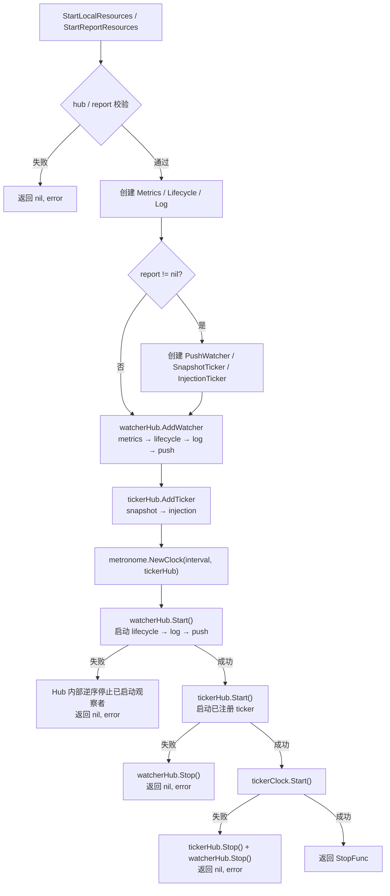
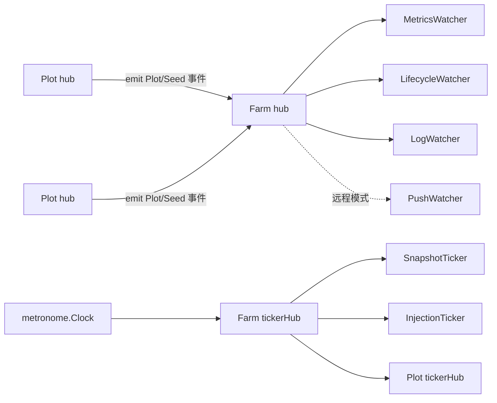

# pkg/assembly/assembly.go

> 📅 最后更新日期: 2026/11/26

`pkg/assembly` 是**运行期资源装配层**。它把「观察者实例的创建、Hub 注册、消费循环与节拍时钟的启停」从 `Plot` / `Farm` 中剥离出来：`Plot` 与 `Farm` 自身只持有 `scarecrow.Hub` 与 `metronome.Hub`，不再直接持有 `funnel.Spout`、持久化观察者实例或时钟。

本文件对外只有 3 个公开符号：

| 符号 | 类别 | 用途 |
|------|------|------|
| `StopFunc` | 类型 | 资源回收函数 `func() error` |
| `StartLocalResources` | 函数 | 为纯本地运行装配观察者、节拍 Hub 与节拍时钟 |
| `StartReportResources` | 函数 | 在本地资源之外追加远程推送与远程注入拉取 |

两者共用内部流程 `startResources`。

## 作用

- 在每次运行开始时创建指标（`scarecrow.MetricsWatcher`）、生命周期（`persist.LifecycleWatcher`）与日志（`persist.LogWatcher`）三类观察者。
- 远程上报模式下额外创建推送观察者 `reporter.PushWatcher`、周期快照 `reporter.SnapshotTicker` 与远程注入 `reporter.InjectionTicker`。
- 按固定顺序注册并启动观察者、ticker 与时钟；事件由 `scarecrow.Hub` 统一分发，周期任务由 `metronome.Hub` 统一调度。
- 返回幂等的 `StopFunc`，在运行结束时按启动的相反顺序停止时钟、ticker 与观察者，触发刷盘并释放文件 / SQLite / HTTP 连接。
- 启动失败时回滚已启动的资源，并把原始错误返回给调用方。

## 核心对象

### `StopFunc`

```go
type StopFunc func() error
```

`StartLocalResources` / `StartReportResources` 成功时返回的回收句柄。调用它会依次停止节拍时钟、ticker Hub 与观察者 Hub，返回聚合后的错误；重复调用直接返回 `nil`。

### `StartLocalResources`

```go
func StartLocalResources(
    watcherHub *scarecrow.Hub,
    tickerHub *metronome.Hub,
    logLevel string,
    interval time.Duration,
) (StopFunc, error)
```

为 standalone Plot（`basePlot.Run`）或本地 Farm 运行装配：

1. 创建 `MetricsWatcher`、`LifecycleWatcher`、`LogWatcher`；
2. 按 `metrics → lifecycle → log` 的顺序注册到 `watcherHub`；
3. 创建并启动节拍时钟，根 ticker 为 `tickerHub`；
4. 返回 `StopFunc`。

`logLevel` 原样交给 `persist.NewLogWatcher`：取值为 `TRACE` / `DEBUG` / `SUCCESS` / `INFO` / `WARNING` / `ERROR` / `CRITICAL`；空字符串或无法识别的级别按 `INFO` 处理。`interval` 是节拍时钟的基础周期，必须为正；`Farm` 与 `Plot` 都传 `metronome.DefaultInterval`（1 秒）。

### `StartReportResources`

```go
func StartReportResources(
    watcherHub *scarecrow.Hub,
    tickerHub *metronome.Hub,
    injectionTarget reporter.InjectionTarget,
    logLevel string,
    interval time.Duration,
    report *reporter.Config,
) (StopFunc, error)
```

在本地资源之外，额外装配远程能力：

- `report == nil` → `assembly: report config is nil`；
- `injectionTarget == nil` → `assembly: injection target is nil`；
- 用 `report.SessionID` / `report.URL` 与同一个 `MetricsWatcher` 创建 `*reporter.PushWatcher`（`reporter.Config.SessionID` 不能为空；`URL` 必须是非空 http/https 地址）；
- 用 `report.SnapshotPeriod` 创建 `*reporter.SnapshotTicker`，周期为 `0` 时使用 `reporter.DefaultSnapshotPeriod`（1 拍）；
- 用 `report.InjectionPeriod` 创建 `*reporter.InjectionTicker`，周期为 `0` 时使用 `reporter.DefaultInjectionPeriod`（5 拍），拉取超时传 `0`（使用 `reporter.DefaultPullTimeout`，3 秒）；
- 推送观察者追加到观察者列表末尾，快照与注入 ticker 依次注册到 `tickerHub`。

`reporter.InjectionTarget` 是只有两个方法的接口，`*farm.Farm` 直接实现它：

```go
type InjectionTarget interface {
    InjectTasks(tasks map[string][]any) error
    InjectTerminations(nodes []string) error
}
```

`*reporter.Config`（在 `pkg/api` 中以 `Report` 别名导出）的字段：

| 字段 | 类型 | 含义 |
|------|------|------|
| `URL` | `string` | 上报服务基础地址，末尾 `/` 会被规范化去掉；必须为 http/https |
| `SessionID` | `string` | 会话标识；装配入口要求非空（`Farm` 会在运行前补齐） |
| `SnapshotPeriod` | `int` | 状态快照节拍周期，`0` 使用默认值 1 |
| `InjectionPeriod` | `int` | 注入拉取节拍周期，`0` 使用默认值 5 |

远程模式下的数据流：

| 组件 | 触发 | 行为 |
|------|------|------|
| `PushWatcher` | `FarmStartEvent` | 推送图元信息到 `/api/push_graph_meta` |
| `PushWatcher` | `SeedWitherEvent` | 推送单条失败任务到 `/api/push_error` |
| `PushWatcher` | `FarmEndEvent` | 先补推一次终态快照到 `/api/push_snapshot`，再推送会话下线到 `/api/shutdown_session` |
| `SnapshotTicker` | 每 `SnapshotPeriod` 拍 | 从 `MetricsView.GetPlots()` 读取整图状态并交给 `PushWatcher.PushSnapshot` |
| `InjectionTicker` | 每 `InjectionPeriod` 拍 | `GET /api/pull_injection?session_id=...`，把返回的 tasks / terminations 交给 `InjectionTarget` |

### 内部流程 `startResources`

```go
func startResources(
    watcherHub *scarecrow.Hub,
    tickerHub *metronome.Hub,
    injectionTarget reporter.InjectionTarget,
    logLevel string,
    interval time.Duration,
    report *reporter.Config,
) (StopFunc, error)
```

完整步骤：

1. `watcherHub == nil` → `assembly: watcher hub is nil`；`tickerHub == nil` → `assembly: ticker hub is nil`；
2. 创建 `scarecrow.NewMetricsWatcher()`、`persist.NewLifecycleWatcher()`、`persist.NewLogWatcher(metricsWatcher, logLevel)`；
3. `report != nil` 时创建 `PushWatcher`、`SnapshotTicker`、`InjectionTicker`，并把 `PushWatcher` 加入观察者列表；
4. 按顺序 `watcherHub.AddWatcher(...)`：`metrics → lifecycle → log → push`；
5. 按顺序 `tickerHub.AddTicker(...)`：`snapshotTicker → injectionTicker`；
6. `metronome.NewClock(interval, tickerHub)`；
7. `watcherHub.Start()`：按注册顺序启动实现 `scarecrow.Lifecycle` 的观察者，即 `lifecycle → log → push`（指标观察者没有生命周期，被跳过）；
8. `tickerHub.Start()`：按注册顺序启动实现 `metronome.Lifecycle` 的 ticker。本包注册的 ticker 中只有 `InjectionTicker` 实现该接口（`SnapshotTicker` 只有 `OnTick` / `TickPeriod`）；Farm 场景下 ticker Hub 里还预先注册了各 Plot 的 ticker Hub，它们也会随 `Hub.Start` 递归启动；
9. `tickerClock.Start()`：启动后台节拍 goroutine，从第 1 拍开始驱动 `tickerHub`；
10. 返回 `stop` 闭包。

> 启动顺序的关键是**先注册、后统一启动**：所有观察者与 ticker 都先进入 Hub，再由 Hub 的 `Start` 按注册顺序启动。这样启动失败时由 Hub 自己逆序回滚已启动项，装配层只需回滚更外层的时钟与 ticker Hub。

本地与远程观察者的差异：

| 观察者 | 构造 | 是否有消费循环 | 注册到 Hub | 需要 `Start` |
|--------|------|:--------------:|:----------:|:------------:|
| `*scarecrow.MetricsWatcher` | `scarecrow.NewMetricsWatcher()` | 否（纯内存聚合） | 是 | 否 |
| `*persist.LifecycleWatcher` | `persist.NewLifecycleWatcher()` | 是（`funnel.Spout`，缓冲 100、超时 1s） | 是 | 是（由 `watcherHub.Start` 调用） |
| `*persist.LogWatcher` | `persist.NewLogWatcher(metrics, logLevel)` | 是（同上） | 是 | 是（由 `watcherHub.Start` 调用） |
| `*reporter.PushWatcher` | `reporter.NewPushWatcher(...)` | 是（`funnel.Spout`，缓冲 64、Stop 超时 3s；入队超时 500ms） | 是（仅远程模式） | 是（由 `watcherHub.Start` 调用） |

### 停止时序

`StopFunc` 内部用一个 `stopped` 布尔值做幂等保护，顺序固定为：

```text
StopFunc()
  ├─ stopped 已为 true → 直接返回 nil
  ├─ tickerClock.Stop()     // 停止节拍 goroutine；最多等待 5s
  ├─ tickerHub.Stop()       // 逆序停止 ticker（InjectionTicker.Stop）
  └─ watcherHub.Stop()      // 逆序停止观察者（push → log → lifecycle）
```

- 停止顺序与启动顺序相反，保证日志/持久化通道关闭前不会再有新的周期任务入场。
- 每个 `Spout.Stop` 关闭队列后最多等待各自超时排空：生命周期 / 日志为 1 秒，推送为 3 秒；随后调用 handler 的 `AfterStop` 关闭文件 / SQLite / HTTP 连接。因此 `StopFunc` 同时承担**刷盘**职责。
- 错误聚合方式：第一个错误直接保存；后续错误用 `fmt.Errorf("%w; %w", ...)` 追加，最终错误文本以 `; ` 连接各段。若第一次调用返回错误，`stopped` 已被置为 true，**再次调用不会重试**，而是直接返回 `nil`。
- 幂等保护是普通布尔值，不是 `sync.Once`，**并发调用 `StopFunc` 存在数据竞争**；应只由单一协程在运行结束后调用。
- `StopFunc` 为 `nil` 时调用会 panic；启动失败返回的是 `(nil, err)`，调用方必须先判错。

## 关键流程

### 启动与注册时序



要点：

- **注册顺序即分发顺序**：`scarecrow.Hub` 按注册顺序同步转发事件，因此事件处理顺序固定为 `metrics → lifecycle → log → push`。指标先更新，日志写 `PlotEnd` 摘要时才能读到本次运行的最终计数。
- **指标最先注册**：`MetricsWatcher` 没有 `Start` 步骤，但必须先于日志观察者进入 Hub。
- **节拍时钟最后启动**：所有 ticker 注册完毕后才创建并启动时钟，避免第一拍丢失或命中半初始化状态。

### 失败回滚

| 失败点 | 返回错误 | 已执行的清理 | Hub 残留 |
|--------|----------|--------------|----------|
| `watcherHub == nil` / `tickerHub == nil` | `assembly: watcher hub is nil` / `assembly: ticker hub is nil` | 无 | 无 |
| `report == nil` / `injectionTarget == nil` | `assembly: report config is nil` / `assembly: injection target is nil` | 无 | 无 |
| reporter 构造失败 | `reporter: ...` 原样返回 | 无 | 无（尚未注册） |
| `AddWatcher` 失败 | Hub 错误原样返回 | 无 | 之前已注册的观察者仍留在 Hub 中，但都未启动 |
| `AddTicker` 失败 | Hub 错误原样返回 | 无 | 已注册的观察者与 ticker 都留在 Hub 中，但都未启动 |
| `NewClock` 失败 | `metronome: interval must be positive, got ...` | 无 | 观察者与 ticker 已注册但未启动 |
| `watcherHub.Start()` 失败 | `scarecrow: start %T: %w`（可能合并回滚错误） | Hub 内部逆序停止本次已启动的观察者，Hub 转为不可再启动 | 观察者仍在列表中，但已停止 |
| `tickerHub.Start()` 失败 | `metronome: start %T: %w` | `watcherHub.Stop()`；`tickerHub.Start` 内部已逆序停止已启动 ticker | 观察者已停止，ticker 仍在列表中 |
| `tickerClock.Start()` 失败 | `metronome: ...`（当前 `Clock.Start` 恒返回 `nil`，该分支为防御性代码） | `tickerHub.Stop()` + `watcherHub.Stop()` | 均保留在 Hub 中但已停止 |

> 回滚只能「停止」已注册的资源，**不能从 `scarecrow.Hub` 注销观察者**（Hub 没有移除接口）。`metronome.Hub` 虽然提供 `RemoveTicker`，本包也没有使用。正常用法中 Hub 是每次运行新建的（`newBasePlot` / `NewFarm` 各自创建），残留不会跨运行累积；若在同一 Hub 上反复调用装配入口，观察者会叠加。

> 校验顺序：`StartReportResources` 先校验 `report` / `injectionTarget`，再进入 `startResources` 校验两个 Hub；`StartLocalResources` 直接进入 `startResources` 校验 Hub。

`LifecycleWatcher.Start()` 失败通常来自 `lifecycles/<日期>/` 目录创建或 SQLite 打开失败；`LogWatcher.Start()` 失败通常来自 `logs/` 目录创建或日志文件打开失败（两者都相对**进程工作目录**）。

## 重要细节

### 与 Plot / Farm 的调用关系

两个入口都不是给业务代码手工调用的常规 API，而是运行框架的内部装配点：

| 调用方 | 代码位置 | 行为 |
|--------|----------|------|
| `basePlot.Run(seeds, logLevel)` | `pkg/plot/plot.go` | `StartLocalResources(p.watcherHub, p.tickerHub, logLevel, metronome.DefaultInterval)`；失败时**静默返回**（`Run` 无返回值）；成功后 `defer stop()`，再 `StartAsync` → 逐颗 `Seed` → `Seal` → `WaitAsync` |
| `Farm.start(logLevel, report, prepare)` | `pkg/farm/farm.go` | `report == nil` 时用 `StartLocalResources`，否则用 `StartReportResources(..., f, ...)`；失败时把 error 返回给 `Farm.Run` / `Farm.Start`；成功后 `defer stop()`，再发 `FarmStartEvent`、把 `f.watcherHub` 注册进每个 Plot 的 Hub、`StartAsync` 全部 Plot，执行 `prepare`，最后逐个 `WaitAsync` |

因此：

- **standalone**：观察者注册在 Plot 自己的 Hub 上，事件由 `basePlot` 直接分发；
- **Farm 模式**：观察者注册在 Farm 的 Hub 上，`Farm.start` 通过 `plot.AddWatcher(f.watcherHub)` 把 Farm Hub 作为观察者挂到每个 Plot 的 Hub，Plot 事件经嵌套 Hub 转发到 Farm 级观察者。`scarecrow.Find` 会递归查找嵌套 Hub，所以 `Harvest` 能从 Plot 的 Hub 里找到注册在 Farm Hub 上的 `LifecycleWatcher`。
- **Farm 节拍**：`Farm.start` 先把每个 Plot 的 ticker Hub 注册到 Farm 的 ticker Hub（`injectTickerHubs`），再由本包创建的时钟驱动整棵节拍树。



### 观测已装配资源

观察者不通过返回值暴露，运行结束后通常从 Hub 中取回：

```go
lifecycle, ok := scarecrow.Find[*persist.LifecycleWatcher](hub)
if !ok {
    // 未装配或已被替换
    return
}
dbPath := lifecycle.DBPath() // Start 之前为空字符串；Start 后指向本次运行的 .sqlite3
records, err := persist.LoadLifecycleStatusesFromPath(dbPath, "plot-name")
```

远程模式下同样可以检查 ticker 是否装配成功：

```go
snapshot, ok := metronome.Find[*reporter.SnapshotTicker](tickerHub)
injection, ok := metronome.Find[*reporter.InjectionTicker](tickerHub)
_, _ = snapshot, injection
```

`lifecycle.DBPath()` 直接读取 handler 中的 `SQLitePath`，该字段在 `LifecycleRecordHandler.BeforeStart`（即 `Start`）中才被赋值。日志文件路径没有对应的查询接口，位置固定为工作目录下的 `logs/grow_log(<YYYY-MM-DD>).log`。

### Hub 的注册约束

- `scarecrow.Hub.AddWatcher` 拒绝 `nil` 观察者，并对 `*Hub` 做环检测；
- `metronome.Hub.AddTicker` 拒绝 `nil` ticker、重复注册、非法节拍周期与 Hub 环；
- 事件 / 节拍均按注册顺序同步分发，单个观察者或 ticker 返回 error / panic 会被各自 Hub 捕获并交给错误处理器，不会中断其余项。

## 使用示例

### 本地运行：独立驱动一个 Hub

```go
package main

import (
    "fmt"
    "time"

    "github.com/Mr-xiaotian/CelestialGrow/pkg/assembly"
    "github.com/Mr-xiaotian/CelestialGrow/pkg/metronome"
    "github.com/Mr-xiaotian/CelestialGrow/pkg/persist"
    "github.com/Mr-xiaotian/CelestialGrow/pkg/scarecrow"
)

func main() {
    hub := scarecrow.NewHub(scarecrow.WithErrorHandler(func(err error) {
        fmt.Println("watcher error:", err)
    }))
    tickerHub, err := metronome.NewHub(metronome.WithErrorHandler(func(err error) {
        fmt.Println("ticker error:", err)
    }))
    if err != nil {
        panic(err)
    }

    stop, err := assembly.StartLocalResources(hub, tickerHub, "DEBUG", metronome.DefaultInterval)
    if err != nil {
        panic(err)
    }
    defer stop() // 保证刷盘与句柄回收

    // 模拟一次种子输入事件；真实场景由 Plot/Farm 的 emit 产生。
    if err := hub.OnEvent(scarecrow.SeedInputEvent{
        Plot:     "demo",
        Seed:     42,
        SeedRepr: "42",
        SeedID:   1,
        Time:     time.Now(),
    }); err != nil {
        panic(err)
    }

    // 重复调用安全：stopped 保护只执行一次回收。
    _ = stop()
    _ = stop()

    lifecycle, ok := scarecrow.Find[*persist.LifecycleWatcher](hub)
    if !ok {
        panic("lifecycle watcher is not registered")
    }

    records, err := persist.LoadLifecycleStatusesFromPath(lifecycle.DBPath(), "demo")
    if err != nil {
        panic(err)
    }
    for _, record := range records {
        fmt.Printf("plot=%s status=%s seed=%s\n", record.Plot, record.Status, record.SeedJSON)
    }
}
```

运行后会在工作目录生成 `logs/grow_log(<日期>).log` 与 `lifecycles/<日期>/grow_lifecycle(<时间>).sqlite3`。

### 远程模式：装配上报与注入

```go
package main

import (
    "fmt"
    "time"

    "github.com/Mr-xiaotian/CelestialGrow/pkg/assembly"
    "github.com/Mr-xiaotian/CelestialGrow/pkg/metronome"
    "github.com/Mr-xiaotian/CelestialGrow/pkg/reporter"
    "github.com/Mr-xiaotian/CelestialGrow/pkg/scarecrow"
)

// injector 演示最小注入目标；实际运行时通常直接传 *farm.Farm。
type injector struct{}

func (injector) InjectTasks(map[string][]any) error { return nil }
func (injector) InjectTerminations([]string) error  { return nil }

func main() {
    hub := scarecrow.NewHub()
    tickerHub, err := metronome.NewHub()
    if err != nil {
        panic(err)
    }

    stop, err := assembly.StartReportResources(
        hub,
        tickerHub,
        injector{},
        "INFO",
        metronome.DefaultInterval,
        &reporter.Config{
            URL:             "http://127.0.0.1:8000",
            SessionID:       "demo@1",
            SnapshotPeriod:  2,
            InjectionPeriod: 5,
        },
    )
    if err != nil {
        panic(err)
    }
    defer stop()

    // 启动事件会触发一次图元信息推送（POST /api/push_graph_meta）。
    if err := hub.OnEvent(scarecrow.FarmStartEvent{
        Farm:        "demo",
        Plots:       []string{"root"},
        Edges:       map[string][]string{"root": {}},
        SourcePlots: []string{"root"},
        StartTime:   time.Now(),
    }); err != nil {
        panic(err)
    }

    if _, ok := metronome.Find[*reporter.SnapshotTicker](tickerHub); !ok {
        panic("snapshot ticker is not registered")
    }
    fmt.Println("report resources started")
}
```

### 通过 Plot / Farm 间接使用

业务代码不需要直接调用本包：

```go
package main

import (
    "fmt"

    "github.com/Mr-xiaotian/CelestialGrow/pkg/farm"
    "github.com/Mr-xiaotian/CelestialGrow/pkg/plot"
)

func double(seed int) (int, error) { return seed * 2, nil }

func main() {
    // standalone：内部会调用 StartLocalResources 并 defer stop。
    p := plot.NewSinglePlot("double", double)
    p.Run([]int{1, 2, 3}, "INFO")

    // Farm：内部会按 report 选择 StartLocalResources / StartReportResources 并 defer stop。
    f := farm.NewFarm("demo")
    if err := f.AddPlot(plot.NewSinglePlot("double", double)); err != nil {
        panic(err)
    }
    if err := f.Run(map[string][]any{"double": {1, 2, 3}}, "INFO", nil); err != nil {
        panic(err)
    }

    fmt.Println("done")
}
```

> `basePlot.Run` 与 `Farm.Run` / `Farm.Start` 都会在返回前停止装配资源，因此调用方拿到结果时日志与 SQLite 已经刷盘。

## 注意事项

- **必须调用 `StopFunc`**：`Spout` 的队列有缓冲，不回收会丢失队列中的日志 / 生命周期 / 推送记录，并泄漏文件、SQLite 与 HTTP 连接。启动失败时返回 `nil`，不要调用。
- **`StopFunc` 要在生产端停止之后调用**：`Spout.Stop` 会关闭队列通道；若仍有协程向队列 `Send`，会 panic（`send on closed channel`）。`Plot.Run` / `Farm.start` 都把 `defer stop()` 安排在 `WaitAsync` 全部完成之后触发，正是为了保证这一点。
- **`StopFunc` 幂等但不可复用**：内部观察者与时钟已关闭，返回值不能再次交给新运行使用；需要重新运行时应重新调用装配入口。首次 `Stop` 返回的错误不会被第二次调用重试。
- **同一 Hub 重复装配会叠加观察者**：`scarecrow.Hub` 无注销接口，重复 `Run` 同一个 Plot / Farm 会让日志与生命周期记录重复写入；重复使用同一 `tickerHub` 则可能因 ticker 重复注册而装配失败。
- **装配失败可能残留已注册资源**：早期失败不会移除已注册的观察者 / ticker，见上文「失败回滚」。
- **日志级别大小写敏感**：只识别大写枚举值，小写 `debug` 会被当作未知级别回退到 `INFO`。
- **输出路径相对工作目录**：`logs/` 与 `lifecycles/` 都基于进程当前工作目录创建，与二进制所在目录无关；不同工作目录会写到不同位置。
- **远程模式要求完整配置**：`SessionID` 为空或 `URL` 非 http/https 时 reporter 构造失败；`Farm` 只会自动补齐空的 `SessionID`，不会校验/补齐 `URL`。
