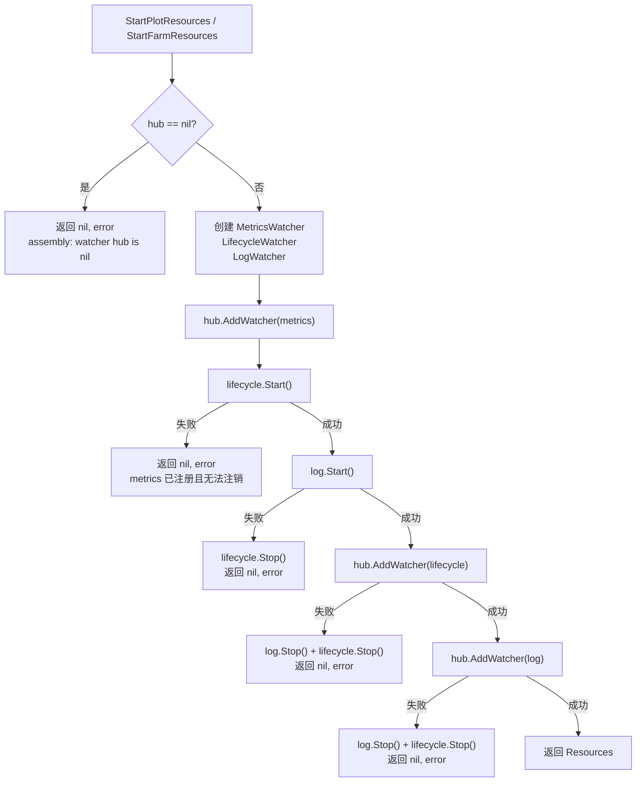
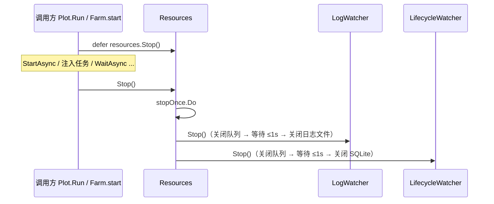
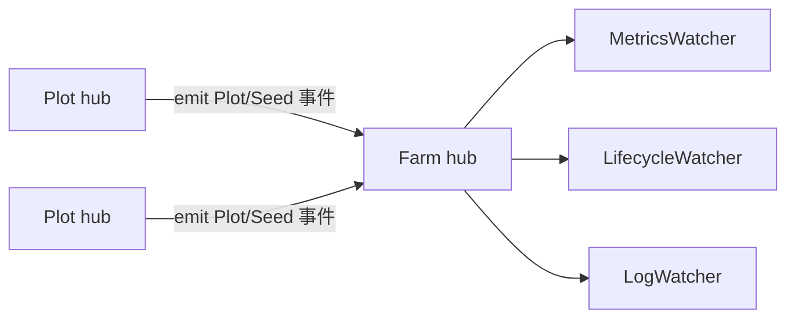

# pkg/assembly/assembly.go

> 📅 最后更新日期: 2026/11/13

`pkg/assembly` 是 **运行期资源装配层**。它把「观察者实例的创建、Hub 注册、消费循环启停」从 `Plot` / `Farm` 中剥离出来：`Plot` 与 `Farm` 自身只持有 `scarecrow.Hub`，不再直接持有 `funnel.Spout` 或 `persist` 观察者实例。

本文件对外只有 3 个公开符号：资源句柄 `Resources`（含 `Stop` 方法）、两个装配入口 `StartPlotResources` / `StartFarmResources`；三者下方共用内部流程 `startResources`。Plot 级与 Farm 级目前的装配内容完全一致，拆分两个入口是为了给 Farm 独有资源（如远程上报）预留扩展点。

## 作用

- 在每次运行开始时创建指标（`scarecrow.MetricsWatcher`）、生命周期（`persist.LifecycleWatcher`）与日志（`persist.LogWatcher`）三类观察者。
- 按固定顺序启动观察者的消费循环，并注册到调用方传入的 `*scarecrow.Hub`；事件从此由 Hub 统一分发。
- 通过返回的 `*Resources` 在运行结束时停止观察者、刷盘并释放文件 / SQLite 句柄。
- 启动失败时回滚已启动的资源，避免留下「已启动但无人回收」的消费协程。

## 核心对象

### `Resources`

```go
type Resources struct {
	lifecycle *persist.LifecycleWatcher
	log       *persist.LogWatcher
	stopOnce  sync.Once
}
```

| 字段 | 含义 |
|------|------|
| `lifecycle` | 生命周期观察者，把事件翻译为 `seed` / `ripen` / `wither` / `prune` 记录并异步写入 SQLite |
| `log` | 日志观察者，把事件翻译为文本行并异步写入 `logs/grow_log(<日期>).log`；Plot 结束日志中的计数直接取自 `MetricsWatcher` 快照 |
| `stopOnce` | 保证 `Stop` 的资源回收只执行一次 |

三个字段均不导出；外部只能通过 `Stop` 回收，不能单独操作某个观察者。需要数据库路径等观测信息时，应通过 `scarecrow.Find` 从 Hub 中查找对应观察者（见下文「观测已装配资源」）。

#### `Stop()`

```go
func (r *Resources) Stop()
```

停止并回收本次运行启动的资源：

1. `stopOnce.Do(...)` 保证重复调用只执行一次；
2. 先 `r.log.Stop()`，再 `r.lifecycle.Stop()`（与启动顺序相反）；
3. 两个 `Stop` 返回的 error 都被显式丢弃（`_ =`）。

`persist` 的 `Stop` 最终落到 `funnel.Spout.Stop`：关闭队列通道、最多等待 1 秒让消费协程处理完剩余记录，然后调用 handler 的 `AfterStop` 关闭文件 / SQLite 连接。因此 `Resources.Stop` 同时承担**刷盘**职责。

> `Stop` 没有 nil 接收者保护：`Resources` 为 nil 时调用会 panic。启动失败时两个入口返回的是 `(nil, err)`，调用方必须先判错再 `defer resources.Stop()`。

### 装配入口

| 函数 | 签名 | 调用方 |
|------|------|--------|
| `StartPlotResources` | `func StartPlotResources(hub *scarecrow.Hub, logLevel string) (*Resources, error)` | standalone 模式下的 `basePlot.Run`（`pkg/plot/plot.go`） |
| `StartFarmResources` | `func StartFarmResources(hub *scarecrow.Hub, logLevel string) (*Resources, error)` | `Farm.start`（`pkg/farm/farm.go`），即 `Farm.Run` / `Farm.Start` 的共同流程 |

两者当前都只是 `startResources` 的转发：

```go
func StartPlotResources(hub *scarecrow.Hub, logLevel string) (*Resources, error) {
	return startResources(hub, logLevel)
}

func StartFarmResources(hub *scarecrow.Hub, logLevel string) (*Resources, error) {
	return startResources(hub, logLevel)
}
```

`logLevel` 原样交给 `persist.NewLogWatcher`：取值为 `TRACE` / `DEBUG` / `SUCCESS` / `INFO` / `WARNING` / `ERROR` / `CRITICAL`；空字符串或无法识别的级别按 `INFO` 处理。

### 内部流程 `startResources`

```go
func startResources(hub *scarecrow.Hub, logLevel string) (*Resources, error)
```

装配的完整步骤：

1. `hub == nil` → 直接返回 `nil, fmt.Errorf("assembly: watcher hub is nil")`；
2. 创建 `scarecrow.NewMetricsWatcher()`；
3. 创建 `persist.NewLifecycleWatcher()`；
4. 创建 `persist.NewLogWatcher(metricsWatcher, logLevel)`——日志观察者依赖指标观察者，用于在 `PlotEndEvent` 时读取成熟 / 枯萎 / 剪枝计数；
5. `hub.AddWatcher(metricsWatcher)`——指标观察者**最先**注册（它没有消费循环，也不需要在 Hub 之外启动）；
6. `lifecycleWatcher.Start()`；
7. `logWatcher.Start()`；
8. `hub.AddWatcher(lifecycleWatcher)`；
9. `hub.AddWatcher(logWatcher)`；
10. 返回 `&Resources{lifecycle: lifecycleWatcher, log: logWatcher}`。

三类观察者的差异：

| 观察者 | 构造 | 是否有消费循环 | 是否注册到 Hub | 需要 `Start` |
|--------|------|:--------------:|:--------------:|:------------:|
| `*scarecrow.MetricsWatcher` | `scarecrow.NewMetricsWatcher()` | 否（纯内存聚合） | 是 | 否 |
| `*persist.LifecycleWatcher` | `persist.NewLifecycleWatcher()` | 是（`funnel.Spout`，缓冲 100、超时 1s） | 是 | 是 |
| `*persist.LogWatcher` | `persist.NewLogWatcher(metrics, logLevel)` | 是（同上） | 是 | 是 |

> `Resources` 只持有后两者。指标观察者没有需要回收的资源，因此不在 `Resources` 中，也不会被 `Stop` 处理。

## 关键流程

### 启动与注册时序



要点：

- **先启动、后注册**：`lifecycle` / `log` 都是消费循环先跑起来，再进入 Hub 的观察者列表。这样注册成功的那一刻起，事件就一定有消费者，不会出现「事件已投递但队列无人消费」的窗口。
- **注册顺序即分发顺序**：Hub 按注册顺序同步转发事件，所以事件处理顺序固定为 `metrics → lifecycle → log`。指标先更新，日志写 `PlotEnd` 摘要时才能读到本次运行的最终计数。
- **指标最先注册**：`MetricsWatcher` 没有 `Start` 步骤，代码在启动其他观察者之前就把它注册进 Hub。

### 失败回滚

| 失败点 | 返回错误 | 已执行的清理 | Hub 残留 |
|--------|----------|--------------|----------|
| `hub == nil` | `assembly: watcher hub is nil` | 无（尚未创建任何对象） | 无 |
| `lifecycleWatcher.Start()` | `assembly: start lifecycle watcher: %w` | 无 | `metrics` 已注册 |
| `logWatcher.Start()` | `assembly: start log watcher: %w` | `lifecycle.Stop()` | `metrics` 已注册 |
| `hub.AddWatcher(lifecycleWatcher)` | 原样返回 Hub 错误 | `log.Stop()` + `lifecycle.Stop()` | `metrics` 已注册 |
| `hub.AddWatcher(logWatcher)` | 原样返回 Hub 错误 | `log.Stop()` + `lifecycle.Stop()` | `metrics`、`lifecycle` 均已注册 |

> 回滚只能「停止」已启动的观察者，**不能从 Hub 注销**：`scarecrow.Hub` 没有提供移除接口。因此装配失败后 Hub 中可能残留指标观察者（以及已注册的生命周期观察者）。正常用法中 Hub 是每次运行新建的（`newBasePlot` / `NewFarm` 各自创建），残留不会跨运行累积；但如果在同一 Hub 上反复调用装配入口，观察者会叠加。

`lifecycle.Start()` 失败通常来自 `lifecycles/<日期>/` 目录创建或 SQLite 打开失败；`log.Start()` 失败通常来自 `logs/` 目录创建或日志文件打开失败（两者都相对**进程工作目录**）。

### 停止时序



- 停止顺序与启动顺序相反：先日志、后生命周期；
- 每个 `Spout.Stop` 关闭通道后最多等待 `1s` 消费剩余记录，正常路径下会把缓冲区刷完；
- 两个 `Stop` 的错误都被丢弃，调用方无法从 `Resources.Stop` 得知「刷盘超时」或「关闭文件失败」。

## 重要细节

### 与 Plot / Farm 的调用关系

两个入口都不是给业务代码手工调用的常规 API，而是运行框架的内部装配点：

| 调用方 | 代码位置 | 行为 |
|--------|----------|------|
| `basePlot.Run(seeds, logLevel)` | `pkg/plot/plot.go` | `StartPlotResources(p.hub, logLevel)`；失败时**静默返回**（`Run` 无返回值）；成功后 `defer resources.Stop()`，再 `StartAsync` → 逐颗 `Seed` → `Seal` → `WaitAsync` |
| `Farm.start(logLevel, prepare)` | `pkg/farm/farm.go` | `StartFarmResources(f.hub, logLevel)`；失败时把 error 返回给 `Farm.Run` / `Farm.Start`；成功后 `defer resources.Stop()`，再发 `FarmStartEvent`、把 `f.hub` 注册进每个 Plot 的 Hub、`StartAsync` 全部 Plot，最后逐个 `WaitAsync` |

因此：

- **standalone**：观察者注册在 Plot 自己的 Hub 上，事件由 `basePlot.emit` 直接分发；
- **Farm 模式**：观察者注册在 Farm 的 Hub 上，`Farm.start` 通过 `plot.AddWatcher(f.hub)` 把 Farm Hub 作为观察者挂到每个 Plot 的 Hub，Plot 事件经嵌套 Hub 转发到 Farm 级观察者。`scarecrow.Find` 会递归查找嵌套 Hub，所以 `Harvest` 能从 Plot 的 Hub 里找到注册在 Farm Hub 上的 `LifecycleWatcher`。



### 观测已装配资源

`Resources` 不暴露内部观察者，运行结束后通常这样取结果：

```go
lifecycle, ok := scarecrow.Find[*persist.LifecycleWatcher](hub)
if !ok {
	// 未装配或已被替换
	return
}
dbPath := lifecycle.DBPath() // Start 之前为空字符串；Start 后指向本次运行的 .sqlite3
records, err := persist.LoadLifecycleStatusesFromPath(dbPath, "plot-name")
```

`lifecycle.DBPath()` 直接读取 handler 中的 `SQLitePath`，该字段在 `LifecycleRecordHandler.BeforeStart`（即 `Start`）中才被赋值。日志文件路径没有对应的查询接口，位置固定为工作目录下的 `logs/grow_log(<YYYY-MM-DD>).log`。

### Hub 的注册约束

- `Hub.AddWatcher` 拒绝 `nil` 观察者；
- 观察者为 `*Hub` 时会做环检测；本包注册的三个观察者都不是 `*Hub`，所以当前实现中两处 `AddWatcher` 的错误分支实际上不可达，属于防御性代码（为将来 Hub 规则变化或替换观察者类型留出错误通道）；
- 事件按注册顺序同步分发，单个观察者返回 error 或 panic 会被 Hub 捕获并交给 `ErrorHandler`，不会中断其他观察者。`Farm` / `Plot` 的 `emit` 忽略 `OnEvent` 的返回值（Hub 本身也始终返回 nil）。

## 使用示例

### 独立驱动一个 Hub

```go
package main

import (
	"fmt"
	"time"

	"github.com/Mr-xiaotian/CelestialGrow/pkg/assembly"
	"github.com/Mr-xiaotian/CelestialGrow/pkg/persist"
	"github.com/Mr-xiaotian/CelestialGrow/pkg/scarecrow"
)

func main() {
	hub := scarecrow.NewHub(scarecrow.WithErrorHandler(func(err error) {
		fmt.Println("watcher error:", err)
	}))

	resources, err := assembly.StartFarmResources(hub, "DEBUG")
	if err != nil {
		panic(err)
	}
	defer resources.Stop() // 保证刷盘与句柄回收

	// 模拟一次种子输入事件；真实场景由 Plot/Farm 的 emit 产生。
	if err := hub.OnEvent(scarecrow.SeedInputEvent{
		Plot:     "demo",
		Seed:     42,
		SeedRepr: "42",
		SeedID:   1,
		Time:     time.Now(),
	}); err != nil {
		panic(err)
	}

	// 重复调用安全：stopOnce 只执行一次回收。
	resources.Stop()
	resources.Stop()

	lifecycle, ok := scarecrow.Find[*persist.LifecycleWatcher](hub)
	if !ok {
		panic("lifecycle watcher is not registered")
	}

	records, err := persist.LoadLifecycleStatusesFromPath(lifecycle.DBPath(), "demo")
	if err != nil {
		panic(err)
	}
	for _, record := range records {
		fmt.Printf("plot=%s status=%s seed=%s\n", record.Plot, record.Status, record.SeedJSON)
	}
}
```

运行后会在工作目录生成 `logs/grow_log(<日期>).log` 与 `lifecycles/<日期>/grow_lifecycle(<时间>).sqlite3`。

### 通过 Plot / Farm 间接使用

业务代码不需要直接调用本包：

```go
package main

import (
	"fmt"

	"github.com/Mr-xiaotian/CelestialGrow/pkg/farm"
	"github.com/Mr-xiaotian/CelestialGrow/pkg/plot"
)

func double(seed int) (int, error) { return seed * 2, nil }

func main() {
	// standalone：内部会 StartPlotResources 并 defer Stop。
	p := plot.NewSinglePlot("double", double)
	p.Run([]int{1, 2, 3}, "INFO")

	// Farm：内部会 StartFarmResources 并 defer Stop。
	f := farm.NewFarm("demo")
	if err := f.AddPlot(plot.NewSinglePlot("double", double)); err != nil {
		panic(err)
	}
	if err := f.Run(map[string][]any{"double": {1, 2, 3}}, "INFO"); err != nil {
		panic(err)
	}

	fmt.Println("done")
}
```

> `basePlot.Run` 与 `Farm.Run` / `Farm.Start` 都会在返回前停止装配资源，因此调用方拿到结果时日志与 SQLite 已经刷盘。

## 注意事项

- **必须 `defer resources.Stop()`**：`Spout` 的队列有缓冲，不调用 `Stop` 会丢失队列中的日志 / 生命周期记录，并泄漏日志文件与 SQLite 连接。
- **`Stop` 要在生产端停止之后调用**：`Spout.Stop` 会关闭队列通道；若仍有协程向队列 `Send`，会 panic（`send on closed channel`）。`Plot.Run` / `Farm.start` 都把 `defer resources.Stop()` 安排在 `WaitAsync` 全部完成之后触发，正是为了保证这一点。
- **启动失败返回 `(nil, err)`**，不要对 nil 调用 `Stop`；standalone 的 `basePlot.Run` 会把该错误静默吞掉（无返回值），排查「Plot 没有任何输出」时应先检查工作目录是否可写、SQLite 是否可打开。
- **`Stop` 幂等但不可复用**：内部观察者已关闭，`Resources` 不能再次交给新运行使用；需要重新运行时应重新调用装配入口。
- **同一 Hub 重复装配会叠加观察者**：Hub 无注销接口，重复 `Run` 同一个 Plot / Farm 会让日志与生命周期记录重复写入（多个 watcher 同时消费同一事件）。
- **装配失败可能残留指标观察者**：`lifecycle.Start` 等早期失败不会移除已注册的 `MetricsWatcher`，见上文「失败回滚」。
- **日志级别大小写敏感**：只识别大写枚举值，小写 `debug` 会被当作未知级别回退到 `INFO`。
- **输出路径相对工作目录**：`logs/` 与 `lifecycles/` 都基于进程当前工作目录创建，与二进制所在目录无关；不同工作目录会写到不同位置。
