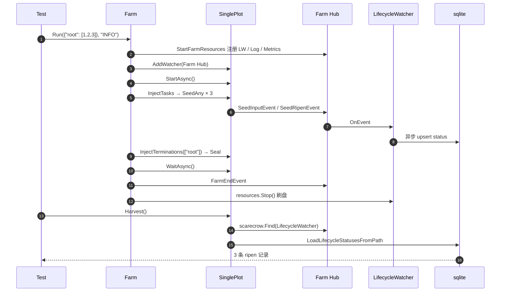

# pkg/farm/farm_harvest_test.go

> 📅 最后更新日期: 2026/11/13

## 作用

`farm_harvest_test.go` 以 `package farm_test` 覆盖「Farm 运行结束后，Plot 能否读取自身生命周期快照」这一跨包协作链路：

- Farm 级 `assembly` 装配的 `LifecycleWatcher` 注册在 **Farm Hub**；
- Farm Hub 在 `start` 中被注册进每个 Plot 的 Hub；
- Plot 运行期发出 `SeedInputEvent` / `SeedRipenEvent`，经嵌套 Hub 传到 `LifecycleWatcher`，异步写入 sqlite；
- `Run` 返回后 `resources.Stop()` 刷盘，`root.Harvest()` 再沿嵌套 Hub 找到观察者并读取数据库。

因此该测试验证的不是单个 getter，而是 **Hub 层级 + 持久化 + 资源回收** 三者共同作用的结果。

## 测试用例

| 测试函数 | 验证点 |
| --- | --- |
| `TestFarmRunHarvest` | 单 Plot Farm 以 `Run(..., "INFO")` 处理 3 颗种子后，`root.Harvest()` 返回 3 条记录且每条 `Status == "ripen"` |

## 测试重点

### 1. `Run` 的完整默认路径

```go
root := plot.NewSinglePlot("root", func(seed int) (int, error) {
    return seed * 2, nil
}, plot.WithTenders(2))

farm := farm.NewFarm("farm_harvest")
farm.AddPlot(root)
farm.Run(map[string][]any{"root": {1, 2, 3}}, "INFO")
```

`root` 是唯一节点，因此 `sourceNodes == ["root"]`：`Run` 会注入 3 颗种子并自动 `Seal()`，无需测试手动终止。

### 2. 嵌套 Hub 查找

`Harvest` 内部使用 `scarecrow.Find[*persist.LifecycleWatcher](p.hub)`。该查找会先检查 Plot 的直属观察者，再递归进入嵌套 Hub——Farm Hub 正是通过 `plot.AddWatcher(f.hub)` 挂进来的。若层级注册缺失，`Harvest` 会返回 `plot %q lifecycle watcher is not registered`，测试会直接失败。

### 3. 状态快照而非原始事件

`LifecycleWatcher` 把 `SeedInputEvent` 写成 `seed` 记录，把 `SeedRipenEvent` 提升为 `ripen` 记录。`LifecycleStatusRecord.Status` 即最终状态字符串，因此断言 `"ripen"` 同时覆盖了：

- seed → ripen 的状态提升；
- `FruitJSON` 等字段的落库路径未破坏主键；
- 记录按 `plot` 名过滤（`LoadLifecycleStatusesFromPath(dbPath, p.name)`）。

### 4. 资源刷盘时机

`Run` 中 `defer resources.Stop()` 会停止 spout 并关闭 sqlite。`Harvest` 在 `Run` 返回后调用，因此能读到全部 3 条记录，间接验证了 `Stop` 的 flush 语义。



## 关键断言

| 断言 | 含义 |
| --- | --- |
| `err != nil` 即失败 | `Harvest` 的错误覆盖「观察者未注册」「数据库未就绪」两类前置条件 |
| `len(records) == 3` | 3 颗输入各自产生且仅产生一条状态快照 |
| 每条 `record.Status == "ripen"` | 成功路径全部走 `SeedRipenEvent`，没有误判为 wither / prune |

> 记录条数与 input 数量严格相等，还隐含验证了「同一 `InputEventID` 只保留一行」的 upsert 语义。

## 关联源码

- `pkg/farm/farm.go`：`Run` / `start` / `InjectTasks` / `InjectTerminations`
- `pkg/farm/farm.go`：`AddWatcher`（Farm Hub 的对外入口）
- `pkg/assembly/assembly.go`：`StartFarmResources` / `Resources.Stop`
- `pkg/plot/plot.go`：`Harvest` / `AddWatcher` / `emit`
- `pkg/persist/lifecycle.go`：`LifecycleWatcher`（`seed` → `ripen` 状态提升）
- `pkg/persist/sqlite.go`：`LifecycleStatusRecord` / `LoadLifecycleStatusesFromPath`
- `pkg/scarecrow/hub.go`：`Find`（穿透嵌套 Hub）

## 运行方式

```bash
go test ./pkg/farm/ -run 'TestFarmRunHarvest' -v
```

## 注意事项

- 该测试会真实创建并写入生命周期 sqlite；断言只依赖条数与状态，不依赖数据库路径。
- `Harvest` 只能在运行结束后调用：运行期间 `DBPath` 虽已就绪，但队列中的记录尚未刷盘，条数可能不足。
- 若后续在 `Farm` 中移除 Hub 层级注册（例如改回直接持有 persist 观察者），本测试会首先失败。
