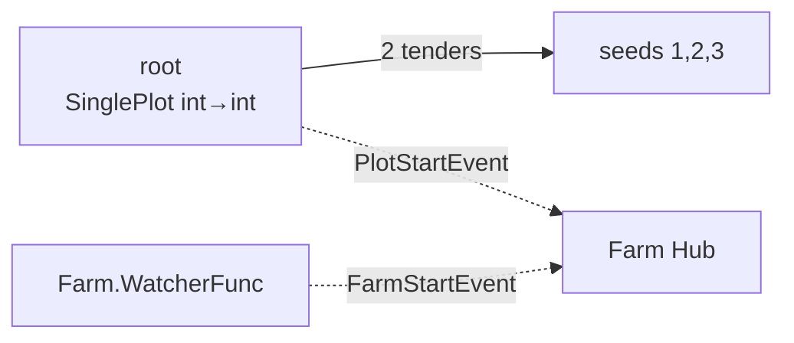
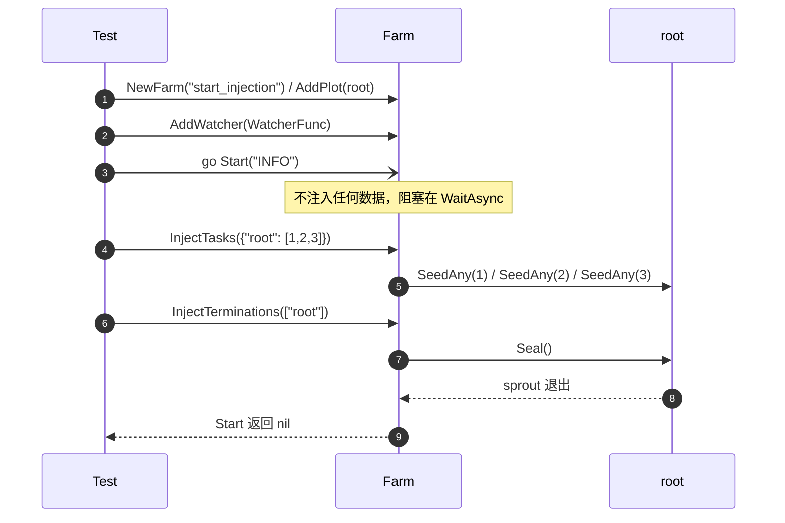

# pkg/farm/farm_inject_test.go

> 📅 最后更新日期: 2026/11/13

## 作用

`farm_inject_test.go` 以 `package farm_test` 覆盖 `Farm` 的**外部驱动模式**：

- `Start(logLevel)` 本身不注入任何种子或终止信号；
- 调用方可在 `Start` 阻塞期间通过 `InjectTasks` / `InjectTerminations` 动态控制任务流；
- Farm 级 watcher（`Farm.AddWatcher`）能同时收到 Farm 事件与 Plot 事件。

这是 `Farm.Run` 拆分后新增能力（`Start` / `InjectTasks` / `InjectTerminations`）的核心回归测试。

## 测试用例

| 测试函数 | 验证点 |
| --- | --- |
| `TestFarmStartWithInjection` | `Start` 不自动注入；运行期注入 3 颗种子后被全部处理；`FarmStartEvent` 与 1 次 `PlotStartEvent` 均被 Farm 级 watcher 观察；`Start` 在终止信号后正常返回 |

## 被测拓扑



只有一个 `root`：`NewSinglePlot("root", ..., plot.WithTenders(2), plot.WithChanSize(8))`，作为 source 与 sink，便于把注意力集中在注入语义与事件分发上。

## 关键流程



## 关键细节

### 1. `Start` 不注入

`Start` 只计算 `sourceNodes` 并调用 `start(logLevel, nil)`；`prepare` 为 `nil` 时不会触发 `InjectTasks` / `InjectTerminations`。测试必须先注入，否则 `Start` 永远不会返回。

### 2. 运行期注入的时序

`InjectTasks` 在 `Start` 的 goroutine 启动后立刻调用：

- Plot 的 `seedChan` 有 `WithChanSize(8)` 缓冲，即使 `StartAsync` 尚未调度到，写入也不会阻塞；
- `InjectTerminations` 在种子之后调用，`sprout` 会按先进先出处理完已入队的 3 颗种子再退出；
- `errCh` 带 1 个缓冲，避免 `Start` 返回后测试已结束、goroutine 永久阻塞。

> 若把 `WithChanSize` 设为 0，注入与 `StartAsync` 的调度顺序会变成额外的隐式依赖，测试稳定性下降。

### 3. Farm 级 watcher 的层级分发

`AddWatcher` 注册到 Farm Hub；`start` 中 Farm Hub 又被注册到 `root` 的 Hub。因此同一个 watcher 会收到：

| 事件 | 来源 | 断言 |
| --- | --- | --- |
| `FarmStartEvent` | `Farm.emit`（Farm Hub） | `farmStarted == true` |
| `PlotStartEvent` | `root.notifyStart` → root Hub → Farm Hub | `plotStarts == 1` |

`PlotStartEvent` 计数为 1 同时说明：Farm Hub 只被注册了一次，未发生重复分发。

### 4. 并发安全

观察者回调可能由不同协程触发（Farm 启动协程与 Plot 的 `StartAsync` 协程），测试用 `sync.Mutex` 保护 `seeds` / `farmStarted` / `plotStarts`；最终断言前再统一加锁读取。

### 5. 种子内容只校验数量

`root` 的 cultivator 把收到的 seed 追加到 `seeds`，测试断言 `len(seeds) == 3`：

- 验证「注入的种子确实被 `sprout`/`tend` 消费」，而不是停留在通道里；
- 不约束处理顺序，因为 2 个 tender 并发执行。

## 关联源码

- `pkg/farm/farm.go`：`Start` / `start` / `InjectTasks` / `InjectTerminations` / `AddWatcher`
- `pkg/assembly/assembly.go`：`StartFarmResources`（`Start` 同样装配资源）
- `pkg/plot/plot.go`：`StartAsync` / `SeedAny` / `Seal` / `AddWatcher` / `notifyStart`
- `pkg/scarecrow/watcher.go`：`Watcher` / `WatcherFunc`
- `pkg/scarecrow/event.go`：`FarmStartEvent` / `PlotStartEvent`

## 运行方式

```bash
go test ./pkg/farm/ -run 'TestFarmStartWithInjection' -v
```

## 注意事项

- 该用例的 `Start` 在独立 goroutine 中执行，主协程负责注入；若把注入也放进 `Start` 之前调用，同样可行（通道有缓冲），但不再覆盖「运行期注入」语义。
- `Start` 的错误通过 `errCh` 回传；不要用 `t.Fatal` 直接结束主协程，否则阻塞中的 `Start` goroutine 会泄漏。
- 若将来 `Start` 改为自动注入，`farmStarted` / `seeds` 断言不会失败，但「无终止信号则不返回」的语义会改变，需同步更新本测试。
