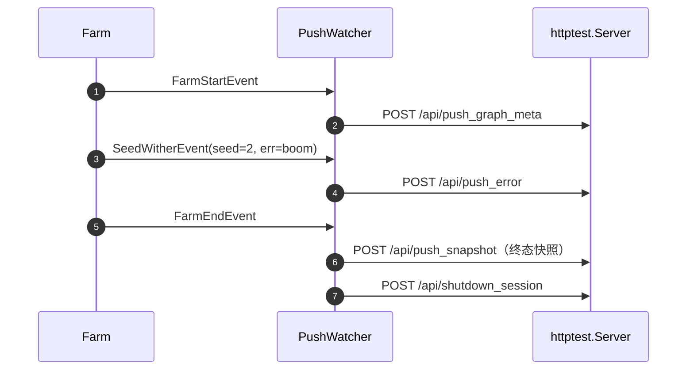

# pkg/farm/farm_report_test.go

> 📅 最后更新日期: 2026/11/26

## 作用

`farm_report_test.go` 以 `package farm_test` 覆盖 `Farm` 的**远程上报模式**，验证当 `Run` 收到非 nil 的 `*reporter.Config` 时：

- `assembly.StartReportResources` 会装配 `PushWatcher`、`SnapshotTicker` 与 `InjectionTicker`；
- `FarmStartEvent` 被翻译为图元信息推送到 `/api/push_graph_meta`；
- 种子培育失败产生的 `SeedWitherEvent` 被推送到 `/api/push_error`；
- `FarmEndEvent` 先补推终态快照 `/api/push_snapshot`，再推送会话下线 `/api/shutdown_session`；
- `SessionID` 为空时由 `normalizeReport` 自动生成。

测试用 `net/http/httptest` 启动真实 HTTP 服务，记录每个请求的路径与 JSON body，属于对「Farm → assembly → reporter」整条链路的黑盒回归。

## 测试用例

| 测试函数 | 验证点 |
| --- | --- |
| `TestFarmRunWithReportPushesGraphErrorSnapshotAndShutdown` | 单 Plot Farm 显式传入 `SessionID: "farm@1"`；运行后四个上报端点均被访问，且图元信息、错误、下线 payload 字段正确 |
| `TestFarmRunGeneratesSessionID` | 传入不含 `SessionID` 的 `reporter.Config`；`/api/push_graph_meta` 中的 `session_id` 以 `"auto_session@"` 为前缀 |

## 关键流程

### 1. 用例拓扑与失败注入

```go
root := plot.NewSinglePlot("root", func(seed int) (int, error) {
    if seed == 2 {
        return 0, errors.New("boom")
    }
    return seed * 2, nil
}, plot.WithTenders(2))

f := farm.NewFarm("report_farm")
f.AddPlot(root)
f.Run(map[string][]any{"root": {1, 2, 3}}, "INFO", &reporter.Config{
    URL:       server.URL,
    SessionID: "farm@1",
})
```

`root` 同时是 source 与 sink，种子 `2` 抛出 `boom`，因此会产生一条 `SeedWitherEvent`。`Run` 不为 `SnapshotPeriod` / `InjectionPeriod` 赋值，二者按 `reporter` 包的默认周期工作。

### 2. 请求的因果顺序

测试没有断言顺序，但按事件产生顺序，四个请求的因果链为：



`SnapshotTicker` 在运行时间较长时也可能插入额外的 `/api/push_snapshot`；本用例运行很快，测试只要求该端点至少出现一次。

### 3. 图元信息字段

```json
{
  "session_id": "farm@1",
  "graph": "report_farm",
  "node_meta": {
    "root": {
      "class_name": "SinglePlot",
      "execution_mode": "thread",
      "max_workers": 2
    }
  }
}
```

- `graph` 来自 `FarmStartEvent.Farm`；
- `node_meta` 来自 `Farm.getNodeMeta()` 汇总的各 Plot `GetMeta()`；
- `NodeMeta.MaxWorkers` 等于 `plot.WithTenders(2)` 设置的 tender 数；
- JSON 反序列化后数字为 `float64`，因此测试断言 `max_workers == float64(2)`。

### 4. 错误与下线 payload

| 端点 | 字段 | 断言值 | 来源 |
| --- | --- | --- | --- |
| `/api/push_error` | `node` | `"root"` | `SeedWitherEvent.Plot` |
| `/api/push_error` | `error_message` | `"boom"` | `SeedWitherEvent.Err` 的 `%v` |
| `/api/shutdown_session` | `session_id` | `"farm@1"` | 配置中的会话标识 |

`/api/push_error` 还包含 `event_id`、`task_json`、`error_type`、`ts` 字段，本测试只校验节点名与错误文本。

## 边界与断言重点

- **只校验端点集合**：测试用 `slices.Contains` 确认四个路径都存在，不约束请求次数与顺序；周期快照或重试可能产生额外请求。
- **不校验注入拉取**：`StartReportResources` 同时装配了 `InjectionTicker`，但本文件没有请求 `/api/pull_injection` 的断言，注入行为由 `pkg/reporter/inject_test.go` 覆盖。
- **会话标识原样透传**：显式 `SessionID` 不会被改写，所有上报记录共用同一个值。
- **自动生成规则**：`SessionID` 为空时，`normalizeReport` 生成 `fmt.Sprintf("%s@%d", f.name, time.Now().UnixNano())`，因此测试只断言 `auto_session@` 前缀，不断言完整值。
- **失败不阻塞主流程**：`PushWatcher` 的 HTTP 失败只写日志，不会让 `Run` 返回错误；本测试的服务端始终返回 `200 OK`，确保上报路径完整走通。
- **StopFunc 刷盘**：`Run` 返回前会停止资源，`PushWatcher.Stop` 关闭 inlet 并等待后台 spout 消费完毕，因此测试在 `Run` 返回后读取请求记录是稳定的。
- **辅助函数**：`findReport` 按路径取第一条记录，缺失时直接 `t.Fatalf`；`capturedReport` 保存 `path` 与 body 的副本，避免共享切片被后续请求覆盖。

## 关联源码

- `pkg/farm/farm.go`：`Run` / `start` / `normalizeReport` / `getNodeMeta`
- `pkg/assembly/assembly.go`：`StartReportResources`（装配 `PushWatcher` / `SnapshotTicker` / `InjectionTicker`）
- `pkg/reporter/push.go`：`PushWatcher.OnEvent`（`FarmStartEvent` / `SeedWitherEvent` / `FarmEndEvent` 到端点的映射）
- `pkg/reporter/config.go`：`Config`
- `pkg/plot/plot.go`：`GetMeta` / `SinglePlot` 的 `NodeMeta`
- `pkg/scarecrow/event.go`：`FarmStartEvent` / `FarmEndEvent` / `SeedWitherEvent`

## 运行方式

```bash
go test ./pkg/farm/ -run 'TestFarmRunWithReport|TestFarmRunGeneratesSessionID' -v
```

## 注意事项

- 该测试不访问外部网络，`httptest.Server` 监听随机本地端口；`server.URL` 直接作为 `reporter.Config.URL`。
- 测试会真实装配节拍时钟与后台推送 spout，但周期很短且 `Run` 结束时会停止资源，不会遗留 goroutine。
- 若把 `report` 改为 `nil`，四个端点都不会收到请求，`findReport` 会立即失败；这正是本地/上报两种装配分支的回归点。
