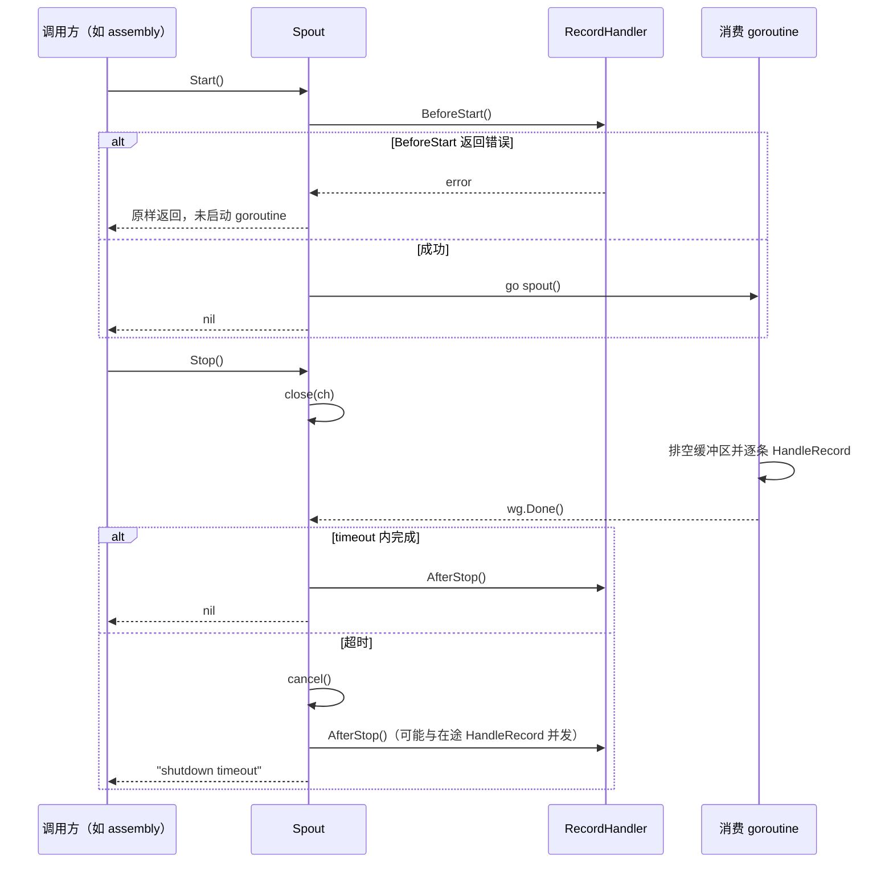
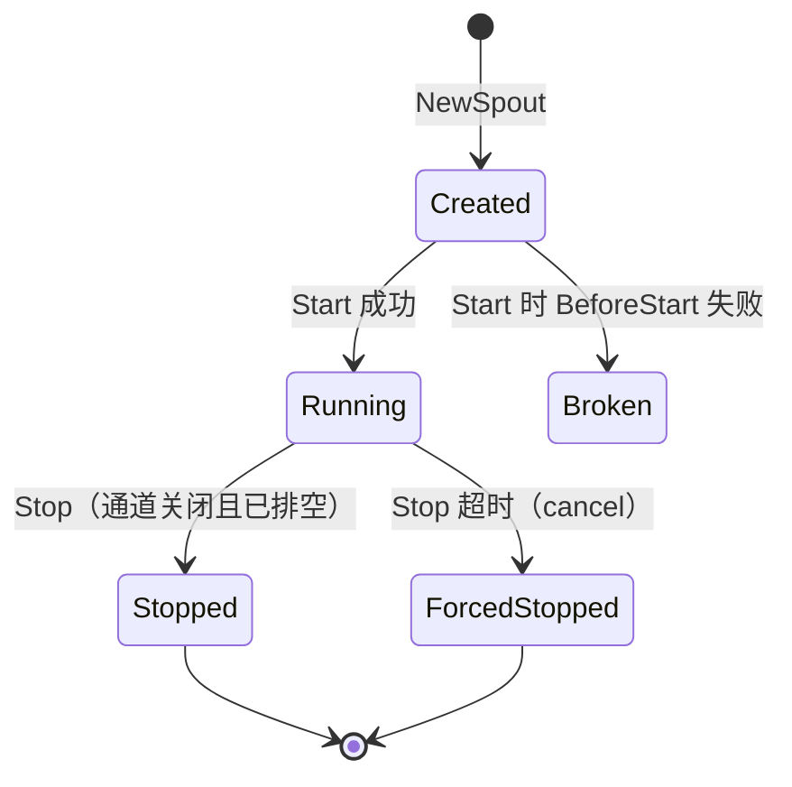

# pkg/funnel/spout.go

> 📅 最后更新日期: 2026/11/13

`pkg/funnel/spout.go` 定义了 `Spout[T]` 泛型抽象——CelestialGrow 异步消费基础设施中的**消费端**（读取者）。它持有一个带缓冲的 Go channel，在后台 goroutine 中持续读取记录并交给 `RecordHandler[T]` 处理；同时通过 `BeforeStart` / `HandleRecord` / `AfterStop` 三段式接口明确资源生命周期。

> **命名提示**：尽管 `Spout` 直观上像"出口"，但在本包中它是**消费端**。`Spout` 不断从内部通道"喷出"记录给 handler，配套的 `Inlet` 才是"灌入"记录的生产端。

## 作用

- 在后台 goroutine 中持续从带缓冲 channel 读取记录。
- 把"业务处理"通过 `RecordHandler[T]` 接口注入，便于在不同持久化后端（文件 / SQLite）之间复用。
- 提供两阶段关闭：先 `close(ch)` 触发优雅退出（并排空缓冲区）；超时未结束则 `cancel()` 让消费 goroutine 在本次 `HandleRecord` 返回后退出，保证调用方不会无限等待。

## 核心对象

### `type RecordHandler[T any]`（接口）

```go
type RecordHandler[T any] interface {
    BeforeStart() error
    HandleRecord(record T) error
    AfterStop() error
}
```

| 方法 | 何时被调用 | 典型用途 |
|------|-----------|----------|
| `BeforeStart() error` | `Spout.Start` 内部、消费 goroutine 启动**前**，同步调用 | 打开文件、建立数据库连接、初始化 buffer |
| `HandleRecord(record T) error` | 消费 goroutine 每读到一条记录 | 单条记录的序列化 / 写入 |
| `AfterStop() error` | `Spout.Stop` 收尾阶段，**无论是否超时**都会调用 | 关闭文件、`fsync`、释放连接 |

三个方法返回的 `error` 待遇不同：`BeforeStart` 的错误会由 `Start` 原样返回；`HandleRecord` 的错误会被 `spout()` **静默丢弃**；`AfterStop` 的错误会被 `Stop()` **静默丢弃**（`Stop` 只返回关闭超时错误）。因此不要在 handler 中把关键失败仅寄托于返回值。

### `type Spout[T any]`

```go
type Spout[T any] struct {
    ch      chan T               // 内部缓冲通道，对外通过 GetQueue 暴露只写句柄
    wg      sync.WaitGroup       // 跟踪消费 goroutine
    timeout time.Duration        // Stop 时优雅关闭的最大等待时间
    ctx     context.Context      // 内部 ctx，被 Stop 在超时时 cancel
    cancel  context.CancelFunc
    handler RecordHandler[T]     // 注入的处理器
}
```

- **泛型参数 `T`**：单条记录的类型。例如 `persist.LogWatcher` 内部使用 `*funnel.Spout[persist.LogRecord]`。
- 字段全部不导出，构造与生命周期管理只能通过公开方法。

### 构造：`NewSpout[T any]`

```go
func NewSpout[T any](handler RecordHandler[T], bufferSize int, timeout time.Duration) *Spout[T]
```

- `handler`：必须实现 `RecordHandler[T]`；所有方法都由**同一个**消费 goroutine 串行调用。
- `bufferSize`：内部 `make(chan T, bufferSize)` 的容量。`0` 会创建无缓冲通道（合法，但会让 `Send` 立即面临背压）；传入**负数**会让 `make` panic，当前实现不做校验。
- `timeout`：`Stop` 阶段优雅关闭的最长等待时间。`0` 表示几乎立即走"强制取消"分支（`time.After(0)` 立即可读）。

### 公开方法

| 方法 | 签名 | 作用 |
|------|------|------|
| `GetQueue` | `func (s *Spout[T]) GetQueue() chan<- T` | 返回只写句柄，供 `Inlet` 绑定 |
| `Start` | `func (s *Spout[T]) Start() error` | 调 `handler.BeforeStart` + 启动消费 goroutine |
| `Stop` | `func (s *Spout[T]) Stop() error` | 先 `close(ch)` 排空并优雅退出；超时则 `cancel()` 强退，并最终 `handler.AfterStop()` |
| `Handler` | `func (s *Spout[T]) Handler() RecordHandler[T]` | 返回当前注入的 handler，便于调试或测试断言 |

> `Spout` 不提供同步的「取一条」方法；记录仅由后台 goroutine 自动从通道拉取，对外只暴露「启停 + 队列入口」。

#### `GetQueue() chan<- T`

- 每次调用都返回同一个 `chan T`（编译器会从双向通道派生只写类型）。
- 调用方通常是 `funnel.NewInlet[T](spout.GetQueue(), timeout)`。
- **不要**在其他地方写入或关闭此通道——所有权归 `Spout`。

#### `Start() error`

1. 同步调用 `s.handler.BeforeStart()`；若返回非 `nil` 错误则**不会**启动 goroutine，直接返回该错误。
2. `s.wg.Add(1)` 后 `go s.spout()`。
3. 成功后立即返回（非阻塞）；`BeforeStart` 失败时可能已经部分打开了资源，`Start` 不会回滚，调用方应自行决定是否需要补偿清理。

#### `Stop() error`

```text
Stop()
  ├─ close(s.ch)                      // 触发 spout() 在 <-s.ch 处排空后返回
  ├─ 等待 wg.Wait() done 通道，最多 timeout
  │     ├─ 正常 done        → err = nil
  │     └─ timeout 触发     → s.cancel()，err = errors.New("shutdown timeout")
  └─ 无论是否超时，都执行 s.handler.AfterStop()          // 返回值被丢弃
```

关键点：

- **必须** `close(s.ch)` 后才能让 `<-s.ch` 的 `ok=false` 分支命中，从而让 `spout()` 优雅返回。
- 关闭通道**不会丢记录**：接收方会把缓冲区中剩余记录按 FIFO 取完（每次 `ok=true`）后才收到 `ok=false`，因此正常路径下 `Stop` 返回前队列已被排空。
- 超时路径**会丢记录**：`ctx` 被取消后，消费 goroutine 会在当前 `HandleRecord` 返回后立即退出，缓冲区中尚未处理的记录被丢弃。
- 内部 `ctx` 仅在**超时**时才会被 `cancel()`，正常路径下永远不会被触发；这是设计选择，避免误杀仍在处理中的 handler。
- `AfterStop` 在**所有**退出路径下都会被调用（即使 `Start` 从未成功过），确保资源不泄漏。
- 返回 `error` 仅在超时场景下为非 `nil`，调用方可据此判定是否需要告警。

#### `Handler() RecordHandler[T]`

- 返回构造时注入的 handler（接口值的副本）。可用于运行时上报 handler 状态、单元测试断言等。
- `persist.LifecycleWatcher.DBPath()` 正是通过 `s.spout.Handler().(*persist.LifecycleRecordHandler)` 断言后读取 `SQLitePath`。
- 只能读取，**不能**用来替换 handler：`handler` 字段不导出且没有 setter，修改这个副本不会影响 `Spout` 内部持有的实例。

### 内部方法 `spout()`（不导出）

消费循环：

```go
for {
    select {
    case record, ok := <-s.ch:
        if !ok { return }                    // 通道关闭：优雅退出
        s.handler.HandleRecord(record)       // 返回值被丢弃
    case <-s.ctx.Done():
        return                              // Stop 超时：强制退出
    }
}
```

- 是 `Start` 启动的 goroutine 入口；`wg.Done()` 在 `defer` 中保证计数归零。
- 串行处理：单 goroutine 顺序调用 `HandleRecord`，handler 内部无需为「多条记录并发到达」加锁。
- 两条退出路径：`ok=false`（通道被 `Stop` 关闭且已排空）或 `ctx.Done()`（`Stop` 超时强退）。
- `select` 在两条路径同时就绪时随机选择，因此超时取消的瞬间可能还会再处理一条已就绪的记录。

## 关键流程

### 启停时序



### 状态迁移



`Broken` 与 `Stopped` / `ForcedStopped` 都**不可复用**：`ch` 已关闭或 handler 已 `AfterStop`。

## 与 persist / assembly 的调用关系

```text
persist.LogWatcher / LifecycleWatcher ──持有──▶ funnel.Inlet[T] ──Send(T)──┐
                                                                          ▼
                                                        chan T（Spout 内部缓冲通道，容量 100）
                                                                          │
                                              GetQueue() 把同一个 chan T 暴露给 Inlet
                                                                          ▼
funnel.Spout[T]（单后台 goroutine）──HandleRecord(T)──▶ persist.LogRecordHandler / LifecycleRecordHandler
```

- `persist.LogRecordHandler` / `persist.LifecycleRecordHandler` 都实现了 `RecordHandler[T]`：
  - `BeforeStart`：创建 `logs/` 目录并按日期打开日志文件 / 创建 `lifecycles/<date>/` 目录并打开 SQLite。
  - `HandleRecord`：格式化为一行文本追加写入文件 / 按 `Kind`（`seed` / `ripen` / `wither` / `prune`）写入事件并更新状态。
  - `AfterStop`：关闭日志文件 / 关闭 SQLite 连接。
- `persist.LogWatcher` / `LifecycleWatcher` 在未导出的 `newLogWatcher` / `newLifecycleWatcher` 中用 `funnel.NewSpout(handler, 100, time.Second)` 构造 `Spout`，再用 `funnel.NewInlet(spout.GetQueue(), time.Second)` 构造配套 `Inlet`。
- `pkg/assembly` 统一管理生命周期：`StartPlotResources` / `StartFarmResources` 创建两个观察者，**先 `lifecycle.Start()`、再 `log.Start()`**，然后把它们注册到 `*scarecrow.Hub`；`Resources.Stop`（`sync.Once` 保护）按相反顺序先 `log.Stop()`、再 `lifecycle.Stop()`。
- `Plot` / `Farm` 只持有 `Hub`，不直接持有 `Spout`，也没有 `BindInlet` / `StartSpouts` / `StopSpouts` 之类的接口——通道的创建与绑定都封装在 `persist` 的观察者构造函数里。

## 与 Inlet 的协作（inlet ← spout）

```go
// 片段：T 为记录类型，handler 为调用方实现的 funnel.RecordHandler[T]
// 1. Spout 持有通道，并注入具体 handler
spout := funnel.NewSpout[T](handler, 100, time.Second)

// 2. 启动消费循环（内部先调 handler.BeforeStart）
if err := spout.Start(); err != nil {
    return err
}

// 3. Inlet 绑定到 Spout 暴露的只写句柄
inlet := funnel.NewInlet[T](spout.GetQueue(), time.Second)

// 4. 上游只需调 inlet.Send(...)；通道满了会等 1s，超时返回错误
```

时序保证：

1. **先 `Start` 再构造 `Inlet`**：消费循环未启动时发送的数据只会堆在缓冲区（容量有限），缓冲满后 `Send` 全部超时。
2. **先停写入、再停读取**：推荐顺序为「上游停止调用 `Send` → `inlet.Close()` → `spout.Stop()`」。`Spout.Stop` 内部会 `close(ch)`，此后任何 `Send` 命中写入分支都会 panic（`send on closed channel`）。
3. `inlet.Close()` 只取消 `ctx`，它**不能**阻止已进入 `select` 的 `Send` 命中写入分支而 panic，只保证「阻塞中的 `Send` 快速返回 `context.Canceled`」。

## 使用示例

最小化的 `Spout` + `Inlet` 组合（与 `inlet.md` 配套）：

```go
package main

import (
    "fmt"
    "time"

    "github.com/Mr-xiaotian/CelestialGrow/pkg/funnel"
)

type PrintHandler struct {
    cnt int
}

func (p *PrintHandler) BeforeStart() error       { fmt.Println("spout start"); return nil }
func (p *PrintHandler) HandleRecord(r int) error { p.cnt++; return nil }
func (p *PrintHandler) AfterStop() error         { fmt.Println("spout stop, total:", p.cnt); return nil }

func main() {
    handler := &PrintHandler{}

    spout := funnel.NewSpout[int](handler, 16, time.Second)
    if err := spout.Start(); err != nil {
        panic(err)
    }

    inlet := funnel.NewInlet[int](spout.GetQueue(), 200*time.Millisecond)
    for i := 0; i < 100; i++ {
        _ = inlet.Send(i) // 队列满时最多等 200ms，失败即丢弃本条
    }

    inlet.Close() // 先停写入
    if err := spout.Stop(); err != nil {
        fmt.Println("shutdown timeout:", err)
    }
}
```

`HandleRecord` 只由单个 goroutine 调用，因此示例中的 `cnt++` 无需加锁。

## 注意事项

- `Spout` 是**单 goroutine 串行**消费；`HandleRecord` 不应做耗时操作（如同步网络请求），否则会成为整个流水线的瓶颈。如需并行处理，请在 `HandleRecord` 内部再分派。
- 超时路径下 `AfterStop` 可能与仍在执行的 `HandleRecord` **并发**发生（例如一边 `WriteString` 一边 `Close`）。耗时 handler 应自行保证「关闭后不再写入」，或把 `timeout` 设得足够大以让正常路径走完。
- `bufferSize` 与 `timeout` 是关键调参点：
  - `bufferSize` 越大，能吸收的突发流量越多，但内存占用越高，正常关闭时需要排空的记录也更多。
  - `timeout` 越大，关闭越"温和"；但进程退出时会被迫等更久。
- `RecordHandler.HandleRecord` 与 `AfterStop` 的错误都被忽略，**不要**把关键错误状态只写进返回值；如需失败可观测，应在 handler 内部自行记录（`persist` 的 handler 目前通过错误返回值传递，但调用方拿不到）。
- **`Start` 不可重复**：调用两次会执行两次 `BeforeStart`（可能重复打开文件）并启动两个消费 goroutine，二者竞争同一通道且 `HandleRecord` 可能并发执行。
- **`Stop` 不幂等**：`ch` 已关闭，再次 `Stop` 会 panic（`close of closed channel`）。`pkg/assembly` 用 `sync.Once` 包了一层来保证只停一次。
- `Stop` 可以在 `Start` 之前调用：会关闭通道、立即通过 `wg.Wait()`、然后调用 `AfterStop`，因此 handler 的 `AfterStop` 必须能容忍「`BeforeStart` 未执行」的状态。
- `Handler()` 返回的引用是只读的，外部修改其内部状态是允许的（例如查询已写入条数），但替换整个 handler 不会生效。
