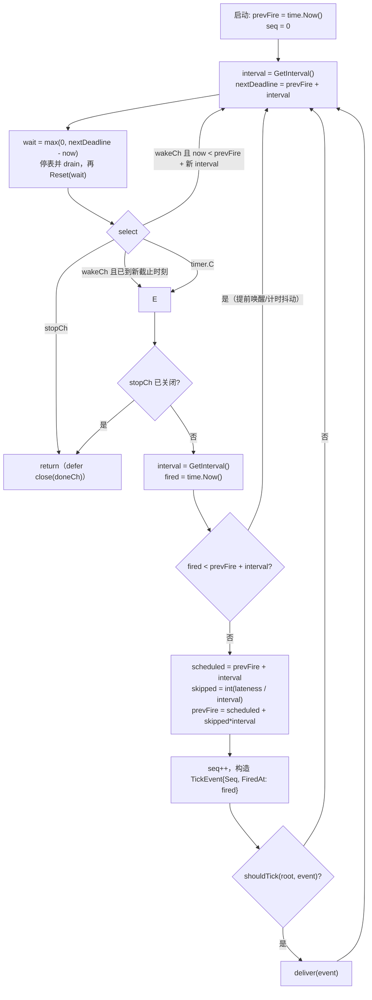
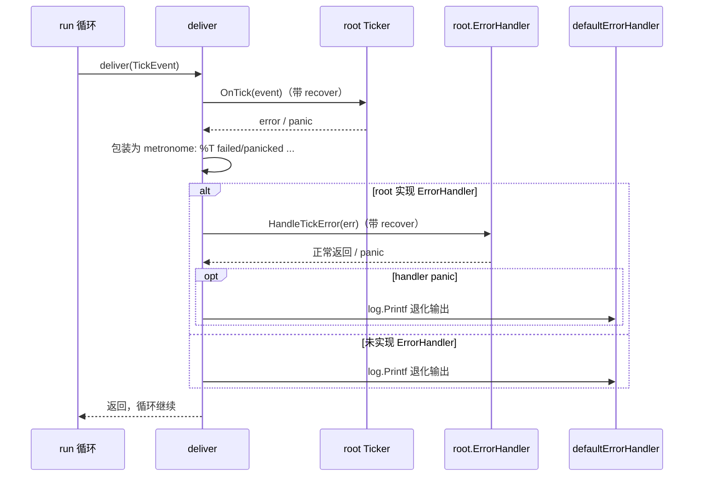

# pkg/metronome/clock.go

> 📅 最后更新日期: 2026/11/26

`pkg/metronome/clock.go` 实现节拍树的**唯一时间源头** `Clock`：它在独立 goroutine 中以固定周期驱动根 `Ticker`，以单调时钟锚定计划触发时刻，并采用「跳过错拍、不追赶」策略避免长耗时处理引发节拍风暴。根 ticker 的 error / panic 会交给其自身 `ErrorHandler`，处理器再 panic 时退化为 `log` 输出，因此时钟不会因单次节拍失败而静默停摆。

## 作用

- 提供周期性 `TickEvent` 来源，是 `Hub` 树之上唯一的驱动者（`Hub` 自身不会自转）。
- 通过 `DefaultInterval` 给出全项目默认基准周期（1 秒），`pkg/assembly`、`pkg/farm`、`pkg/plot` 等多处都以它作为默认 `interval` 传入。
- 支持运行期 `SetInterval` 动态变速，并立即唤醒等待中的循环，使新周期在**下一拍**生效。
- 把根 ticker 的失败隔离在 `deliver` 内，保证后台循环继续运行。

## 核心对象

### 常量

```go
const (
    DefaultInterval = time.Second // 默认基准周期
    joinTimeout     = 5 * time.Second
)
```

| 名称 | 导出 | 语义 |
|------|:----:|------|
| `DefaultInterval` | ✅ | 默认节拍周期，`1s`。由调用方显式传给 `NewClock`，`NewClock` 本身不会套用默认值。 |
| `joinTimeout` | ❌ | `Stop` 等待后台 goroutine 退出的上限，`5s`。超时后返回错误，但 goroutine 可能仍在运行。 |

### `type Clock`

```go
type Clock struct {
    root Ticker

    mu       sync.RWMutex // 保护 interval
    interval time.Duration

    stateMu sync.Mutex   // 保护运行状态与三个 channel
    running bool
    stopCh  chan struct{}
    doneCh  chan struct{}
    wakeCh  chan struct{} // 容量 1，用于 SetInterval 唤醒
}
```

- `root`：根 ticker，通常是 `*Hub`。构造后不可替换。
- `mu` 与 `stateMu` **分离**：周期读写不阻塞启停判断，`SetInterval` 可以只拿 `mu` 改值、再短暂拿 `stateMu` 取 `wakeCh`。
- `stopCh` / `doneCh` / `wakeCh` 每次 `Start` 重新创建，因此时钟可以停止后再次启动。
- `wakeCh` 容量为 1 且发送使用 `select + default`，多次连续改周期不会堆积唤醒信号。

### 构造：`NewClock(interval time.Duration, root Ticker) (*Clock, error)`

| 错误场景 | 返回 |
|---------|------|
| `root == nil` | `metronome: root ticker is nil` |
| `interval <= 0` | `metronome: interval must be positive, got %s`（`%s` 是 `time.Duration` 的字符串形式，如 `0s`、`-1ms`） |

构造只做校验与赋值，**不会**启动 goroutine，也**不会**调用 `root.Start()`。

### 公开方法

| 方法 | 签名 | 作用 |
|------|------|------|
| `Start` | `func (c *Clock) Start() error` | 启动后台节拍 goroutine；已运行则直接返回 `nil` |
| `Stop` | `func (c *Clock) Stop() error` | 通知循环退出并等待其结束，最多等 `5s` |
| `IsRunning` | `func (c *Clock) IsRunning() bool` | 返回 `running` 标志 |
| `GetInterval` | `func (c *Clock) GetInterval() time.Duration` | 读取当前周期 |
| `SetInterval` | `func (c *Clock) SetInterval(interval time.Duration) error` | 修改周期，下一拍起生效 |

#### `Start() error`

1. 加 `stateMu`；若 `running` 为真，直接返回 `nil`（**幂等**）。
2. 新建 `stopCh`、`doneCh`、容量 1 的 `wakeCh`，置 `running = true`。
3. `go c.run(...)` 后立即返回 `nil`。

`Start` 目前没有任何失败路径，返回值恒为 `nil`；签名保留 `error` 是为了与 `Lifecycle` 接口一致。停止后再启动会得到全新的 goroutine 与从 1 重新计数的 `Seq`。

#### `Stop() error`

1. 加 `stateMu`；若未运行，直接返回 `nil`（**幂等**）。
2. 取出 `stopCh` / `doneCh`，**先把 `running` 置为 `false`**，再释放锁。
3. `close(stopCh)`，然后在 `doneCh` 与 `time.After(joinTimeout)` 之间二选一：
   - goroutine 正常退出（`run` 的 `defer close(doneCh)`）：返回 `nil`；
   - 超过 `5s`：返回 `metronome: clock goroutine did not terminate within 5s`。

> **超时的真实含义**：`run` 只在循环顶部与 `select` 中检查 `stopCh`，一旦进入 `deliver`（即根 ticker 的 `OnTick`）就无法被打断。若某个 ticker 阻塞超过 5 秒，`Stop` 会超时返回错误，而 `running` 已经是 `false`——此时 `IsRunning()` 报"已停止"，但 goroutine 仍然活着并在返回后自行退出。

#### `IsRunning() bool`

只读 `running` 标志，不探测 goroutine 是否真的存活。因此它回答的是"是否处于已启动且未调用 `Stop` 的状态"，而不是"goroutine 是否在跑"。

#### `GetInterval() / SetInterval(interval time.Duration) error`

- `GetInterval` 取 `mu.RLock` 后返回值，可在任意 goroutine 调用。
- `SetInterval` 先校验 `interval > 0`，否则返回 `metronome: interval must be positive, got %s`；校验通过后改值、再取 `stateMu` 判断是否运行中，运行中则向 `wakeCh` 做一次非阻塞发送。
- 未运行时仅改值、不唤醒（下次 `Start` 自然使用新值）。
- 唤醒的意义：循环此时可能正 `select` 在一个按**旧周期**设置的长 timer 上；不唤醒就要等到旧截止时刻才重新计算，改周期会延迟最多一个旧周期。`TestClockSetIntervalTakesEffectOnNextTick` 正是验证这一点（200ms → 10ms，要求 120ms 内收到首拍）。

## 关键流程

### 主循环 `run`



要点：

1. **先停表再 `Reset`**：`if !timer.Stop() { select { case <-timer.C: default: } }` 清掉可能已到达的旧触发，避免"上一次的 timer 提前把这一拍打出去"。
2. **两次检查 `stopCh`**：`select` 中一次，`select` 之后、真正触发前再非阻塞检查一次，缩短"已 Stop 但仍多打一拍"的窗口（无法完全消除：若 `stopCh` 在检查之后关闭，这一拍仍会投递）。
3. **提前唤醒不触发**：`fired.Before(prevFire.Add(interval))` 为真时直接 `continue`，防止定时器抖动或 `wakeCh` 提前唤醒造成"周期被缩短"。

### 锚定与「跳过错拍、不追赶」

网格由 `prevFire`（上一次的**计划**触发时刻）与 `interval` 决定，而不是由 `fired`（实际触发时刻）决定：

| 情形 | 计算 | 结果 |
|------|------|------|
| 准时 | `fired ≈ scheduled = prevFire + interval` | `lateness ≈ 0`，`skipped = 0`，`prevFire = scheduled`，网格不漂移 |
| 轻微延后（< 1 个周期） | `lateness = fired - scheduled ∈ (0, interval)` | `skipped = 0`，`prevFire = scheduled`，下一拍仍在原网格上，间隔被压缩 |
| 明显延后（≥ 1 个周期） | 例：`interval = 10ms`、`scheduled = T+10ms`、`fired = T+35ms` | `lateness = 25ms`，`skipped = 2`，`prevFire = T+30ms`，下一截止 `T+40ms` |

由此得到几条确定的性质：

- **不补发**：被跳过的节拍**不会**逐个调用 `OnTick`，也不会占用新的 `Seq`。上例中 `T+20ms`、`T+30ms` 两拍永远不会以独立事件出现。
- **最多立即再触发一次**：若一次 `OnTick` 耗时 55ms（`interval = 10ms`），返回后 `wait` 为负被钳成 0，循环会立刻打出**一拍**（`PrevFire` 对齐到 `T+60ms`），随后按 `T+70ms`、`T+80ms` 继续，不会出现连续 5 次突发。
- **网格长期不漂移**：因为始终用 `scheduled`（而非 `fired`）推进 `prevFire`，长期平均频率仍由 `interval` 决定，误差不会累积。
- **网格间隔恒为 `interval`**：两次实际触发之间的间隔可能略小于 `interval`（上一拍迟到、下一拍仍在原网格上），但不会因为提前唤醒而变小。

> 这套策略的动机写在 `Clock` 的 doc-string 中：宁可跳过，也不要在慢处理之后集中补拍，否则下游（尤其是网络上报、注入类 ticker）会遭遇请求风暴。

### 动态改周期

`SetInterval` 的效果体现在下一次循环迭代：

- 新的截止时刻 = `prevFire + 新 interval`，即以**上一拍的计划时刻**为新锚点重新铺网格，而不是以"改周期的瞬间"为锚点。
- 若新周期很短、新截止时刻已经过去，`wakeCh` 分支的条件不成立，循环会立即触发一拍（相当于"提前到来的下一拍"），随后按新网格运行。
- 若新周期很长，`wakeCh` 唤醒后条件成立，循环 `continue` 并按照新时长重设 timer——这正是"不必等旧 timer 到期"的关键。
- 若改周期发生在 `OnTick` 执行期间，唤醒 token 会留在容量 1 的 `wakeCh` 中，`OnTick` 返回后立即被消费，不会丢失。

### 根 ticker 调用与错误隔离 `deliver`



- `OnTick` 的 panic 被 `recover` 转成 `metronome: %T panicked on tick %d: %v`；
- `OnTick` 返回的错误被包装为 `metronome: %T failed on tick %d: %w`（保留 `%w`，`errors.Is` 可穿透）；
- 若根 ticker 实现 `ErrorHandler`，错误交给 `HandleTickError`；**处理器自身 panic 时**不再向上抛，而是 `defaultErrorHandler(fmt.Errorf("metronome: %T error handler panicked: %v", ...))`；
- 未实现 `ErrorHandler` 时直接 `defaultErrorHandler(err)`，即 `log.Printf("metronome: %v", err)`（输出到标准错误）。

> Clock 只识别**根 ticker** 的 `ErrorHandler`。当根是 `*Hub` 时，子 ticker 的错误由 `Hub` 自己消化，`Hub.OnTick` 始终返回 `nil`，因此 Clock 的这条退化路径在常规装配中很少被走到。

## 使用示例

### 最小可运行时钟（Hub 作为根）

```go
package main

import (
    "fmt"
    "time"

    "github.com/Mr-xiaotian/CelestialGrow/pkg/metronome"
)

type printer struct{}

func (p *printer) OnTick(event metronome.TickEvent) error {
    fmt.Printf("seq=%d at=%s\n", event.Seq, event.FiredAt.Format(time.RFC3339Nano))
    return nil
}

func main() {
    hub, err := metronome.NewHub()
    if err != nil {
        panic(err)
    }
    if err := hub.AddTicker(&printer{}); err != nil {
        panic(err)
    }

    clock, err := metronome.NewClock(metronome.DefaultInterval, hub)
    if err != nil {
        panic(err)
    }

    // 先启动 Hub 的生命周期，再启动时钟；Clock 不会替你调用 hub.Start()。
    if err := hub.Start(); err != nil {
        panic(err)
    }
    if err := clock.Start(); err != nil {
        panic(err)
    }

    time.Sleep(3500 * time.Millisecond)

    // 提速到 200ms/拍，下一拍起生效。
    if err := clock.SetInterval(200 * time.Millisecond); err != nil {
        panic(err)
    }
    time.Sleep(time.Second)

    // 先停时钟（不再产生节拍），再停 Hub 的生命周期。
    if err := clock.Stop(); err != nil {
        panic(err)
    }
    if err := hub.Stop(); err != nil {
        panic(err)
    }
}
```

### 处理根 ticker 的失败

```go
type resilientRoot struct {
    handler func(error)
}

func (r *resilientRoot) OnTick(metronome.TickEvent) error {
    return fmt.Errorf("network unavailable")
}

// 实现 ErrorHandler：Clock 会优先调用它，而不是打印默认日志。
func (r *resilientRoot) HandleTickError(err error) {
    r.handler(err)
}

func run() error {
    root := &resilientRoot{handler: func(err error) { fmt.Println("handled:", err) }}
    clock, err := metronome.NewClock(metronome.DefaultInterval, root)
    if err != nil {
        return err
    }
    return clock.Start() // 每拍失败都会被 handle，时钟继续运行
}
```

## 注意事项

- **`OnTick` 是同步的**：根 ticker（通常是整棵 `Hub` 树）在时钟 goroutine 上串行执行，任何慢 ticker 都会推迟后续节拍，并可能让 `Stop` 超时。
- **`Stop` 超时后不会强杀 goroutine**：Go 无法中断正在执行的函数；超时只表示"等不到了"。设计 `OnTick` 时应自带超时/取消机制。
- **`Stop` 之后再 `Start` 会重置 `Seq`**：新 goroutine 从 `seq = 0` 开始，首拍仍为 `1`。
- **`Start`/`Stop` 不是为并发对撞设计的**：`Stop` 在释放 `stateMu` 之后才 `close(stopCh)`，若此时另一个 goroutine 调 `Start` 替换了 channel，`Stop` 关闭的是旧 `stopCh`、等待的是旧 `doneCh`，新循环不受影响——结果可能是"`Stop` 返回 `nil` 但时钟仍在运行"。生命周期应由单一控制方串行驱动（`pkg/assembly` 的做法即如此）。
- **时钟不管理根 ticker 的生命周期**：`NewClock`/`Start` 都不会调用 `root.Start()`。根是 `*Hub` 时必须先 `hub.Start()`（启动子 ticker）再 `clock.Start()`，停止顺序相反。
- **`interval` 越小时 `Stop` 越容易等到一次在途节拍**，但 5 秒余量通常足够；真正危险的是阻塞型 `OnTick`。
- **`FiredAt` 用单调分量参与调度**，系统改时间不会造成跳变；但日志里展示的是墙钟时间。
