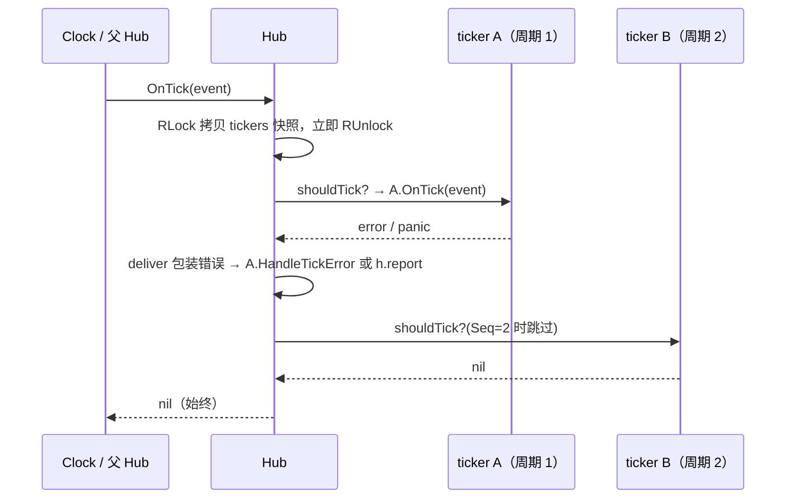
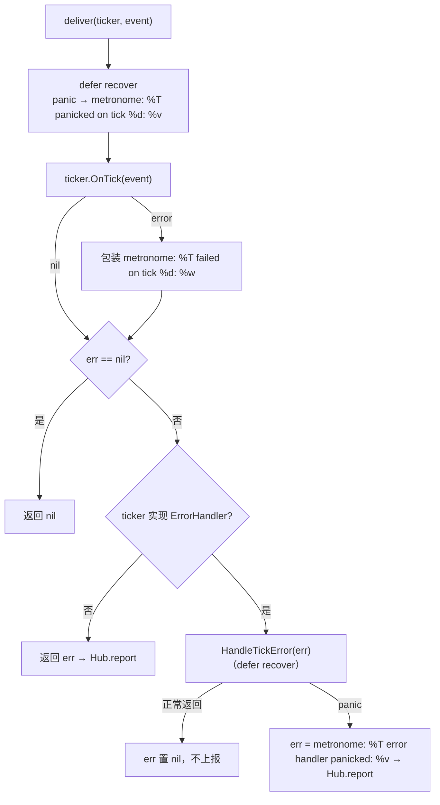
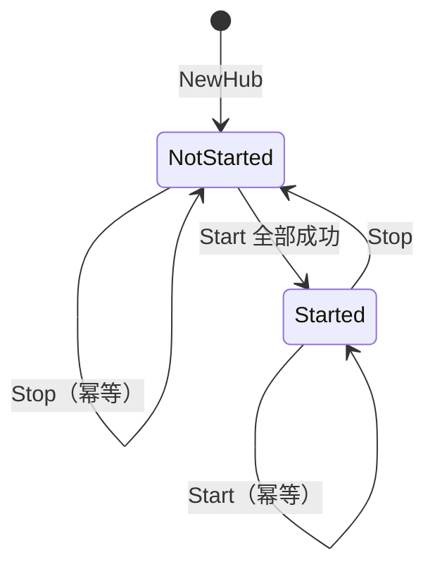
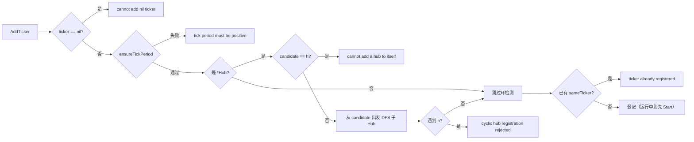

# pkg/metronome/hub.go

> 📅 最后更新日期: 2026/11/26

`pkg/metronome/hub.go` 实现节拍分发中心 `Hub`。`Hub` 自身既是 `Ticker`（`OnTick`）又是 `Periodic`（`TickPeriod`）和 `Lifecycle`（`Start`/`Stop`），因此同一份实现既能作为 `Clock` 的根接收者，也能作为子节点挂进另一棵 `Hub` 树，形成**层级分发**。每个节拍按子 ticker 的 `TickPeriod` 过滤后，**按注册顺序同步**转发；单个 ticker 的 error / panic 被隔离并交给其自身 `ErrorHandler`，否则交给 `Hub` 的默认错误处理器，绝不会中断其余 ticker。

## 作用

- **扇出**：把上游 `TickEvent` 分发给所有命中的子 ticker，并保持严格的注册顺序。
- **过滤**：按 `Periodic.TickPeriod()` 做整拍过滤，未实现 `Periodic` 的 ticker 视为周期 1。
- **隔离**：把每个子 ticker 的失败限制在自身，`OnTick` 始终返回 `nil`。
- **生命周期编排**：对实现 `Lifecycle` 的子项按注册顺序 `Start`、逆序 `Stop`，并支持运行期增删。
- **结构查询**：`Contains` 查直接子项，泛型 `Find[T]` 在整棵 Hub 树中查找第一个指定类型的 ticker（`pkg/assembly` 用它确认 `*reporter.SnapshotTicker` / `*reporter.InjectionTicker` 是否已装配）。

## 核心对象

### `type HubOption` 与配置函数

```go
type HubOption func(*Hub) error

func WithErrorHandler(handler func(error)) HubOption
func WithTickPeriod(period int) HubOption
```

| 选项 | 作用 | 失败情形 |
|------|------|---------|
| `WithErrorHandler(handler)` | 设置 `Hub` 的默认错误处理器，供"ticker 未实现 `ErrorHandler`"或"`HandleTickError` 再 panic"时使用。传 `nil` 等价于不设置（回退到默认日志）。 | 不会失败 |
| `WithTickPeriod(period)` | 设置 `Hub` 作为**子 ticker** 时的自身节拍周期，默认 `1`。 | `period < 1` → `metronome: tick period must be positive, got %d`，`NewHub` 直接返回该错误 |

选项在 `NewHub` 中按传入顺序依次应用，任一返回错误即整体失败并返回 `nil, err`。

### `type Hub`

```go
type Hub struct {
    mu      sync.RWMutex // 保护 tickers 与 period
    tickers []Ticker     // 注册顺序，分发顺序即此顺序

    lifecycleMu sync.Mutex // 串行化 Start/Stop/AddTicker/RemoveTicker
    started     bool

    period  int
    onError func(error)
}
```

- `tickers` 是**有序切片**，`OnTick` 依赖该顺序，`Find` 也依赖它做稳定查找。
- `lifecycleMu` 只被生命周期相关方法持有，`OnTick` 不取它——两者可以并行，代价是"摘除后仍可能收到一拍在途节拍"（见下文）。
- `period` 为 `Hub` 自身作为子 ticker 时的周期；`TickPeriod()` 对 `< 1` 的值做了防御性纠正（返回 1），尽管构造/设置时已校验。

### 构造：`NewHub(opts ...HubOption) (*Hub, error)`

- 默认 `period = 1`、`onError = nil`。
- 无参数时永远成功；带 `WithTickPeriod(0)` 等非法值时返回该选项的错误。

### 公开方法

| 方法 | 签名 | 作用 |
|------|------|------|
| `TickPeriod` | `func (h *Hub) TickPeriod() int` | 返回自身作为子 ticker 的周期；`< 1` 时返回 1 |
| `SetTickPeriod` | `func (h *Hub) SetTickPeriod(period int) error` | 运行期修改自身周期 |
| `AddTicker` | `func (h *Hub) AddTicker(ticker Ticker) error` | 注册子 ticker |
| `RemoveTicker` | `func (h *Hub) RemoveTicker(ticker Ticker) error` | 注销子 ticker |
| `Contains` | `func (h *Hub) Contains(ticker Ticker) bool` | 是否为**直接**子项 |
| `Start` | `func (h *Hub) Start() error` | 按注册顺序启动实现 `Lifecycle` 的子项 |
| `Stop` | `func (h *Hub) Stop() error` | 按相反顺序停止实现 `Lifecycle` 的子项 |
| `OnTick` | `func (h *Hub) OnTick(event TickEvent) error` | 分发节拍，始终返回 `nil` |

### 泛型查询：`Find[T Ticker]`

```go
func Find[T Ticker](hub *Hub) (T, bool)
```

- 类型参数 `T` 必须满足 `Ticker`；可以是具体类型（如 `*reporter.SnapshotTicker`），也可以是接口（如 `metronome.Lifecycle`）。
- 返回 `(zero, false)` 的情况：`hub == nil`、整棵树中没有匹配项。
- 内部用 `map[*Hub]struct{}` 记录已访问的 Hub，即使结构中出现异常环也不会无限递归。

## 关键流程

### 节拍分发 `OnTick`



1. **快照**：在 `mu.RLock` 下 `append([]Ticker(nil), h.tickers...)`，随后的遍历完全基于快照。因此分发期间的 `AddTicker`/`RemoveTicker` 不会改变本轮遍历集合。
2. **按注册顺序**：`for _, ticker := range tickers`，串行调用，绝不并发。前一个 ticker 执行完毕才会调用下一个，顺序可被测试稳定断言（`TestHubFansOutInRegistrationOrder` 期望 `a, b, c`）。
3. **周期过滤**：`shouldTick(ticker, event)` → `(event.Seq-1)%period == 0`；`period < 1` 视为不命中。
4. **错误隔离**：`h.deliver` 返回非 nil 时调用 `h.report(err)`，然后继续下一个 ticker。
5. **返回值恒为 `nil`**：子 ticker 的失败不会沿父 Hub 冒泡，父 Hub 也不会重复上报——每个错误只在**直接父级**处理一次。

### 单 ticker 的调用与错误收敛 `deliver`



- 有 `ErrorHandler` 且处理成功时，`err` 被显式置 `nil`，**不会**再触发 `Hub` 的默认处理器（`TestHubUsesTickerErrorHandlerBeforeDefaultReporter` 断言 `reported` 为空）。
- 有 `ErrorHandler` 但自身 panic 时，panic 被转成错误继续上报——这是"处理器本身有 bug 也不能吞掉节拍失败"的兜底。

### 默认错误处理 `report`

```go
func (h *Hub) report(err error) {
    handler := h.onError
    if handler == nil {
        handler = defaultErrorHandler
    }
    defer func() {
        if recovered := recover(); recovered != nil {
            defaultErrorHandler(fmt.Errorf("metronome: error handler panicked: %v", recovered))
        }
    }()
    handler(err)
}
```

- `h.onError` 为 `nil` 时使用 `defaultErrorHandler`：`log.Printf("metronome: %v", err)`，输出到标准错误。
- `h.onError` 自身 panic 时，退化为默认日志，`OnTick` 继续处理后续 ticker（`TestHubSurvivesDefaultErrorHandlerPanic` 验证健康 ticker 仍被调用）。
- 由于 `deliver` 已经把错误包装成 `metronome: ...`，默认日志会出现 `metronome: metronome: ...` 的双前缀——这是当前实现的实际输出，不影响语义。

### 生命周期：Start / Stop



- **`Start`**：持 `lifecycleMu`；已 `started` 则直接返回 `nil`；拷贝 `tickers` 快照后按注册顺序遍历，跳过未实现 `Lifecycle` 的项，逐个 `Start()`。
  - 某项失败时立即停止：对已成功启动的项调用 `stopReversed`（逆序 `Stop`），返回 `errors.Join(startErr, stopErr)`（回滚也失败）或仅 `startErr`；`started` **保持 `false`**，允许修复后重试。
  - 全部成功才置 `started = true`。
- **`Stop`**：持 `lifecycleMu`；未 `started` 返回 `nil`；拷贝快照、**先置 `started = false`**，再收集所有 `Lifecycle` 子项并 `stopReversed`，用 `errors.Join` 汇总全部停止错误（不会因第一个失败而跳过后续）。

`stopReversed` 的细节：从末尾向前遍历，每个错误包装为 `metronome: stop %T: %w`，最终 `errors.Join` 成一个错误（多个错误时 `Error()` 用换行拼接，`errors.Is` 仍可逐个匹配）。

### 运行期 Add / Remove

| 场景 | 行为 |
|------|------|
| Hub 未启动时 `AddTicker` | 只登记，不调用 `Start` |
| Hub 已启动时 `AddTicker` | 若 ticker 实现 `Lifecycle`，**先 `Start` 再登记**；`Start` 失败则返回 `metronome: start %T: %w`，**不登记**，且不会自动回滚该 ticker 的内部状态 |
| Hub 未启动时 `RemoveTicker` | 直接从切片摘除，不调用 `Stop` |
| Hub 已启动时 `RemoveTicker` | **先摘除再 `Stop`**；`Stop` 失败仍保持"已摘除"，返回 `metronome: stop %T: %w` |

"先启动后登记 / 先摘除后停止"的顺序保证：新 ticker 不会在半初始化状态下收到节拍；被移除的 ticker 不会再通过**新建立的**快照收到节拍。

> 例外：`OnTick` 在摘除**之前**已拷贝了快照，因此正在分发的这一轮仍可能给"刚刚被摘除、正在被 Stop"的 ticker 再送一拍。生命周期与分发之间的隔离是"尽力而为"，不是严格屏障。

### 环检测与重复注册

`AddTicker` 的校验顺序：`nil` → 周期合法性 → `rejectCycle` → 判重 → 登记。



- **自环**：`a.AddTicker(a)` → `metronome: cannot add a hub to itself`。
- **间接环**：`a.AddTicker(b)` 成功后 `b.AddTicker(a)` → `metronome: cyclic hub registration rejected: target hub already contains this hub`（`TestHubRejectsCyclicRegistration`）。
- **判重用 `sameTicker`**：

  ```go
  leftType := reflect.TypeOf(left)
  rightType := reflect.TypeOf(right)
  if leftType == nil || rightType == nil || leftType != rightType { return false }
  if !leftType.Comparable() { return false }
  return left == right
  ```

  - 动态类型不同 → 永不相等；
  - 类型不可比较（如 `TickerFunc`、包含 slice/map 字段的值类型）→ **不判重**，可重复注册；
  - 可比较类型 → 用 `==` 判断，即指针结构体按**实例地址**判等（`TestHubRejectsDuplicateRegistration` 用同一 `*periodProbe` 验证）。

### `Contains` 与 `Find` 的查找语义

- `Contains(ticker)`：只检查**直接**子项，同样使用 `sameTicker`。因此 `Hub` 不会报告"孙子节点"是否存在，`TickerFunc` 永远返回 `false`。
- `Find[T](hub)`：按层推进的深度优先——
  1. 先看当前 Hub 的**所有直接子项**中是否有类型 `T`（按注册顺序，取第一个）；
  2. 再按注册顺序递归进入子 `*Hub`。
  
  因此"就近优先"：若父 Hub 同时注册了 `childHub` 和 `tickerX`，且两者都能匹配 `T`，`tickerX` 会先被返回，即使 `childHub` 在注册顺序上更靠前。`Find` 不会匹配传入的 `hub` 自身（只检查其子项与子树）。

## 重要细节

### 错误信息一览

| 触发点 | 错误文本 |
|--------|---------|
| `AddTicker(nil)` | `metronome: cannot add nil ticker` |
| 周期非法（`AddTicker` / `NewHub` / `SetTickPeriod`） | `metronome: tick period must be positive, got %d` |
| 自注册 | `metronome: cannot add a hub to itself` |
| 间接成环 | `metronome: cyclic hub registration rejected: target hub already contains this hub` |
| 重复注册 | `metronome: ticker already registered` |
| 运行期 `AddTicker` 启动失败 | `metronome: start %T: %w` |
| `RemoveTicker(nil)` | `metronome: cannot remove nil ticker` |
| 移除未注册项 | `metronome: ticker is not registered` |
| 运行期 `RemoveTicker` 停止失败 | `metronome: stop %T: %w` |
| `OnTick` panic | `metronome: %T panicked on tick %d: %v` |
| `OnTick` 返回错误 | `metronome: %T failed on tick %d: %w` |
| ticker 的 `HandleTickError` panic | `metronome: %T error handler panicked: %v` |
| `Hub.onError` panic | 默认日志输出 `metronome: metronome: error handler panicked: %v`（内层错误自带前缀，`log.Printf` 再加一层） |

### 并发与锁

- `mu`（`RWMutex`）保护 `tickers` 与 `period`。`OnTick`/`Find`/`Contains`/`TickPeriod` 只取读锁，并在锁内完成快照拷贝，**不在持锁状态下调用任何 ticker**——因此 ticker 在 `OnTick` 中回调 `hub.AddTicker` / `hub.Contains` 不会自死锁。
- `lifecycleMu` 串行化 `Start`/`Stop`/`AddTicker`/`RemoveTicker`，避免"启动与停止交叉""重复启动同一子项"。
- `Start`/`Stop` 在持有 `lifecycleMu` 时仍会短暂取 `mu` 读写 `tickers`，锁顺序始终是 `lifecycleMu → mu`；`OnTick` 只取 `mu`，不会反向持锁，因此无死锁环。
- `OnTick` 与生命周期变更可以并发：`Hub` 不保证"ticker 停止后绝不再收到节拍"（见上文的在途快照）。

### 与 `Clock` 的职责边界

- `Hub` **不会自己产生节拍**：必须由 `Clock`（或父 `Hub`）调用 `OnTick`。测试中直接手工调用 `hub.OnTick(TickEvent{Seq: 1})`，这正是无时钟场景的合法用法。
- `Clock` **不会调用**根 `Hub` 的 `Start`/`Stop`。标准顺序是 `hub.Start()` → `clock.Start()`，停止时 `clock.Stop()` → `hub.Stop()`（`pkg/assembly` 的 `startResources` 即此模式）。
- 因为 `Hub` 实现了 `Lifecycle`，把子 `Hub` 注册进**已启动**的父 Hub 会自动 `child.Start()`；父 Hub `Stop` 时会逆序停止子 Hub，从而递归停止整棵子树。

### `Periodic` 与 `TickPeriod` 的关系

`Hub` 自身的 `TickPeriod()` 只在它作为**子 ticker** 时被父 Hub/Clock 读取；它不会影响自己向子 ticker 分发的过滤逻辑（过滤只看子 ticker 的周期）。`WithTickPeriod(2)` 表示"这个子树每两拍才收到一次节拍"，子树内部看到的 `Seq` 会是 `1, 3, 5, ...`（因为父层传入的 `Seq` 未重编号）。

## 使用示例

### 层级 Hub + 周期过滤 + 自定义错误处理

```go
package main

import (
    "errors"
    "fmt"
    "time"

    "github.com/Mr-xiaotian/CelestialGrow/pkg/metronome"
)

type counter struct {
    name   string
    period int
    n      int
}

func (c *counter) TickPeriod() int { return c.period }

func (c *counter) OnTick(event metronome.TickEvent) error {
    c.n++
    fmt.Printf("[%s] seq=%d 第 %d 次执行\n", c.name, event.Seq, c.n)
    return nil
}

type faulty struct{}

func (faulty) OnTick(metronome.TickEvent) error { return errors.New("boom") }

func main() {
    // 子 Hub：每 3 拍才从父 Hub 收到一次节拍。
    child, err := metronome.NewHub(metronome.WithTickPeriod(3))
    if err != nil {
        panic(err)
    }
    if err := child.AddTicker(&counter{name: "child-odd", period: 2}); err != nil {
        panic(err)
    }

    parent, err := metronome.NewHub(metronome.WithErrorHandler(func(err error) {
        fmt.Println("hub 默认处理器:", err)
    }))
    if err != nil {
        panic(err)
    }

    // 注册顺序即分发顺序。
    for _, t := range []metronome.Ticker{
        &counter{name: "fast", period: 1},
        faulty{},
        &counter{name: "slow", period: 4},
        child,
    } {
        if err := parent.AddTicker(t); err != nil {
            panic(err)
        }
    }

    // 启动生命周期（child 会被递归启动），再由 Clock 驱动。
    if err := parent.Start(); err != nil {
        panic(err)
    }
    clock, err := metronome.NewClock(100*time.Millisecond, parent)
    if err != nil {
        panic(err)
    }
    if err := clock.Start(); err != nil {
        panic(err)
    }

    time.Sleep(time.Second)

    if err := clock.Stop(); err != nil {
        panic(err)
    }
    if err := parent.Stop(); err != nil {
        panic(err)
    }

    // 泛型查找：确认某类型是否已装配。
    if c, ok := metronome.Find[*counter](parent); ok {
        fmt.Println("找到 counter:", c.name)
    }
}
```

### 运行期增删

```go
hub, _ := metronome.NewHub()
if err := hub.Start(); err != nil { // 先启动空 Hub
    panic(err)
}

t := &counter{name: "late", period: 1}
if err := hub.AddTicker(t); err != nil { // 已启动 → 立即 Start（若实现 Lifecycle）
    panic(err)
}

// 摘除后立即 Stop（若实现 Lifecycle）；此后的新一轮节拍不再包含它。
if err := hub.RemoveTicker(t); err != nil {
    panic(err)
}
_ = hub.Stop()
```

## 注意事项

- **分发是同步串行的**：任何 ticker 阻塞都会推迟同轮后续 ticker，并可能让 `Clock.Stop` 在 5 秒后超时。需要并行处理的 ticker 应自行把工作投递到队列/goroutine。
- **`OnTick` 永远返回 `nil`**：不要企图通过 `hub.OnTick` 的返回值感知下游失败；请使用 `WithErrorHandler` 或让 ticker 实现 `ErrorHandler`。
- **`Find` 只返回第一个匹配项**，且"就近优先"；同名类型的多个实例需要自己遍历或改用 `Contains` + 显式引用。
- **`TickerFunc` 无法判重也无法被 `Contains`/`Find` 稳定识别**：`sameTicker` 对不可比较类型直接返回 `false`；需要去重语义时请用指针结构体。
- **注册顺序是契约**：`Start` 顺序、`OnTick` 分发顺序、`Stop` 逆序都依赖切片顺序；运行期 `RemoveTicker` 会把后面的元素前移，但不改变剩余元素的相对顺序。
- **`Start` 失败后 `started` 仍为 `false`**，已回滚的项不应再被单独 `Stop`；修复后可直接重试 `Start`。
- **`RemoveTicker` 的 `Stop` 失败不会把 ticker 放回**：错误只表示"停止时报错"，注册关系已经变更，调用方需自行决定是否重试停止或重新注册。
- **默认错误处理器写标准错误**：`log.Printf("metronome: %v", err)`，长期运行且错误频繁时建议显式提供 `WithErrorHandler` 做限流/聚合。
