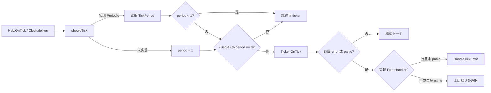

# pkg/metronome/ticker.go

> 📅 最后更新日期: 2026/11/26

`pkg/metronome/ticker.go` 定义了节拍系统的最小契约：**接收者** `Ticker`，以及三个可选能力接口 `Lifecycle`、`ErrorHandler`、`Periodic`。`Clock` 与 `Hub` 只依赖这些接口，因此业务侧只需实现 `OnTick` 即可接入，按需再补齐生命周期、错误处理与周期过滤。

## 作用

- `Ticker`：任何想接收节拍的类型必须实现的唯一方法。
- `Lifecycle`：让 `Hub` 统一管理子资源的启动/停止（`Start` 正序、`Stop` 逆序）。
- `ErrorHandler`：让 ticker 自行消化错误，而不是让错误冒泡到 Hub 的默认处理器。
- `Periodic`：声明"每 N 拍触发一次"，由上层在分发前过滤。
- `TickerFunc`：把普通函数适配为 `Ticker`，省去为一次性逻辑定义结构体。

## 核心对象

### `type Ticker interface`

```go
type Ticker interface {
    OnTick(event TickEvent) error
}
```

- 仅当 `shouldTick` 判定命中（未实现 `Periodic` 时视为周期 1，即每拍命中）才会被调用。
- 返回的 `error` 会被上层 `Hub` 或 `Clock` 捕获并交给错误处理器，**不会中断其余 ticker**。
- `OnTick` 在分发方（`Clock` 的后台 goroutine 或父 `Hub` 的调用栈）中**同步执行**，因此慢 ticker 会拖慢整条节拍链。

### `type Lifecycle interface`

```go
type Lifecycle interface {
    Start() error
    Stop() error
}
```

`Hub` 在注册项中识别该接口：`Start` 按注册顺序调用，`Stop` 按相反顺序调用。**未实现该接口的 ticker 只参与节拍分发**，`Hub` 不会对它们做任何启动/停止动作。

> `Hub` 自身也实现了 `Start`/`Stop`，因此它同时满足 `Lifecycle`——这正是嵌套 Hub 能被父 Hub 递归启动/停止的原因。

### `type ErrorHandler interface`

```go
type ErrorHandler interface {
    HandleTickError(err error)
}
```

当 `OnTick` 返回 error 或 panic 时，`Hub`/`Clock` **优先**调用该钩子，并传入已经包装过的错误（形如 `metronome: *T failed on tick 7: ...`）。只有以下情况才退化到上层默认处理器：

- ticker 未实现 `ErrorHandler`；
- `HandleTickError` 自身 panic。

### `type Periodic interface`

```go
type Periodic interface {
    TickPeriod() int
}
```

- 返回值必须为正整数：`1` 表示每拍触发，`2` 表示每两拍触发一次。
- `Hub`/`Clock` **每次分发前都会重新读取**该值，因此实现方可以在运行期动态调整周期。
- `AddTicker` 会在注册时校验一次（非法值直接返回错误），但运行期若 `TickPeriod()` 返回 `< 1`，`shouldTick` 会静默跳过该 ticker（不报错、不触发）。

### `type TickerFunc`

```go
type TickerFunc func(event TickEvent) error

func (f TickerFunc) OnTick(event TickEvent) error
```

- 适配器：`OnTick` 直接调用被包装的函数并透传返回值。
- 函数类型**不可比较**，因此 `Hub` 的判重逻辑（`sameTicker`）不会把两个 `TickerFunc` 视为同一实例——**同一个 `TickerFunc` 值可以被重复注册多次**，每次都会收到节拍。测试 `TestHubFansOutInRegistrationOrder` 正是利用这一点注册了三个 `TickerFunc`。
- `nil` 的 `TickerFunc` 可以放进接口（接口本身非 nil），但调用 `OnTick` 会 panic；`Clock`/`Hub` 的 recover 会把它转成错误，而不是让进程崩溃。

### 未导出的辅助函数（行为约定）

| 函数 | 行为 |
|------|------|
| `ensureTickPeriod(period int) error` | `period < 1` 时返回 `metronome: tick period must be positive, got %d`。 |
| `tickPeriod(ticker Ticker) int` | 实现 `Periodic` 则取其返回值，否则返回 `1`。 |
| `shouldTick(ticker Ticker, event TickEvent) bool` | `period < 1` 返回 `false`；否则返回 `(event.Seq-1)%period == 0`。 |

## 关键流程



## 重要细节

- **接口是隐式的**：ticker 无需显式声明"实现某接口"，只要方法集匹配即可被 `type assertion` 识别。典型组合是四种能力自由拼接，例如"既实现 `Periodic` 又实现 `Lifecycle`"。
- **周期过滤使用 `(Seq-1) % period`**：`Seq` 从 1 开始，因此 `period = 2` 命中 `1, 3, 5, ...`（奇数拍），而不是 `2, 4, 6, ...`。这是很容易写错的边界。
- **周期在注册时校验、在分发时读取**：`AddTicker` 校验的是"注册那一刻"的 `TickPeriod()`；之后实现方若把它改成 `0`，注册不会失败，但该 ticker 会永久静默跳过。
- **错误处理器只收到"包装后的错误"**：`errors.Is` / `errors.As` 仍可穿透 `%w` 包装定位原始错误，`TestHubIsolatesTickerError` 就是这么断言的。
- **`HandleTickError` 没有返回值**：它无法"再次上报"给上层；想要回退到 Hub 默认处理器，只能通过 panic（随后被 recover 转成错误交给 `Hub.report`）。

## 使用示例

### 最小 ticker + 周期 + 生命周期

```go
package main

import (
    "fmt"
    "time"

    "github.com/Mr-xiaotian/CelestialGrow/pkg/metronome"
)

// Sampler 每 5 拍采样一次，并演示生命周期的接入方式。
type Sampler struct {
    name   string
    closed bool
}

func (s *Sampler) TickPeriod() int { return 5 } // 实现 Periodic

func (s *Sampler) Start() error { // 实现 Lifecycle
    fmt.Println(s.name, "started")
    return nil
}

func (s *Sampler) Stop() error {
    s.closed = true
    fmt.Println(s.name, "stopped")
    return nil
}

func (s *Sampler) OnTick(event metronome.TickEvent) error { // 实现 Ticker
    fmt.Println(s.name, "sample at seq", event.Seq, event.FiredAt.Format(time.RFC3339))
    return nil
}

// 可选：自行处理错误，避免落到 Hub 的默认日志。
func (s *Sampler) HandleTickError(err error) { // 实现 ErrorHandler
    fmt.Println(s.name, "tick error:", err)
}
```

### 用 `TickerFunc` 写一次性逻辑

```go
hub, err := metronome.NewHub()
if err != nil {
    panic(err)
}

ticks := 0
if err := hub.AddTicker(metronome.TickerFunc(func(event metronome.TickEvent) error {
    ticks++
    fmt.Println("tick", event.Seq)
    return nil
})); err != nil {
    panic(err)
}
```

`TickerFunc` 的 `TickPeriod()` 不存在，因此按周期 1 每拍触发；它也不实现 `Lifecycle`，`Hub.Start`/`Stop` 不会对它做任何事。

## 注意事项

- **接口拆分而非大接口**：只实现 `OnTick` 就是合法 ticker；不要为了"看起来完整"而实现空转的 `Start`/`Stop`——一旦实现 `Lifecycle`，`Hub` 就会在启动/停止时真的调用它们，失败还会中断 `Hub` 的启停流程。
- **`OnTick` 要快**：它位于时钟 goroutine（或父 ticker 的调用栈）上，阻塞会直接推迟后续节拍，并可能让 `Clock.Stop` 在 5 秒后超时返回错误。
- **`Periodic` 返回值不要动态缩到 0**：`shouldTick` 会静默跳过，表现为"ticker 莫名不再触发"。
- **`TickerFunc` 不能判重**：需要"同一实例只注册一次"的语义时，请使用指针结构体，而不是函数适配器。
- **`ErrorHandler` 不是万能兜底**：它自身 panic 时，`Hub` 会退化为默认日志，`Clock` 也会退化为默认日志——两层都有 recover，但错误信息里会多出"error handler panicked"的包装。
