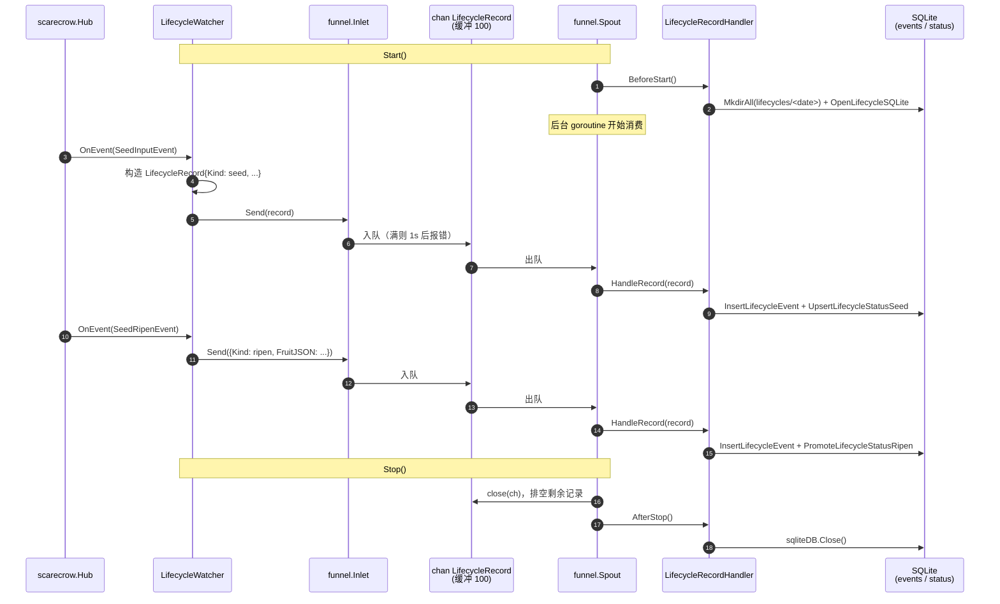

# pkg/persist/lifecycle.go

> 📅 最后更新日期: 2026/11/13

## 作用

`pkg/persist/lifecycle.go` 把 `pkg/scarecrow` 的运行期事件翻译成 **生命周期记录**，并异步写入 SQLite：

- 实现 `scarecrow.Watcher` 的 `LifecycleWatcher` 负责「事件 → `LifecycleRecord`」的转换与投递；
- `LifecycleRecordHandler` 实现 `funnel.RecordHandler[LifecycleRecord]`，负责「记录 → SQLite」的落库；
- 两者由 `funnel.Spout` / `funnel.Inlet` 连接：`Spout` 在后台 goroutine 串行消费，`Inlet` 负责并发安全的投递。

每颗种子在库里由两类数据表达：`events`（事件本体 + `event_parents` 父边）与 `status`（以 `input_event_id` 为主键的最新状态快照）。本文件本身不写 SQL，建表与增删改查全部在 [`sqlite.md`](./sqlite.md) 中实现。

> 本文件只依赖 `pkg/funnel` 与 `pkg/scarecrow`，不直接引用 `pkg/runtime`；事件 ID 由事件结构体携带（`SeedID` / `FruitID` / `WeedID` / `PruneID`），持久化层原样落库。

## 核心对象

### `LifecycleRecord` — 队列载荷

```go
type LifecycleRecord struct {
    Kind           string
    InputEventID   int
    CurrentEventID int
    ParentIDs      []int
    PlotName       string
    SeedJSON       string
    FruitJSON      string
    WitherType     string
    WitherMessage  string
    TS             float64
}
```

| 字段 | 含义 |
|------|------|
| `Kind` | 操作类型，取包内常量 `lifecycleSeed` / `lifecycleRipen` / `lifecycleWither` / `lifecyclePrune`（即 `seed` / `ripen` / `wither` / `prune`）；同时作为 `events.event_type` 落库 |
| `InputEventID` | 本颗种子（输入）的事件 ID，对应 `status.input_event_id` |
| `CurrentEventID` | 本次产生的事件 ID，对应 `events.event_id` 与 `status.current_event_id`；`seed` 时等于 `InputEventID` |
| `ParentIDs` | 父事件 ID 列表，写入 `event_parents` 边；外部注入的种子为 `nil` |
| `PlotName` | 事件所属 Plot 名称，写入 `events.plot` 与 `status.plot` |
| `SeedJSON` | 种子载荷 JSON，仅 `seed` 记录填写 |
| `FruitJSON` | 果实 JSON，仅 `ripen` 记录填写 |
| `WitherType` | 枯萎错误类型，仅 `wither` 记录填写（`fmt.Sprintf("%T", err)`） |
| `WitherMessage` | 枯萎错误文本，仅 `wither` 记录填写（`fmt.Sprintf("%v", err)`） |
| `TS` | 事件时间（Unix 秒，浮点，毫秒精度），由事件的 `Time` 字段换算 |

### `LifecycleRecordHandler` — 消费端

```go
type LifecycleRecordHandler struct {
    SQLitePath string
    sqliteDB   *sql.DB
}
```

实现 `funnel.RecordHandler[LifecycleRecord]`：

| 方法 | 触发时机 | 行为 |
|------|----------|------|
| `BeforeStart() error` | `Spout.Start()` 内、消费循环启动前 | 创建 `lifecycles/<YYYY-MM-DD>/`（权限 `0755`），拼出 `grow_lifecycle(<HH-MM-SS.mmm>).sqlite3` 路径，调用 `OpenLifecycleSQLite` 打开库并建表；路径存入 `SQLitePath`，句柄存入 `sqliteDB` |
| `HandleRecord(record LifecycleRecord) error` | 每条记录出队 | 先校验 `sqliteDB != nil`，再按 `Kind` 先写事件、后写/晋升状态快照 |
| `AfterStop() error` | `Spout.Stop()` 收尾 | 关闭 `sqliteDB` 并置空；句柄本就为空时直接返回 `nil` |

> `SQLitePath` 是公开字段，`AfterStop` 后仍保留最后一次打开的路径；离线读取通过 `LoadLifecycleStatusesFromPath`（见 [`sqlite.md`](./sqlite.md)）完成，`LifecycleRecordHandler` 本身不再提供查询方法。

### `LifecycleWatcher` — 事件观察者

```go
type LifecycleWatcher struct {
    spout *funnel.Spout[LifecycleRecord]
    inlet *funnel.Inlet[LifecycleRecord]
}
```

| 方法 | 行为 |
|------|------|
| `NewLifecycleWatcher() *LifecycleWatcher` | 用默认 `LifecycleRecordHandler` 构造：`funnel.NewSpout(handler, 100, time.Second)` + `funnel.NewInlet(spout.GetQueue(), time.Second)` |
| `Start() error` | 委托 `spout.Start()`：触发 `BeforeStart` 建目录、开库，并启动后台消费 goroutine |
| `Stop() error` | 委托 `spout.Stop()`：关闭通道、等待队列排空（最多 1s），最后 `AfterStop` 关库；超时返回 `shutdown timeout` |
| `DBPath() string` | 返回底层 handler 的 `SQLitePath`；消费循环尚未 `Start` 时为空串 |
| `OnEvent(event scarecrow.Event) error` | 按事件类型构造 `LifecycleRecord` 并 `inlet.Send`；未关心的事件直接返回 `nil` |

> `newLifecycleWatcher(handler funnel.RecordHandler[LifecycleRecord])` 是包内构造函数，测试用它注入捕获型 handler。此时 `DBPath()` 会因 handler 不是 `*LifecycleRecordHandler` 而返回空串。

## 事件映射

`OnEvent` 只处理 4 类种子结果事件，其余事件一律忽略：

| `scarecrow` 事件 | `Kind` | `InputEventID` | `CurrentEventID` | `ParentIDs` | 载荷 |
|------------------|--------|----------------|------------------|-------------|------|
| `SeedInputEvent` | `seed` | `SeedID` | `SeedID` | `ev.Parents` | `SeedJSON = toLifecycleJSON(ev.Seed)` |
| `SeedRipenEvent` | `ripen` | `SeedID` | `FruitID` | `[]int{ev.SeedID}` | `FruitJSON = toLifecycleJSON(ev.Fruit)` |
| `SeedWitherEvent` | `wither` | `SeedID` | `WeedID` | `[]int{ev.SeedID}` | `WitherType = %T(ev.Err)`、`WitherMessage = %v(ev.Err)` |
| `SeedPruneEvent` | `prune` | `SeedID` | `PruneID` | `[]int{ev.SeedID}` | 无 |

被显式忽略（`return nil`，不入库）的事件：`FarmStartEvent`、`FarmEndEvent`、`PlotStartEvent`、`PlotEndEvent`、`SeedReplantEvent`、`SealInputEvent`、`SealMergeEvent`。包外无法新增事件类型（`scarecrow.Event` 的 `isEvent()` 是私有方法），因此 switch 之外的兜底分支实际不会被触发。

时间戳统一由 `unixSeconds(ev.Time)` 生成：

```go
func unixSeconds(t time.Time) float64 {
    return float64(t.UnixMilli()) / 1000
}
```

因此 `TS` 精确到毫秒，且与事件发生时间一致，不受队列积压影响。

## 关键流程



### `HandleRecord` 的 Kind 路由

```go
func (l *LifecycleRecordHandler) HandleRecord(record LifecycleRecord) error {
    if l.sqliteDB == nil {
        return fmt.Errorf("生命周期 sqlite 未初始化")
    }

    switch record.Kind {
    case lifecycleSeed:
        if err := InsertLifecycleEvent(l.sqliteDB, record.CurrentEventID, record.Kind, record.PlotName, record.TS, record.ParentIDs); err != nil {
            return err
        }
        return UpsertLifecycleStatusSeed(l.sqliteDB, record.InputEventID, record.SeedJSON, record.PlotName, record.TS)
    // ripen / wither / prune 同理：先 InsertLifecycleEvent，再 PromoteLifecycleStatusXxx
    default:
        return fmt.Errorf("unsupported lifecycle operation: %s", record.Kind)
    }
}
```

要点：

- 四种 `Kind` 都先写 `events`（含 `event_parents` 父边），成功后才写 `status`；事件写入失败时状态不会变更，两者保持一致。
- `ripen` / `wither` / `prune` 通过 `UPDATE status ... WHERE input_event_id = ?` 晋升，因此要求对应的 `seed` 记录已先落库（`UPDATE` 未命中不会报错，见 [`sqlite.md`](./sqlite.md)）。
- `kind` 非法时返回 `unsupported lifecycle operation: <kind>`；`sqliteDB == nil` 时返回 `生命周期 sqlite 未初始化`。
- 所有错误都原样向上返回，由 `Spout` 的消费循环丢弃（`Spout` 不检查 `HandleRecord` 的返回值）；如需观测写入失败，只能依赖 SQLite 文件本身或日志。

### DB 路径与目录

```text
lifecycles/<YYYY-MM-DD>/grow_lifecycle(<HH-MM-SS.mmm>).sqlite3
```

- 日期 `2006-01-02`、时间 `15-04-05.000` 在 `BeforeStart` 中各取一次 `time.Now()`；同一天多次启动会得到多个文件。
- 目录权限 `0755`；文件由 `sql.Open("sqlite", "file:...")` 自动创建，`BeforeStart` 不显式建文件。
- `os.MkdirAll` 失败 → `创建生命周期目录失败: %w`；打开库失败 → `打开生命周期 sqlite 失败: %w`。
- `Start` 失败时不会留下已启动的消费循环；`assembly` 会在 `Start` 成功后才把观察者注册进 Hub。

### `toLifecycleJSON` 兜底

```go
func toLifecycleJSON(value any) string {
    data, err := json.Marshal(value)
    if err == nil {
        return string(data)
    }
    lifecycle, lifecycleErr := json.Marshal(fmt.Sprintf("%+v", value))
    if lifecycleErr == nil {
        return string(lifecycle)
    }
    return `"marshal_error"`
}
```

优先 `json.Marshal`；失败时退化为 `fmt.Sprintf("%+v", value)` 的 JSON 字符串；再次失败写死 `"marshal_error"`。返回的始终是合法 JSON 文本，`status.seed_json` 不会出现 `NULL`。

## 公开符号清单

| 符号 | 类别 | 用途 |
|------|------|------|
| `LifecycleRecord` | 类型 | 队列载荷（`Kind` + 事件字段 + 状态字段） |
| `LifecycleRecordHandler` | 类型 | `funnel.RecordHandler[LifecycleRecord]` 实现，负责落库 |
| `(*LifecycleRecordHandler).BeforeStart` | 方法 | 建目录、开库、建表 |
| `(*LifecycleRecordHandler).HandleRecord` | 方法 | 按 `Kind` 写事件并推进状态 |
| `(*LifecycleRecordHandler).AfterStop` | 方法 | 关闭数据库句柄 |
| `LifecycleWatcher` | 类型 | `scarecrow.Watcher` 实现，事件 → 记录 |
| `NewLifecycleWatcher` | 函数 | 创建观察者（默认 handler、缓冲 100、超时 1s） |
| `(*LifecycleWatcher).Start` | 方法 | 启动消费循环并打开数据库 |
| `(*LifecycleWatcher).Stop` | 方法 | 停止消费循环、刷盘并关库 |
| `(*LifecycleWatcher).DBPath` | 方法 | 返回本次运行的 SQLite 路径 |
| `(*LifecycleWatcher).OnEvent` | 方法 | 事件翻译与投递 |

> `lifecycleSeed` / `lifecycleRipen` / `lifecycleWither` / `lifecyclePrune`、`newLifecycleWatcher`、`unixSeconds`、`toLifecycleJSON` 均为包内私有符号。

## 使用示例

以 `scarecrow.Hub` 为分发中心，启动观察者后发送事件，结束后按 `DBPath()` 离线读取：

```go
package main

import (
    "errors"
    "fmt"
    "time"

    "github.com/Mr-xiaotian/CelestialGrow/pkg/persist"
    "github.com/Mr-xiaotian/CelestialGrow/pkg/scarecrow"
)

func main() {
    hub := scarecrow.NewHub()
    watcher := persist.NewLifecycleWatcher()
    if err := hub.AddWatcher(watcher); err != nil {
        panic(err)
    }
    if err := watcher.Start(); err != nil {
        panic(err)
    }

    now := time.Now()
    events := []scarecrow.Event{
        scarecrow.SeedInputEvent{Plot: "stage_a", Seed: 1, SeedID: 1, Time: now},
        scarecrow.SeedRipenEvent{Plot: "stage_a", Seed: 1, Fruit: 2, SeedID: 1, FruitID: 2, Time: now},
        scarecrow.SeedInputEvent{Plot: "stage_a", Seed: 2, SeedID: 3, Time: now},
        scarecrow.SeedWitherEvent{Plot: "stage_a", Seed: 2, Err: errors.New("boom"), SeedID: 3, WeedID: 4, Time: now},
    }
    for _, event := range events {
        if err := hub.OnEvent(event); err != nil {
            panic(err)
        }
    }

    if err := watcher.Stop(); err != nil {
        panic(err)
    }

    // Stop 后 SQLitePath 仍保留，可离线查询
    dbPath := watcher.DBPath()
    statuses, err := persist.LoadLifecycleStatusesFromPath(dbPath, "stage_a")
    if err != nil {
        panic(err)
    }
    for _, status := range statuses {
        fmt.Println(status.InputEventID, status.CurrentEventID, status.Status, status.WitherMessage)
    }
}
```

运行后在 `lifecycles/<date>/grow_lifecycle(<time>).sqlite3` 的 `status` 表中得到两行：`1 2 ripen` 与 `3 4 wither boom`。

## 注意事项

- **必须先 `Start` 再收事件**：`BeforeStart` 才会初始化 `sqliteDB`，否则 `HandleRecord` 返回 `生命周期 sqlite 未初始化`；该错误会被 `Spout` 丢弃，表现为「事件静默丢失」。
- **`OnEvent` 会阻塞调用方**：投递使用容量 100 的缓冲通道、超时 1s；队列满时 `OnEvent` 返回 `inlet send timeout after 1s`，`Hub` 会把它交给 `ErrorHandler`。观察者不应在 `OnEvent` 中做重活。
- **`Spout.Stop` 的刷盘语义**：先 `close(ch)` 让消费循环排空剩余记录；若 1s 内未排空则取消上下文并返回 `shutdown timeout`，随后无论是否超时都会关闭数据库。因此高频写入后应立即 `Stop`，不要依赖进程退出。
- **`DBPath()` 只对默认 handler 有效**：`DBPath` 用类型断言取 `*LifecycleRecordHandler.SQLitePath`，注入自定义 handler（如测试）时返回空串；调用方应把空串视为「数据库不可用」。
- **`AfterStop` 后句柄置空但路径保留**：因此 `DBPath()` 在 `Stop` 之后仍可返回路径，配合 `LoadLifecycleStatusesFromPath` 做离线查询（`Plot.Harvest` 即按此方式实现）。
- **状态晋升依赖 seed 先落库**：`Promote*` 是 `UPDATE`，目标行不存在时影响 0 行且不报错；上游必须保证 `SeedInputEvent` 先于对应的 `Ripen` / `Wither` / `Prune` 事件投递。
- **错误信息为 `fmt.Sprintf` 形式**：`WitherType` / `WitherMessage` 分别取 `%T` / `%v`，包装过的错误会丢失错误链，只保留最外层文本。
- **时间戳来自事件**：`TS` 由 `ev.Time` 计算（毫秒精度），与 `time.Now()` 无关，回放事件时能得到与原始运行一致的时间轴。
