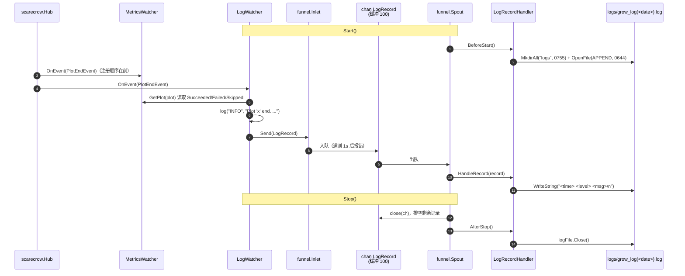

# pkg/persist/log.go

> 📅 最后更新日期: 2026/11/13

## 作用

`pkg/persist/log.go` 把 `pkg/scarecrow` 的运行期事件翻译成文本日志，并异步追加到文件：

- `LogWatcher` 实现 `scarecrow.Watcher`，在 `OnEvent` 中完成「事件 → `LogRecord`」的映射与级别过滤；
- `LogRecordHandler` 实现 `funnel.RecordHandler[LogRecord]`，把记录格式化为一行文本写入 `logs/grow_log(YYYY-MM-DD).log`；
- 两者通过 `funnel.Spout` / `funnel.Inlet` 连接，写入发生在后台 goroutine，业务执行路径只承担一次入队开销。

`LogWatcher` 还持有一个 `*scarecrow.MetricsWatcher`：`PlotEndEvent` 的果实/杂草/剪枝数量直接读取指标快照，不再自行计数。

> 生命周期持久化见 [`lifecycle.md`](./lifecycle.md) / [`sqlite.md`](./sqlite.md)；它与日志共用 Inlet/Spout 抽象，但不共用通道与文件。两者由 `pkg/assembly` 统一创建、注册到 `scarecrow.Hub` 并启动。

## 核心对象

### `LogRecord` — 队列载荷

```go
type LogRecord struct {
    FormatTime string
    Level      string
    Message    string
}
```

| 字段 | 说明 |
|------|------|
| `FormatTime` | 事件时间格式化结果（`2006-01-02 15:04:05`），由 `log` 在投递前从事件自带的时间生成 |
| `Level` | `TRACE` / `DEBUG` / `SUCCESS` / `INFO` / `WARNING` / `ERROR` / `CRITICAL` 之一 |
| `Message` | 已渲染好的文本（不含时间与级别） |

### `LogRecordHandler` — 消费端

```go
type LogRecordHandler struct {
    LogPath string
    logFile *os.File
}
```

实现 `funnel.RecordHandler[LogRecord]`：

| 方法 | 触发时机 | 行为 |
|------|----------|------|
| `BeforeStart() error` | `Spout.Start()` 内、消费循环启动前 | 创建 `logs/`（权限 `0755`），以 `O_CREATE \| O_WRONLY \| O_APPEND`、权限 `0644` 打开 `logs/grow_log(<YYYY-MM-DD>).log`，路径存入 `LogPath` |
| `HandleRecord(record LogRecord) error` | 每条记录出队 | 用 `fmt.Sprintf("%s %s %s\n", FormatTime, Level, Message)` 拼成一行并 `WriteString` |
| `AfterStop() error` | `Spout.Stop()` 收尾 | 关闭 `logFile`（不置空） |

错误文本分别为 `创建日志目录失败: %w`、`打开日志文件失败: %w`、`写入日志文件失败: %w`、`关闭日志文件失败: %w`。

### `LogWatcher` — 事件观察者

```go
type LogWatcher struct {
    spout    *funnel.Spout[LogRecord]
    inlet    *funnel.Inlet[LogRecord]
    metrics  *scarecrow.MetricsWatcher
    minLevel int
}
```

| 方法 | 行为 |
|------|------|
| `NewLogWatcher(metrics *scarecrow.MetricsWatcher, level string) *LogWatcher` | 用默认 `LogRecordHandler` 构造；`level` 经 `levelOrder` 转成 `minLevel`，未知级别回落到 `INFO`；缓冲 100、入队超时 1s |
| `Start() error` | 委托 `spout.Start()`：触发 `BeforeStart` 建目录、开文件，并启动后台消费 goroutine |
| `Stop() error` | 委托 `spout.Stop()`：关闭通道、排空队列（最多 1s），最后 `AfterStop` 关文件；超时返回 `shutdown timeout` |
| `OnEvent(event scarecrow.Event) error` | 按事件类型调用 `log(level, message, at)`；不关心的事件直接返回 `nil` |

> `newLogWatcher(handler funnel.RecordHandler[LogRecord], metrics *scarecrow.MetricsWatcher, level string)` 是包内构造函数，测试用它注入捕获型 handler。

### 级别表 `levelOrder`

```go
var levelOrder = map[string]int{
    "TRACE":    0,
    "DEBUG":    1,
    "SUCCESS":  2,
    "INFO":     3,
    "WARNING":  4,
    "ERROR":    5,
    "CRITICAL": 6,
}
```

数值越小优先级越低。`log` 在入队前判断 `levelOrder[level] < minLevel`，成立则**静默丢弃**并返回 `nil`。因此 `NewLogWatcher(metrics, "WARNING")` 只放行 `WARNING` / `ERROR` / `CRITICAL`。

## 事件到文本的映射

| 事件 | 级别 | 文本模板（`%.2fs` 为耗时秒数） |
|------|------|-------------------------------|
| `FarmStartEvent` | `INFO` | 先输出 `Farm '<farm>' start. Structure:`，再逐行输出 `ev.Structure` 的每一项 |
| `FarmEndEvent` | `INFO` | `Farm '<farm>' end. Use <elapsed>s.` |
| `PlotStartEvent` | `INFO` | `Plot '<plot>' start with <tenders> tenders.` |
| `PlotEndEvent` | `INFO` | `Plot '<plot>' end. Use <elapsed>s. <ripened> ripened, <withered> withered, <pruned> pruned.` |
| `SeedInputEvent` | `DEBUG` | `In '<plot>', Seed <seedRepr> input. [<seedID>*]` |
| `SeedRipenEvent` | `SUCCESS` | `In '<plot>', Seed <seedRepr> ripened. Fruit is <fruitRepr>. Use <elapsed>s. [<seedID>-><fruitID>*]` |
| `SeedWitherEvent` | `ERROR` | `In '<plot>', Seed <seedRepr> withered: <err>. Use <elapsed>s. [<seedID>-><weedID>*]` |
| `SeedPruneEvent` | `INFO` | `In '<plot>', Seed <seedRepr> pruned. Use <elapsed>s. [<seedID>-><pruneID>*]` |
| `SeedReplantEvent` | `WARNING` | `In '<plot>', Seed <seedRepr> attempt <n> withered: <err>. Replanting. [<seedID>*]` |
| `SealInputEvent` / `SealMergeEvent` | — | 忽略，不产生日志 |

要点：

- `PlotEndEvent` 的计数来自 `metrics.GetPlot(ev.Plot)`，取 `PlotMetrics.Succeeded` / `Failed` / `Skipped`。`metrics == nil` 或该 Plot 未登记时返回零值，日志显示 `0 ripened, 0 withered, 0 pruned`；`GetPlot` 的 `ok` 被忽略。
- `FarmStartEvent` 是唯一产生多行的映射：先输出标题行，再按 `Structure` 顺序逐行输出；任一行投递失败都会立即返回错误。
- 时间取自事件自带字段（`StartTime` / `EndTime` / `Time`），不是写日志时的 `time.Now()`，因此回放事件可复现原始时间轴。
- `log` 的签名是 `log(level, message string, at time.Time) error`：过滤命中时返回 `nil`，否则返回 `inlet.Send` 的错误（队列满 1s 后为 `inlet send timeout after 1s`）。

## 关键流程



### 文件布局与追加语义

```text
logs/
└── grow_log(2026-11-13).log
```

- 文件名只含日期（`time.Now().Format("2006-01-02")`），同一天的多次运行、多进程写入都追加到同一文件。
- 没有轮转逻辑：跨日期自然生成新文件，旧文件保留供外部归档。
- `HandleRecord` 一次 `WriteString` 写完整行；`Spout` 单 goroutine 串行调用，正常使用下不会出现行内交错。

### 异步与刷盘

- `OnEvent` 只做映射、过滤、入队；真正的 `WriteString` 在 `Spout` 的后台 goroutine 中执行。
- `Stop` 先 `close(ch)`，消费循环读完缓冲区内剩余记录后退出；若 1s 内未排空，`Spout` 取消上下文并返回 `shutdown timeout`。
- 无论是否超时，`AfterStop` 都会执行并关闭文件句柄，因此 `Stop` 返回后日志已落盘且句柄已释放。
- `pkg/assembly.Resources.Stop` 会先停日志、再停生命周期观察者，保证运行结束时两类队列都被刷空。

## 公开符号清单

| 符号 | 类别 | 用途 |
|------|------|------|
| `LogRecord` | 类型 | 队列载荷 |
| `LogRecordHandler` | 类型 | `funnel.RecordHandler[LogRecord]` 实现，负责写文件 |
| `LogWatcher` | 类型 | `scarecrow.Watcher` 实现，负责事件翻译与级别过滤 |
| `NewLogWatcher` | 函数 | 创建观察者（默认 handler、缓冲 100、超时 1s） |
| `(*LogWatcher).Start` | 方法 | 启动消费循环并打开日志文件 |
| `(*LogWatcher).Stop` | 方法 | 停止消费循环、刷盘并关闭文件 |
| `(*LogWatcher).OnEvent` | 方法 | 事件翻译与投递 |

> `levelOrder`、`newLogWatcher`、`(*LogWatcher).log` 为包内私有符号。

## 使用示例

```go
package main

import (
    "errors"
    "time"

    "github.com/Mr-xiaotian/CelestialGrow/pkg/persist"
    "github.com/Mr-xiaotian/CelestialGrow/pkg/scarecrow"
)

func main() {
    hub := scarecrow.NewHub()
    metrics := scarecrow.NewMetricsWatcher()
    watcher := persist.NewLogWatcher(metrics, "DEBUG")

    // 指标观察者需先注册，PlotEnd 时才能读到完整计数
    if err := hub.AddWatcher(metrics); err != nil {
        panic(err)
    }
    if err := hub.AddWatcher(watcher); err != nil {
        panic(err)
    }
    if err := watcher.Start(); err != nil {
        panic(err)
    }

    now := time.Now()
    events := []scarecrow.Event{
        scarecrow.FarmStartEvent{Farm: "demo", Structure: []string{"harvester -> packager"}, StartTime: now},
        scarecrow.PlotStartEvent{Plot: "harvester", Tenders: 2, StartTime: now},
        scarecrow.SeedInputEvent{Plot: "harvester", Seed: 1, SeedRepr: "1", SeedID: 1, Time: now},
        scarecrow.SeedRipenEvent{Plot: "harvester", Seed: 1, SeedRepr: "1", Fruit: 2, FruitRepr: "2", SeedID: 1, FruitID: 2, Elapsed: 120 * time.Millisecond, Time: now},
        scarecrow.SeedInputEvent{Plot: "harvester", Seed: 3, SeedRepr: "3", SeedID: 3, Time: now},
        scarecrow.SeedWitherEvent{Plot: "harvester", Seed: 3, SeedRepr: "3", Err: errors.New("boom"), SeedID: 3, WeedID: 4, Elapsed: 400 * time.Millisecond, Time: now},
        scarecrow.PlotEndEvent{Plot: "harvester", EndTime: now, Elapsed: 1230 * time.Millisecond},
        scarecrow.FarmEndEvent{Farm: "demo", EndTime: now, Elapsed: 1400 * time.Millisecond},
    }
    for _, event := range events {
        if err := hub.OnEvent(event); err != nil {
            panic(err)
        }
    }

    if err := watcher.Stop(); err != nil {
        panic(err)
    }
}
```

`logs/grow_log(<date>).log` 追加内容：

```text
2026-11-13 10:00:00 INFO Farm 'demo' start. Structure:
2026-11-13 10:00:00 INFO harvester -> packager
2026-11-13 10:00:00 INFO Plot 'harvester' start with 2 tenders.
2026-11-13 10:00:00 DEBUG In 'harvester', Seed 1 input. [1*]
2026-11-13 10:00:00 SUCCESS In 'harvester', Seed 1 ripened. Fruit is 2. Use 0.12s. [1->2*]
2026-11-13 10:00:00 DEBUG In 'harvester', Seed 3 input. [3*]
2026-11-13 10:00:00 ERROR In 'harvester', Seed 3 withered: boom. Use 0.40s. [3->4*]
2026-11-13 10:00:00 INFO Plot 'harvester' end. Use 1.23s. 1 ripened, 1 withered, 0 pruned.
2026-11-13 10:00:00 INFO Farm 'demo' end. Use 1.40s.
```

## 注意事项

- **过滤在观察者侧、入队之前**：未达 `minLevel` 的事件不会进入通道，也不会产生错误；因此默认 `INFO` 会丢弃 `SeedInputEvent`（`DEBUG`）。
- **未知级别回落到 `INFO`**：`NewLogWatcher(metrics, "VERBOSE")` 不报错，`minLevel = levelOrder["INFO"]`。但 `log` 内部直接用 `levelOrder[level]` 查表，未登记级别取零值 `0`，在 `minLevel > 0` 时被静默丢弃——内部代码只应使用 7 个合法级别名。
- **`PlotEndEvent` 依赖指标观察者**：`metrics` 为 `nil` 或该 Plot 尚未登记时计数全为 0；`pkg/assembly` 保证 `MetricsWatcher` 先于 `LogWatcher` 注册到同一个 Hub，因此计数在 `PlotEndEvent` 到达时已是最新。
- **`OnEvent` 会阻塞调用方**：队列容量 100、超时 1s；队列满时返回 `inlet send timeout after 1s`，`Hub` 将其交给 `ErrorHandler`，不会中断其它观察者。
- **`FormatTime` 来自事件时间**：由 `at.Format("2006-01-02 15:04:05")` 生成；若事件时间为零值，日志会显示 `0001-01-01 00:00:00`。
- **文件按天追加、无轮转**：同一天所有运行共享一个文件；需要按体积切分时必须在本文件之外实现。
- **`AfterStop` 不置空 `logFile`**：仅关闭句柄，`LogPath` 仍保留，便于排查；重复 `Stop` 会重复关闭通道而 panic，因此只应由 `assembly.Resources.Stop`（内部 `sync.Once`）统一调用。
- **错误传播**：`BeforeStart` / `HandleRecord` / `AfterStop` 的错误会经 `Start` / `Stop` 返回；`HandleRecord` 的错误在 `Spout` 内部被丢弃，不会回流到 `OnEvent` 调用方。
