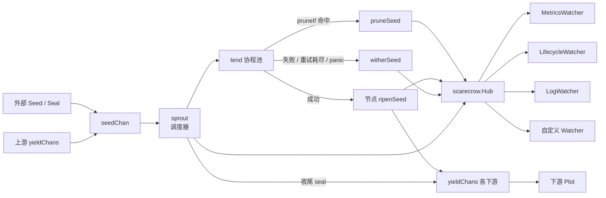
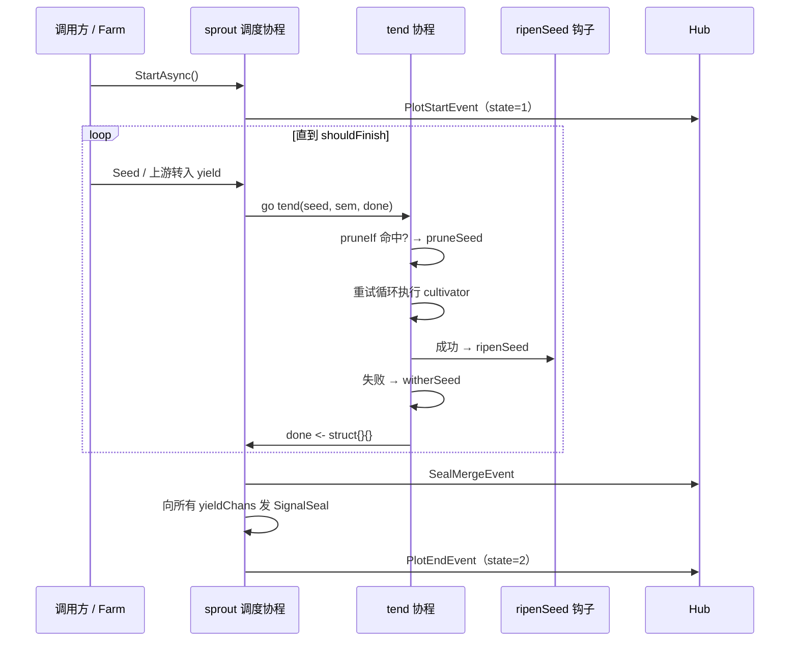

# pkg/plot/plot.go

> 📅 最后更新日期: 2026/11/13

`plot.go` 是 `pkg/plot` 的**共享运行骨架**，同时承载包文档。它定义两样东西：

1. `PlotNode` 接口——抹除泛型后供 `pkg/farm` 统一持有不同 seed/fruit 类型的节点；
2. `basePlot[S, F, Y]` 泛型结构——`SinglePlot`、`SplitPlot`、`RoutePlot` 共同内嵌的基类。

`basePlot` 承担几乎全部通用职责：上下游连接、并发调度（`sprout` + `tend`）、修剪与重试、seal 合并、指标读取、事件发送、standalone 跑批与结果导出。节点之间的唯一差异通过构造时注入的 `ripenSeed` 钩子表达，因此三种节点各自只需实现一个 `ripenSeed` 方法。

## 作用

- 定义 `PlotNode` 接口，作为 `Farm` 与 plot 之间的契约。
- 提供 `basePlot` 共享骨架，避免 `SinglePlot` / `SplitPlot` / `RoutePlot` 重复实现调度、重试与结果处理。
- 通过三个泛型参数把「种子类型」「结果类型」「下游 yield 类型」解耦，使同一套骨架能支撑广播（`SinglePlot`）、拆分（`SplitPlot`）与路由（`RoutePlot`）三种成功语义。
- 以「事件 + 观察者」模型输出运行期信息：指标、生命周期与日志全部由 `pkg/scarecrow` 的 `Hub` 分发，`basePlot` 自身不持有任何持久化资源。

## 核心对象

### `PlotNode` 接口

```go
type PlotNode interface {
	GetName() string
	GetState() int32
	GetSeedChanAny() any

	ConnectTo(next PlotNode) error
	AddUpstream(name string)
	AddWatcher(listener scarecrow.Watcher) error
	SetEventClient(eventClient runtime.EventClient)

	StartAsync()
	WaitAsync()
	SeedAny(seed any) error
	Seal()
}
```

| 方法 | 用途 |
|------|------|
| `GetName()` | 返回 plot 名称（`Farm` 中需唯一） |
| `GetState()` | 返回状态：`0=idle`、`1=running`、`2=done` |
| `GetSeedChanAny()` | 以 `any` 暴露 `seedChan`，供上游 `ConnectTo` 做类型断言 |
| `ConnectTo(next)` | 建立「本节点 yield → 下游 seed」的连接并校验类型 |
| `AddUpstream(name)` | 由**上游**在 `ConnectTo` 时调用，登记本节点的上游名称，用于 seal 聚合 |
| `AddWatcher(listener)` | 向本节点内部 `Hub` 注册观察者，重复注册会重复收到事件 |
| `SetEventClient(eventClient)` | 注入事件 ID 分配器（`Farm` 会统一注入同一个 client） |
| `StartAsync()` / `WaitAsync()` | 异步启动调度器 / 阻塞等待后台协程退出 |
| `SeedAny(seed)` | 以 `any` 播入单颗种子，`Farm` 注入初始任务时使用 |
| `Seal()` | 发送外部终止信号 |

> 接口上**没有** `AddObserver`、`BindInlet`、`StartSpouts` 或任何计数器读写方法：观察者统一为 `scarecrow.Watcher`，持久化资源由 `pkg/assembly` 装配，指标通过事件流重建。

### `basePlot[S, F, Y]` 结构

```go
type basePlot[S any, F any, Y any] struct {
	name       string
	cultivator func(S) (F, error)
	ripenSeed  func(seedPayload runtime.Payload[S], fruit F, startTime time.Time)
	plotOptions

	seedChan   chan runtime.Payload[S]
	yieldChans map[string]chan runtime.Payload[Y]
	upstreams  map[string]struct{}

	eventClient runtime.EventClient
	hub         *scarecrow.Hub

	ctx    context.Context
	cancel context.CancelFunc
	wg     sync.WaitGroup
	state  atomic.Int32 // 0=idle, 1=running, 2=done
}
```

| 泛型参数 | 语义 |
|---------|------|
| `S` | 种子（seed）输入类型，即 `cultivator` 的入参类型 |
| `F` | 本节点的**结果**类型，即 `cultivator` 的返回类型（三种节点各不相同） |
| `Y` | 向下游输出的 yield 类型，必须与下游节点的 `S` 一致 |

| 字段 | 含义 |
|------|------|
| `name` | plot 名称 |
| `cultivator` | 培育函数，返回本节点的结果类型 `F` |
| `ripenSeed` | 成功钩子，由具体节点注入；签名固定为 `(seedPayload, fruit F, startTime)` |
| `plotOptions` | 内嵌的可选配置（并发数、缓冲、重试策略、修剪谓词），见 `option.md` |
| `seedChan` | seed 输入通道，容量 = `WithChanSize`；数据与控制信号（`SignalSeal`）共用 |
| `yieldChans` | `下游 plot 名 → 该下游的 seed 通道`，由 `ConnectTo` 填充 |
| `upstreams` | 已登记的上游 plot 名称集合，用于判断 seal 是否到齐 |
| `eventClient` | 进程内事件 ID 分配器，默认 `runtime.NewLocalEventClient()` |
| `hub` | 本节点的事件分发中心，默认 `scarecrow.NewHub()`；观察者由 `AddWatcher` 注册 |
| `ctx` / `cancel` | 由 `context.WithCancel(context.Background())` 派生，用于内部强制收尾 |
| `wg` | 汇聚 `StartAsync` 启动的后台协程 |
| `state` | 状态原子变量（0/1/2） |

### 三种节点的泛型实例化

| 节点 | 底层 `basePlot` | 结果类型 | 下游 yield 类型 `Y` |
|------|----------------|---------|--------------------|
| `SinglePlot[S, F]` | `basePlot[S, F, F]` | `F` | `F` |
| `SplitPlot[S, F]` | `basePlot[S, []F, F]` | `[]F` | `F` |
| `RoutePlot[S, Y]` | `basePlot[S, map[string]Y, Y]` | `map[string]Y` | `Y` |

> `ConnectTo` 会用类型断言校验「上游的 `Y`」与「下游的 `S`」是否一致，因此 `SinglePlot[S, F]` 只能连到 `S == F` 的下游节点，否则连接时立即返回类型不兼容错误。

### 构造（未导出）

```go
func newBasePlot[S any, F any, Y any](
	name string,
	cultivator func(S) (F, error),
	ripenSeed func(seedPayload runtime.Payload[S], fruit F, startTime time.Time),
	opts ...Option,
) *basePlot[S, F, Y]
```

仅由同包的 `NewSinglePlot` / `NewSplitPlot` / `NewRoutePlot` 调用。流程：

1. 取 `defaultOptions()`，依次应用 `opts`；
2. `context.WithCancel(context.Background())` 派生 `ctx / cancel`；
3. 分配 `seedChan`（容量 `chanSize`）与空的 `yieldChans` / `upstreams`；
4. 初始化 `eventClient = runtime.NewLocalEventClient()` 与 `hub = scarecrow.NewHub()`。

## 指标读取

`basePlot` 不再自带计数器，指标由事件流重建：`pkg/assembly` 在运行期间把 `*scarecrow.MetricsWatcher` 注册到 plot 的 `hub`，`basePlot` 读取时通过 `scarecrow.Find` 在 hub（含嵌套 hub）中定位它。

```go
func (p *basePlot[S, F, Y]) currentMetrics() (scarecrow.PlotMetrics, bool) {
	metrics, ok := scarecrow.Find[*scarecrow.MetricsWatcher](p.hub)
	if !ok {
		return scarecrow.PlotMetrics{}, false
	}
	return metrics.GetPlot(p.name)
}
```

| 方法 | 数据来源（`PlotMetrics`） | 说明 |
|------|--------------------------|------|
| `GetSeedNum() int` | `InputTotal` | 输入总数 = 外部注入 + 各上游投递 |
| `GetFruitNum() int` | `Succeeded` | 成熟（成功）数 |
| `GetWeedNum() int` | `Failed` | 枯萎（失败）数 |
| `GetPruneNum() int` | `Skipped` | 剪枝（跳过）数 |
| `GetCompleted() int` | `Processed` | 已处理数 = 成熟 + 枯萎 + 剪枝 |
| `IsFinish() bool` | `Processed == InputTotal` | 所有已输入种子都已得出结果 |

> 未装配指标观察者（例如直接 `StartAsync` 而未经过 `Run` / 未注册 `MetricsWatcher`）时：计数类方法返回 `0`，`IsFinish()` 返回 `false`。这些方法读的是**当前快照**，并发下各字段不是同一时刻的严格一致视图。

## 事件发送

`basePlot` 通过 `emit` 把事件同步分发给 `hub` 上的所有观察者；观察者返回的错误或 panic 由 `Hub` 的错误处理器消费，不会影响执行路径：

```go
func (p *basePlot[S, F, Y]) emit(event scarecrow.Event) {
	_ = p.hub.OnEvent(event)
}
```

| 事件 | 触发点 | 关键字段 |
|------|--------|---------|
| `PlotStartEvent` | `notifyStart` | `Plot`、`Tenders`、`StartTime` |
| `PlotEndEvent` | `notifyFinish` | `Plot`、`EndTime`、`Elapsed` |
| `SeedInputEvent` | `Seed`（`From` 为空）；具体节点 `ripenSeed`（`From` 为上游名） | `Seed`、`SeedRepr`、`SeedID`、`Parents` |
| `SeedRipenEvent` | 具体节点的 `ripenSeed` | `Fruit`、`FruitRepr`、`SeedID`、`FruitID` |
| `SeedWitherEvent` | `witherSeed` | `Err`、`SeedID`、`WeedID` |
| `SeedPruneEvent` | `pruneSeed` | `SeedID`、`PruneID` |
| `SeedReplantEvent` | `tend` 重试循环 | `Err`、`Attempt`、`SeedID` |
| `SealInputEvent` | `Seal` | `SealID` |
| `SealMergeEvent` | `sprout` 收尾 | `ParentIDs`、`SealID` |

> 生命周期与日志都不再由 `basePlot` 直接写库：`pkg/persist` 的 `LifecycleWatcher` / `LogWatcher` 作为普通 `Watcher` 订阅这些事件，`pkg/assembly.StartPlotResources` 负责创建并注册。事件 ID 仍由 `eventClient.Emit(...)` 分配：`seed` / `fruit` / `weed` / `prune` / `seal`。

## 关键流程

### 数据流



### 启动与收尾



- `StartAsync` 只启动 1 个协程（`sprout`），协程退出由 `wg` 收敛；
- `sprout` 用容量为 `numTenders` 的 `sem` 信号量限制并发：`sem <- struct{}{}` 满则阻塞，从而在调度侧形成背压；
- 每个 seed 派生一个 `tend` 协程，`inFlight` 计数增减靠 `done` 通道；
- `tend` 返回前必定 `<-sem`（释放令牌）并 `done <- struct{}{}`。

### `sprout` 主循环

```go
sem := make(chan struct{}, p.numTenders)
done := make(chan struct{}, p.numTenders)
sealedFrom := make(map[string]int, len(p.upstreams))

ctxCancel := false
inputClosed := false
inFlight := 0
shouldFinish := func() bool {
	return ctxCancel || (inputClosed && inFlight == 0)
}
```

`select` 三个分支：

| 分支 | 行为 |
|------|------|
| `seed := <-p.seedChan` | 若 `Signal == SignalSeal` → `inputClosed = p.markSealed(seed.Source, seed.EventID, sealedFrom)`；否则占用信号量、`inFlight++`、`go p.tend(...)` |
| `<-done` | `inFlight--` |
| `<-p.ctx.Done()` | `ctxCancel = true`（内部取消，强制收尾） |

`shouldFinish()` 为真时进入收尾：把 `sealedFrom` 中记录的各 seal 事件 ID 收集为 `parentIDs`，`eventClient.Emit("seal", parentIDs)` 分配 `sealID`，发出 `SealMergeEvent`，然后向**所有** `yieldChans` 发送 `Payload[Y]{Signal: SignalSeal, Source: p.name, EventID: sealID}`，最后返回。

> 收尾广播是**阻塞**的：下游若已停止消费且其 `seedChan` 缓冲已满，上游会卡在 `sprout` 收尾处。

### 输入关闭与 seal 传播

`markSealed(source string, sealID int, sealedFrom map[string]int) bool` 的判定顺序：

| 条件 | 结果 |
|------|------|
| `source == sourceInput`（外部 `Seal()`） | 记入 `sealedFrom` 并**直接返回 `true`**——强终止，不再等待其他上游 |
| `source == ""` | 返回 `false`，忽略 |
| `source` 不在 `p.upstreams` 中（未登记上游） | 返回 `false`，忽略 |
| 其他已登记上游 | 记入 `sealedFrom`，返回 `len(sealedFrom) == len(p.upstreams)` |

即：普通上游的 seal 必须**全部到齐**，输入才视为关闭；而外部 `Seal()` 一票即可关闭。seal 的哨兵值见 `constant.md`。

### 成功路径由 `ripenSeed` 钩子注入

`basePlot` 自身不关心成功结果如何转化与转发，它只调用注入的钩子：

```go
ripenSeed func(seedPayload runtime.Payload[S], fruit F, startTime time.Time)
```

| 节点 | 注入的 `ripenSeed` 行为 |
|------|------------------------|
| `SinglePlot[S, F]` | 一颗 fruit → 每个下游各一颗 yield（广播） |
| `SplitPlot[S, F]` | `[]F` 中每个元素 → 每个下游各一颗 yield |
| `RoutePlot[S, Y]` | `map[string]Y` → 按 key 定向投递，未连接目标跳过 |

### 修剪路径 `pruneSeed`

`tend` 在进入重试循环之前先判断修剪谓词：

```go
if p.pruneIf != nil && p.pruneIf(seed) {
	p.pruneSeed(seedPayload, startTime)
	return
}
```

`pruneSeed` 是一次「直接终结」：

1. `eventClient.Emit("prune", []int{seedID})` 分配 `pruneID`；
2. 发出 `SeedPruneEvent`（父事件为 `seedID`），生命周期观察者据此落一条 `prune` 记录；
3. **不**调用 `cultivator`、**不**进入重试循环、**不**向任何下游转发。

> 修剪发生在 `cultivator` **之前**，因此被修剪的种子既不会被培育、也不会失败，而是当作一种「预先判定跳过」。它仍计入完成数（`Processed` 包含剪枝），保证进度不会卡住。

### 失败路径 `witherSeed`

1. `eventClient.Emit("weed", []int{seedID})` 分配 `weedID`；
2. 发出 `SeedWitherEvent`（父事件为 `seedID`，含 `Err` 与 `Elapsed`）；
3. **不**向任何下游转发。

### 重试循环 `tend`

```go
for attempt := 1; attempt <= p.maxRetries+1; attempt++ {
	fruit, err = p.cultivator(seed)
	if err == nil {
		break
	}
	if !p.retryIf(err) {
		break
	}
	if attempt <= p.maxRetries {
		p.emit(scarecrow.SeedReplantEvent{ /* Attempt: attempt, Err: err, SeedID: seedID */ })
	}
	time.Sleep(p.retryDelay(attempt))
}
```

| 场景 | 行为 |
|------|------|
| `pruneIf` 命中 | 不调用 `cultivator`，直接 `pruneSeed` 后返回 |
| `cultivator` 返回 `nil` | 立即 break，进入 `ripenSeed` |
| 返回 err 且 `retryIf(err) == false` | 立即 break，进入 `witherSeed`（不再重试） |
| `attempt <= maxRetries` | 发出 `SeedReplantEvent`（含 1-based `Attempt`），再 `Sleep(retryDelay(attempt))` |
| 最后一次（`attempt == maxRetries+1`）仍失败 | 不发出 `SeedReplantEvent`，但仍会执行一次 `Sleep(retryDelay(maxRetries+1))` |
| `cultivator` panic | `defer recover` 捕获，转为 `cultivator panic: %v` 错误走 `witherSeed`（不再重试） |

> panic 路径传入的 `startTime` 是 `time.Now()`，因此 `SeedWitherEvent.Elapsed` 接近 0，并不代表真实培育耗时。

### 输入与异步执行

| 方法 | 行为 |
|------|------|
| `Seed(seed S)` | 分配 seed 事件 ID（无父事件），发出 `SeedInputEvent`（`From` 为空），再向 `seedChan` 投递 `Payload[S]{Value: seed, EventID: seedID}` |
| `SeedAny(seed any) error` | 类型断言为 `S`，失败返回 `plot %q seed type mismatch: got %T`；成功则转发到 `Seed` |
| `Seal()` | 分配 seal 事件 ID，发出 `SealInputEvent`，向 `seedChan` 投递 `Payload[S]{Signal: SignalSeal, Source: sourceInput, EventID: sealID}`，触发**强终止**语义 |
| `StartAsync()` | 通过 `p.wg.Go` 启动 1 个后台协程：`notifyStart`（state=1）→ `sprout` 主循环 → `notifyFinish`（state=2） |
| `WaitAsync()` | `p.wg.Wait()`，阻塞等待后台协程退出 |

> `Seed` / `Seal` 都是**同步写 channel**：若 `seedChan` 缓冲已满且没有 tender 消费，调用方会阻塞。

### Standalone 执行 `Run`

```go
func (p *basePlot[S, F, Y]) Run(seeds []S, logLevel string)
```

standalone 模式的一站式入口（阻塞）：

1. `assembly.StartPlotResources(p.hub, logLevel)` 装配指标、生命周期与日志观察者，失败时**直接返回**（无错误返回、无任何输出）；
2. 以 `defer resources.Stop()` 保证退出时刷盘并回收资源；
3. `StartAsync()`；
4. 依次 `Seed(seed)` 注入 `seeds`；
5. `Seal()` 声明不再有外部输入；
6. `WaitAsync()` 阻塞到全部结束。

> `logLevel` 是本次运行日志的最低级别，空字符串按 `INFO` 处理（由 `pkg/persist.NewLogWatcher` 解释）。同一个 plot 重复 `Run` 会重复注册观察者，属于误用。

### 结果导出 `Harvest`

```go
func (p *basePlot[S, F, Y]) Harvest() ([]persist.LifecycleStatusRecord, error)
```

在调用时从 hub（含嵌套 hub）查找 `*persist.LifecycleWatcher`，读取其 `DBPath()`，再用 `persist.LoadLifecycleStatusesFromPath(dbPath, p.name)` 离线查询状态快照。因此：

- 运行结束后可直接查询，不需要在 plot 上保存数据库路径；
- 未注册生命周期观察者 → 返回 `plot %q lifecycle watcher is not registered`；
- 观察者已注册但数据库尚未就绪（`DBPath()` 为空）→ 返回 `plot %q lifecycle database is not ready`。

> 返回的 `persist.LifecycleStatusRecord` 关键字段：`Status`（`ripen` / `wither` / `prune`）、`SeedJSON`、`FruitJSON`、`WitherType`、`WitherMessage`。

## 使用示例

### Standalone 模式

```go
package main

import (
	"fmt"

	"github.com/Mr-xiaotian/CelestialGrow/pkg/plot"
)

func main() {
	p := plot.NewSinglePlot("double",
		func(seed int) (int, error) { return seed * 2, nil },
		plot.WithTenders(4),
	)

	p.Run([]int{1, 2, 3, 4, 5}, "INFO")

	records, err := p.Harvest()
	if err != nil {
		panic(err)
	}
	for _, r := range records {
		fmt.Println(r.SeedJSON, r.Status, r.FruitJSON)
	}
}
```

### 订阅事件

```go
package main

import (
	"fmt"

	"github.com/Mr-xiaotian/CelestialGrow/pkg/plot"
	"github.com/Mr-xiaotian/CelestialGrow/pkg/scarecrow"
)

func main() {
	p := plot.NewSinglePlot("double", func(seed int) (int, error) { return seed * 2, nil })

	if err := p.AddWatcher(scarecrow.WatcherFunc(func(event scarecrow.Event) error {
		switch ev := event.(type) {
		case scarecrow.SeedRipenEvent:
			fmt.Printf("[%s] %s -> %s (%s)\n", ev.Plot, ev.SeedRepr, ev.FruitRepr, ev.Elapsed)
		case scarecrow.SeedWitherEvent:
			fmt.Printf("[%s] %s wither: %v\n", ev.Plot, ev.SeedRepr, ev.Err)
		}
		return nil
	})); err != nil {
		panic(err)
	}

	p.Run([]int{1, 2, 3}, "INFO")
}
```

### Farm 模式

Farm 模式不直接调用 `Run` / `Seed` / `Seal`，而是把节点作为 `plot.PlotNode` 交给 `pkg/farm`：

```go
package main

import (
	"fmt"

	"github.com/Mr-xiaotian/CelestialGrow/pkg/farm"
	"github.com/Mr-xiaotian/CelestialGrow/pkg/plot"
)

func main() {
	double := plot.NewSinglePlot("double", func(seed int) (int, error) {
		return seed * 2, nil
	}, plot.WithTenders(2))

	addOne := plot.NewSinglePlot("addOne", func(seed int) (int, error) {
		return seed + 1, nil
	}, plot.WithTenders(2))

	f := farm.NewFarm("demo")
	if err := f.AddPlot(double, addOne); err != nil {
		panic(err)
	}
	if err := f.Connect([]plot.PlotNode{double}, []plot.PlotNode{addOne}); err != nil {
		panic(err)
	}
	if err := f.Run(map[string][]any{"double": {1, 2, 3}}, "INFO"); err != nil {
		panic(err)
	}

	fmt.Println("done")
}
```

此时运行期资源由 `Farm.Run` 统一装配，节点只负责产生事件。

## 测试重点

`basePlot` 的行为由 `plot_harvest_test.go`（结果快照）、`plot_prune_test.go`（修剪语义）与 `plot_retry_test.go`（重试语义）覆盖，逐用例说明见对应测试文档。

## 注意事项

- 默认并发数与 channel 缓冲均为 `runtime.NumCPU()`；I/O 密集型业务可结合 `WithTenders` / `WithChanSize` 调整（见 `option.md`）。
- `Run` 是**阻塞**调用，直到所有种子处理完成才返回；它没有返回值，装配失败时静默返回。
- 上游 `Y` 与下游 `S` 类型不匹配时，`ConnectTo` 会立即返回错误而不会 panic；建议在 `Farm.AddPlot` / `Farm.Connect` 后检查错误。
- `ctx` / `cancel` 目前仅在 `newBasePlot` 中创建并被 `sprout` 监听，`cancel` 没有对外调用点，属于预留的内部终止通道。
- `AddUpstream` 只应在建图阶段（`ConnectTo`）调用；运行期修改 `upstreams` 会与 `sprout` 的读取产生数据竞争。
- 外部 `Seal()` 具有**强终止**语义：一旦到达，即使还有上游未发 seal 也会立即收尾。
- 所有指标都来自 `MetricsWatcher`，因此**必须**在运行期间装配指标观察者（standalone 由 `Run` 完成，Farm 由 `Farm.Run` 完成）后才能读到非零计数。
