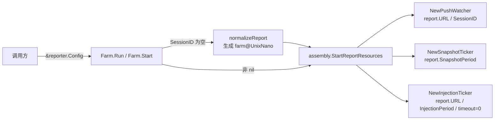

# pkg/reporter/config.go

> 📅 最后更新日期: 2026/11/26

`pkg/reporter/config.go` 定义远程上报运行所需的最小配置载体 `Config`。它本身只是纯数据：不校验、不带方法，真正的合法性检查发生在 `NewPushWatcher`、`NewSnapshotTicker`、`NewInjectionTicker` 三个构造函数中。

## 作用

- 把「上报服务地址 + 会话标识 + 两个节拍周期」打包传给 `Farm.Run` / `Farm.Start`。
- 作为 `pkg/api` 对外暴露的 `Report` 类型（`type Report = reporter.Config`，是**类型别名**而非新类型），调用方无需直接 import `pkg/reporter`。
- 由 `pkg/assembly.StartReportResources` 读取，分别构造推送观察者、快照 ticker 与注入 ticker。

`report` 参数为 `nil` 表示**本地运行**：`Farm` 走 `assembly.StartLocalResources`，既不推送、也不拉取注入。因此 `Config` 也是"是否启用远程上报"的开关。

## 核心对象

### `type Config`

```go
type Config struct {
    URL             string // 上报服务基础地址
    SessionID       string // 上报会话标识；为空时由运行入口生成
    SnapshotPeriod  int    // 状态快照节拍周期
    InjectionPeriod int    // 注入拉取节拍周期
}
```

| 字段 | 类型 | `0` 值语义 | 实际消费方 |
|------|------|-----------|-----------|
| `URL` | `string` | **非法**：`normalizeBaseURL` 返回 `reporter: base url is empty` | `NewPushWatcher`、`NewInjectionTicker` |
| `SessionID` | `string` | **由入口生成**：`Farm.normalizeReport` 生成 `<farmName>@<UnixNano>` | 推送载荷的 `session_id`、注入请求的查询参数 |
| `SnapshotPeriod` | `int` | 使用 `DefaultSnapshotPeriod`（`1`，即每拍） | `NewSnapshotTicker` |
| `InjectionPeriod` | `int` | 使用 `DefaultInjectionPeriod`（`5`） | `NewInjectionTicker` |

所有字段均导出，`Config` 可被直接字面量构造；没有构造函数、没有默认值填充方法，也没有 `Validate`。

### 周期单位是"拍"，不是秒

`SnapshotPeriod` / `InjectionPeriod` 是 `metronome.Periodic` 语义下的节拍数：`1` 表示每拍触发，`2` 表示每两拍触发一次（`(Seq-1)%period == 0`）。实际墙钟间隔 = 拍数 × 时钟基准周期。`Farm` 装配时固定传入 `metronome.DefaultInterval`（`1s`），所以默认值可以粗略理解为「快照 1 秒一次、注入 5 秒一次」；若调用方自行把 `metronome.Clock` 的间隔改成 200ms，同样的配置就会变成 200ms / 1s。

周期为负数会在构造函数中报错（`snapshot period must be positive` / `injection period must be positive`），只有 `0` 才代表"用默认值"。

## 关键流程



1. `Farm.Run` / `Farm.Start` 先调用 `normalizeReport`：仅当 `report != nil` 且 `SessionID` 去空格后为空时，**复制**一份配置并填入 `<farmName>@<time.Now().UnixNano()>`；原对象不被修改。
2. `assembly` 用同一个 `Config` 构造三个组件。`NewInjectionTicker` 的 `timeout` 传 `0`，即采用 `DefaultPullTimeout`（3 秒）。
3. 任一构造函数报错，`assembly` 立即返回错误，`Farm` 随之中止本次运行（不会退化成静默的本地运行）。

## 使用示例

### 批处理 + 远程上报

```go
package main

import (
    "fmt"

    "github.com/Mr-xiaotian/CelestialGrow/pkg/farm"
    "github.com/Mr-xiaotian/CelestialGrow/pkg/plot"
    "github.com/Mr-xiaotian/CelestialGrow/pkg/reporter"
)

func main() {
    double := plot.NewSinglePlot("double", func(seed int) (int, error) {
        return seed * 2, nil
    })
    format := plot.NewSinglePlot("format", func(seed int) (string, error) {
        return fmt.Sprintf("result=%d", seed), nil
    })

    f := farm.NewFarm("demo")
    if err := f.AddPlot(double, format); err != nil {
        panic(err)
    }
    if err := f.Connect([]plot.PlotNode{double}, []plot.PlotNode{format}); err != nil {
        panic(err)
    }

    report := &reporter.Config{
        URL:             "http://127.0.0.1:5005",
        SessionID:       "demo@manual", // 留空则由 Farm 生成 demo@<UnixNano>
        SnapshotPeriod:  2,             // 每 2 拍推一次状态
        InjectionPeriod: 5,             // 每 5 拍拉一次注入
    }
    if err := f.Run(map[string][]any{"double": {1, 2, 3}}, "INFO", report); err != nil {
        panic(err)
    }
}
```

### 外部驱动 + 远程注入

`Start` 不注入初始任务与终止信号，适合由 reporter 的 `/api/pull_injection` 驱动；必须显式给 `SessionID`（或留空让 `Farm` 生成），否则 `NewPushWatcher` 会以 `session id is empty` 失败。

```go
package main

import (
    "github.com/Mr-xiaotian/CelestialGrow/pkg/farm"
    "github.com/Mr-xiaotian/CelestialGrow/pkg/plot"
    "github.com/Mr-xiaotian/CelestialGrow/pkg/reporter"
)

func main() {
    root := plot.NewSinglePlot("root", func(seed int) (int, error) { return seed, nil })
    f := farm.NewFarm("external")
    if err := f.AddPlot(root); err != nil {
        panic(err)
    }

    // 阻塞直到远程注入终止信号（或服务端下发 shutdown）。
    if err := f.Start("INFO", &reporter.Config{
        URL:             "http://127.0.0.1:5005",
        InjectionPeriod: 1,
    }); err != nil {
        panic(err)
    }
}
```

## 注意事项

- **`URL` 不会在构造 `Config` 时校验**：错误会延迟到 `Farm` 启动阶段才暴露。`URL` 只接受 `http` / `https`，末尾 `/` 会被去掉；带路径的地址（如 `http://host/api`）可以通过校验，但后续端点是**字符串拼接**，会得到 `http://host/api/api/push_snapshot` 这类双前缀地址。
- **`SessionID` 是服务端的唯一键**：为空时 `Farm` 用 `UnixNano` 生成，保证不同运行互不覆盖；手工指定时若两次运行复用同一个值，服务端状态会互相干扰。
- **`SnapshotPeriod` 与 `InjectionPeriod` 的默认值不同**（1 vs 5）：快照量大但便宜（只入队），注入拉取是一次同步 HTTP 请求，默认更稀疏。
- **`Config` 不含超时**：推送 HTTP 超时（`DefaultPushTimeout`）、单次入队超时（`DefaultSendTimeout`）、注入拉取超时（`DefaultPullTimeout`）都是包内常量，当前无配置入口。
- **并发安全**：`Config` 是只读数据载体；`Farm.normalizeReport` 在 `SessionID` 为空时会复制结构体，因此调用方后续复用同一个 `Config` 不会串会话。
