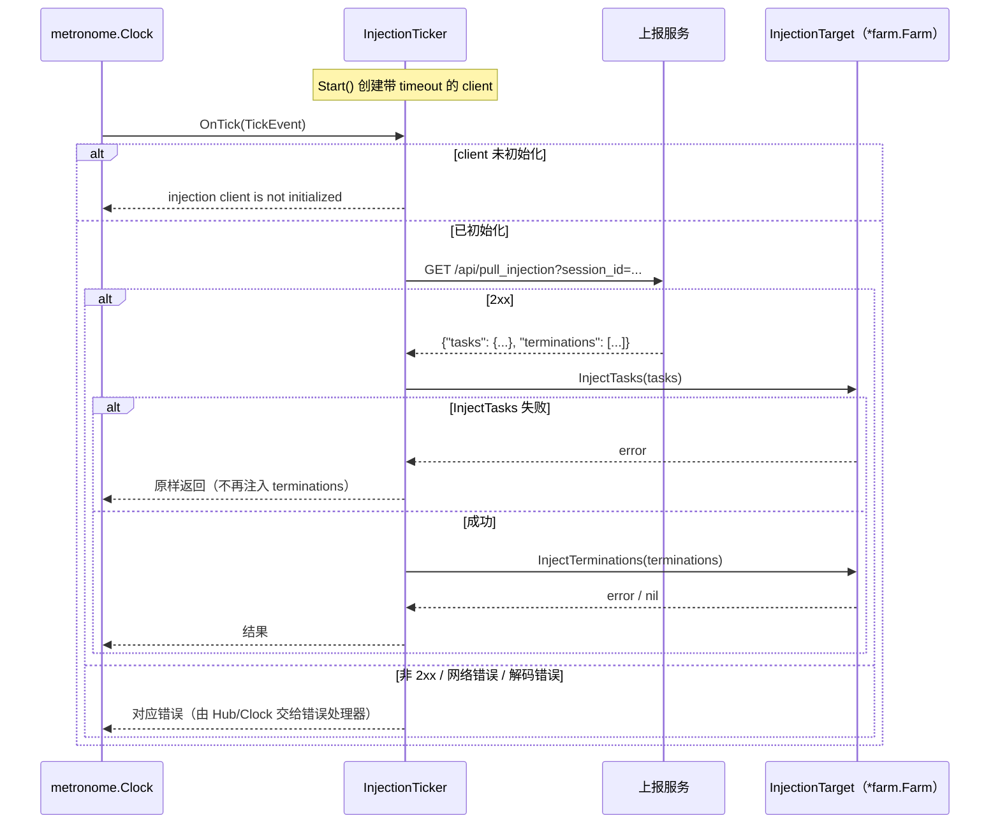

# pkg/reporter/inject.go

> 📅 最后更新日期: 2026/11/26

`pkg/reporter/inject.go` 实现**远程注入拉取**：按节拍向服务端 `GET /api/pull_injection`，把响应中的 `tasks` 与 `terminations` 转交给本地目标（通常是 `*farm.Farm`）。它是「服务端 → 本地图」方向的唯一入口，与 `push.go` 的「本地图 → 服务端」方向互补。

## 作用

- 把远程下发的任务注入到指定 Plot，并把需要终止的 Plot 名单交给目标。
- 自持一个带超时的 `*http.Client`：`Start` 创建、`Stop` 关闭空闲连接。
- 作为 `metronome.Ticker` + `metronome.Lifecycle` 注册到 `metronome.Hub`，由统一的节拍时钟驱动。

## 核心对象

### 常量

```go
const (
    DefaultInjectionPeriod = 5               // 默认 5 拍拉取一次
    DefaultPullTimeout     = 3 * time.Second // 单次拉取的 HTTP 超时
)
```

### `type InjectionTarget`（接口）

```go
type InjectionTarget interface {
    InjectTasks(tasks map[string][]any) error
    InjectTerminations(nodes []string) error
}
```

| 方法 | 语义 | 典型实现 |
|------|------|----------|
| `InjectTasks(map[string][]any) error` | 把 `Plot 名 -> 种子列表` 注入到对应 Plot；目标需校验 Plot 已注册 | `farm.Farm.InjectTasks` |
| `InjectTerminations([]string) error` | 通知这些 Plot 不再接收新种子，处理完在途数据后退出 | `farm.Farm.InjectTerminations` |

`pkg/assembly.StartReportResources` 直接把 `*farm.Farm`（通过接口参数 `injectionTarget`）传进来；`Farm` 的这两个方法在运行期可安全调用。

### `type injectionPayload`（不导出）

```go
type injectionPayload struct {
    Tasks        map[string][]any `json:"tasks"`
    Terminations []string         `json:"terminations"`
}
```

服务端返回的 JSON 形状：`{"tasks": {"root": [1, "x"]}, "terminations": ["leaf"]}`。由于解码到 `any`，数字一律变成 `float64`（例如 `1` 会变成 `1.0`），下游需要自行做类型断言。

### `type InjectionTicker`

```go
type InjectionTicker struct {
    baseURL   string
    sessionID string
    target    InjectionTarget
    period    int
    timeout   time.Duration
    client    *http.Client
}
```

字段全部不导出；`client` 的生命周期与 `Start` / `Stop` 绑定。

### 构造：`NewInjectionTicker`

```go
func NewInjectionTicker(
    baseURL string,
    sessionID string,
    target InjectionTarget,
    period int,
    timeout time.Duration,
) (*InjectionTicker, error)
```

校验按**固定顺序**执行，先命中的错误先返回：

| 顺序 | 条件 | 返回错误 |
|:----:|------|---------|
| 1 | `target == nil` | `reporter: injection target is nil` |
| 2 | `strings.TrimSpace(sessionID) == ""` | `reporter: session id is empty` |
| 3 | `period == 0` → 替换为 `5`；随后 `period < 1` | `reporter: injection period must be positive, got %d` |
| 4 | `timeout == 0` → 替换为 `3s`；随后 `timeout < 0` | `reporter: pull timeout must be non-negative, got %s` |
| 5 | `normalizeBaseURL(baseURL)` 失败 | `base url is empty` / `invalid base url %q` / `base url must use http or https, got %q` |

因此「空 URL + 空 SessionID」会先报 SessionID 错误；`period` / `timeout` 的默认值替换发生在校验之前，`-1` 不会被替换成默认值。

- `baseURL` 会经 `normalizeBaseURL` 规范化：去首尾空白、去掉**所有**尾部 `/`，并要求 scheme 为 `http`/`https` 且 host 非空。
- `timeout` 不是「0 表示不超时」，而是「0 表示用默认 3 秒」；想要更长/更短必须显式给正值。

### 方法

| 方法 | 签名 | 作用 |
|------|------|------|
| `TickPeriod` | `func (t *InjectionTicker) TickPeriod() int` | 返回生效后的节拍周期（已填充默认值） |
| `Start` | `func (t *InjectionTicker) Start() error` | 创建 HTTP 客户端；始终返回 `nil` |
| `Stop` | `func (t *InjectionTicker) Stop() error` | 关闭空闲连接并置空客户端；始终返回 `nil` |
| `OnTick` | `func (t *InjectionTicker) OnTick(event metronome.TickEvent) error` | 拉取一次注入并交给目标 |

#### `Start` / `Stop` 的可重入性

- `Start` 只在 `client == nil` 时创建，重复调用不会替换已有客户端。
- `Stop` 关闭空闲连接后把 `client` 置 `nil`，因此 **`Stop` 之后 `OnTick` 会报 `reporter: injection client is not initialized`**，必须再次 `Start` 才能继续。
- 二者都返回 `nil`，不可通过返回值判断是否真的执行了动作。

#### `OnTick` 的执行细节

1. `client == nil` → 直接返回错误，**不会发起任何网络请求**（这是「Start 前调用 OnTick 报错」的保证）。
2. 拼接端点：`baseURL + "/api/pull_injection?session_id=" + url.QueryEscape(sessionID)`。`@` 等字符会被转义为 `%40`，服务端 `Query().Get("session_id")` 解码后仍是原值。
3. `client.Get` 失败 → `reporter: pull injection: %w`（保留底层 `url.Error`，可 `errors.Is` / `errors.As`）。
4. `StatusCode/100 != 2` → `reporter: pull injection failed: <Status>`（如 `500 Internal Server Error`）。**不读取响应体**。
5. 解码 JSON 失败 → `reporter: decode injection payload: %w`；只解码**第一个** JSON 值，尾随内容被忽略，响应体不设大小上限。
6. 缺失或 `null` 的 `tasks` / `terminations` 会被归一化为空 `map` / 空切片，目标永远拿到非 `nil` 值。
7. **先** `InjectTasks`，成功后才 `InjectTerminations`。目标返回的 error **原样返回**，不包装、不重试；`InjectTasks` 失败时本拍不会再注入终止名单。
8. `event`（`TickEvent`）完全未使用，触发时机只由 `metronome` 决定。

| 错误来源 | 错误文本 | 是否可 `errors.Is/As` |
|----------|----------|----------------------|
| 未 `Start` | `reporter: injection client is not initialized` | — |
| 网络/超时 | `reporter: pull injection: <底层错误>` | ✅（`%w`） |
| 非 2xx | `reporter: pull injection failed: <Status>` | — |
| 解码失败 | `reporter: decode injection payload: <err>` | ✅（`%w`） |
| 目标注入失败 | 目标返回的原始 error | ✅（未包装） |

## 关键流程



`metronome.Hub.OnTick` 会捕获 `OnTick` 返回的 error 并交给错误处理器，**不会中断其它 ticker**；因此单次拉取失败不会让节拍停摆。

## 使用示例

### 手动驱动一次拉取

```go
package main

import (
    "fmt"

    "github.com/Mr-xiaotian/CelestialGrow/pkg/metronome"
    "github.com/Mr-xiaotian/CelestialGrow/pkg/reporter"
)

// demoTarget 演示注入目标的最小实现。
type demoTarget struct{}

func (demoTarget) InjectTasks(tasks map[string][]any) error {
    fmt.Println("tasks:", tasks) // 数字已是 float64
    return nil
}

func (demoTarget) InjectTerminations(nodes []string) error {
    fmt.Println("terminations:", nodes)
    return nil
}

func main() {
    ticker, err := reporter.NewInjectionTicker(
        "http://127.0.0.1:5005/", // 尾部 / 会被规范化去掉
        "demo@1",
        demoTarget{},
        0, // 使用 DefaultInjectionPeriod（5）
        0, // 使用 DefaultPullTimeout（3s）
    )
    if err != nil {
        panic(err)
    }
    fmt.Println("period:", ticker.TickPeriod())

    if err := ticker.Start(); err != nil {
        panic(err)
    }
    defer func() { _ = ticker.Stop() }()

    if err := ticker.OnTick(metronome.TickEvent{Seq: 1}); err != nil {
        fmt.Println("pull failed:", err)
    }
}
```

### 注册到节拍时钟

```go
package main

import (
    "fmt"
    "time"

    "github.com/Mr-xiaotian/CelestialGrow/pkg/metronome"
    "github.com/Mr-xiaotian/CelestialGrow/pkg/reporter"
)

type demoTarget struct{}

func (demoTarget) InjectTasks(tasks map[string][]any) error    { return nil }
func (demoTarget) InjectTerminations(nodes []string) error     { return nil }

func main() {
    ticker, err := reporter.NewInjectionTicker(
        "http://127.0.0.1:5005",
        "demo@1",
        demoTarget{},
        1, // 每拍拉取
        time.Second,
    )
    if err != nil {
        panic(err)
    }

    hub, err := metronome.NewHub()
    if err != nil {
        panic(err)
    }
    if err := hub.AddTicker(ticker); err != nil { // 校验周期、拒绝重复注册
        panic(err)
    }

    clock, err := metronome.NewClock(time.Second, hub)
    if err != nil {
        panic(err)
    }
    if err := hub.Start(); err != nil { // 按注册顺序调用 InjectionTicker.Start
        panic(err)
    }
    if err := clock.Start(); err != nil {
        panic(err)
    }

    time.Sleep(2500 * time.Millisecond) // 供观察两拍

    _ = clock.Stop() // 先停时钟，避免 Stop 与 OnTick 并发
    if err := hub.Stop(); err != nil { // 反向调用 InjectionTicker.Stop
        fmt.Println(err)
    }
}
```

## 注意事项

- **同步网络 IO 占用节拍 goroutine**：`OnTick` 在 `metronome.Clock` 的唯一调度 goroutine 中同步执行，单次最多阻塞 `timeout`。同一拍中排在它后面的 ticker 会被延后；阻塞超过一个基准周期时，`Clock` 会**跳过错过的节拍而不补拍**（见 `pkg/metronome/clock.go`）。默认 3 秒超时下，服务端无响应会导致快照节拍被拖慢。
- **无重试、无退避**：失败只通过 error 上报给 Hub 的错误处理器。若需要重试，应在上层或服务端实现，避免在 ticker 内堆积请求。
- **不校验响应内容**：`tasks` 的键是否为已知 Plot、值是否可被目标接受，全部由 `InjectionTarget` 负责；`Farm.InjectTasks` 会在任一目标 Plot 不存在时整体失败。
- **`OnTick` 与 `Stop` 不可并发**：`Stop` 直接把 `client` 置 `nil`，与 `OnTick` 读取 `t.client` 之间存在数据竞争。正常用法是「先停时钟、再停 Hub」，`pkg/assembly` 的 `StopFunc` 正是 `Clock.Stop → tickerHub.Stop` 的顺序。
- **`Stop` 不会取消在途请求**：`CloseIdleConnections` 只影响空闲连接；正在执行的 `Get` 仍会跑到超时或完成。
- **重定向与 3xx**：`http.Client` 默认跟随最多 10 次重定向，最终状态码参与 2xx 判定；重定向目标不受 `normalizeBaseURL` 约束。
- **TLS/代理**：使用克隆的 `http.DefaultTransport`（`newHTTPClient`），会继承 `HTTP_PROXY` / `HTTPS_PROXY` 等环境配置；每个 ticker 独立持有 Transport，`Stop` 只关闭自己的空闲连接。
