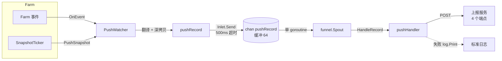
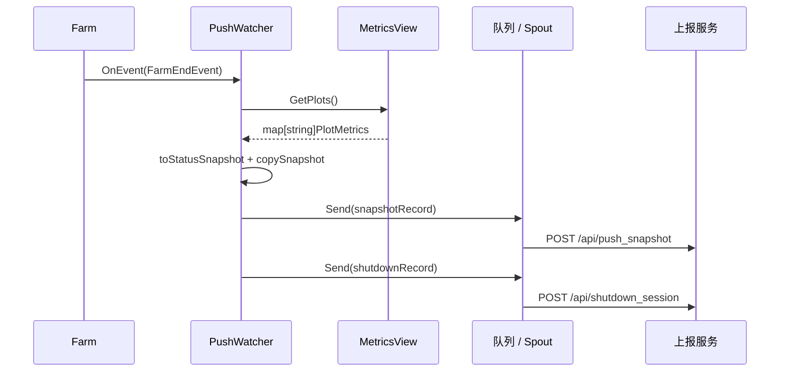

# pkg/reporter/push.go

> 📅 最后更新日期: 2026/11/26

`pkg/reporter/push.go` 负责「本地图 → 上报服务」方向的推送：把 Farm 事件与周期快照翻译成 4 类 JSON 记录，经 `funnel.Inlet` + `funnel.Spout` 的异步队列，由后台 goroutine 逐条 POST 到服务端的 4 个端点。

> 同步/异步边界：`OnEvent`、`PushSnapshot` **只做入队**（最多阻塞 `DefaultSendTimeout`），真正的网络 IO 全部发生在 `Spout` 的单个消费 goroutine 中。因此慢服务端不会拖住 Farm 的事件分发线程，但会以队列积压的形式形成背压。

## 作用

- 事件翻译：`FarmStartEvent` → 图元信息、`SeedWitherEvent` → 错误记录、`FarmEndEvent` → 终态快照 + 会话下线。
- 周期快照：接收 `SnapshotTicker` 送入的 `map[string]NodeStatus`，补上会话标识与时间戳后推送。
- 网络隔离：单条推送失败只写标准日志，**不中断消费循环**，也不向 Farm 冒泡。

## 核心对象

### 常量

```go
const (
    DefaultPushBufferSize = 64                      // 队列缓冲条数
    DefaultPushTimeout    = 3 * time.Second         // HTTP 超时 + Spout 优雅关闭超时
    DefaultSendTimeout    = 500 * time.Millisecond  // Inlet.Send 单次入队超时

    defaultGraphMode = "grow"                       // 固定图模式
)
```

`DefaultPushTimeout` 有**双重职责**：既作为 `http.Client.Timeout`，也作为 `funnel.NewSpout` 的关闭等待上限。

### `type pushRecord`（封闭接口）

```go
type pushRecord interface {
    isPushRecord()
}
```

`isPushRecord` 不导出，包外无法实现，因此 `pushHandler.handle` 的 `type switch` 可以认为覆盖全部记录类型；未知类型走 `default` 返回 `reporter: unsupported push record %T`。

### 4 种记录与 JSON 契约

#### `graphMetaRecord` → `POST /api/push_graph_meta`

| 字段 | JSON 键 | 来源 |
|------|---------|------|
| `SessionID` | `session_id` | `PushWatcher.sessionID` |
| `Graph` | `graph` | `FarmStartEvent.Farm` |
| `GraphMode` | `graph_mode` | 固定 `"grow"` |
| `StartTime` | `start_time` | `FarmStartEvent.StartTime` 的 Unix 浮点秒 |
| `IsDAG` | `is_dag` | `FarmStartEvent.IsDAG` |
| `Nodes` | `nodes` | `FarmStartEvent.Plots` 的副本 |
| `Edges` | `edges` | `FarmStartEvent.Edges` 的深拷贝；无出边的节点编码为 `[]` |
| `SourceNodes` | `source_nodes` | `FarmStartEvent.SourcePlots` 的副本 |
| `NodeMeta` | `node_meta` | `FarmStartEvent.NodeMeta` 的副本（`class_name` / `execution_mode` / `max_workers`） |

`FarmStartEvent.Structure`（预渲染的结构行）**不上报**，Web 端自行渲染拓扑。

#### `snapshotRecord` → `POST /api/push_snapshot`

| 字段 | JSON 键 | 说明 |
|------|---------|------|
| `SessionID` | `session_id` | 会话标识 |
| `Timestamp` | `timestamp` | 快照时间（Unix 浮点秒）；周期快照取 `time.Now()`，Farm 结束快照取 `FarmEndEvent.EndTime` |
| `Snapshot` | `snapshot` | `map[string]NodeStatus`，详见 [`snapshot.md`](./snapshot.md) |

#### `taskFailRecord` → `POST /api/push_error`

| 字段 | JSON 键 | 来源 |
|------|---------|------|
| `SessionID` | `session_id` | 会话标识 |
| `EventID` | `event_id` | **`SeedWitherEvent.WeedID`**（枯萎事件 ID，不是 `SeedID`） |
| `Node` | `node` | `SeedWitherEvent.Plot` |
| `Task` | `task_json` | `toJSONValue(SeedWitherEvent.Seed)`，不可序列化时降级为可读字符串 |
| `ErrorType` | `error_type` | `fmt.Sprintf("%T", Err)`，如 `*errors.errorString` |
| `ErrorMessage` | `error_message` | `fmt.Sprintf("%v", Err)` |
| `Timestamp` | `ts` | `SeedWitherEvent.Time` 的 Unix 浮点秒 |

> `taskFailRecord` 没有 `result_json` 字段：本地只上报失败任务与错误文本，不附带任何结果占位。

#### `shutdownRecord` → `POST /api/shutdown_session`

| 字段 | JSON 键 | 说明 |
|------|---------|------|
| `SessionID` | `session_id` | 会话标识；服务端据此下线该会话 |

### `type pushHandler`（不导出）

```go
type pushHandler struct {
    baseURL string
    timeout time.Duration
    client  *http.Client
}
```

实现 `funnel.RecordHandler[pushRecord]` 三件套：

| 方法 | 行为 |
|------|------|
| `BeforeStart()` | `h.client = newHTTPClient(h.timeout)`，始终返回 `nil` |
| `HandleRecord(record)` | 调 `handle`；**出错只 `log.Print`，然后返回 `nil`** |
| `AfterStop()` | `CloseIdleConnections()` 并置空客户端，始终返回 `nil` |

`HandleRecord` 永远返回 `nil` 是关键设计：`funnel.Spout` 本身就丢弃 handler 返回值，主动吞掉错误可避免"看起来能传播、实际不会"的误解；失败可观测性完全依赖标准日志。

#### 端点分发与 `post`

| 记录类型 | 端点 |
|----------|------|
| `graphMetaRecord` | `/api/push_graph_meta` |
| `snapshotRecord` | `/api/push_snapshot` |
| `taskFailRecord` | `/api/push_error` |
| `shutdownRecord` | `/api/shutdown_session` |

`post(path, payload any)` 的步骤：

1. `client == nil` → `reporter: push client is not initialized`。正常路径下 `Spout.Start` 会先 `BeforeStart` 建好 client 再消费，因此这是防御性分支（例如 handler 被脱离 `Spout` 直接复用）。
2. `json.Marshal(payload)` 失败 → `reporter: marshal <path> payload: %w`。
3. `POST baseURL+path`，`Content-Type: application/json`。
4. 传输层错误 → `reporter: push <path>: %w`。
5. 非 2xx：
   - 用 `io.LimitReader(res.Body, 512)` 读取最多 **512 字节**响应体；
   - 再用 `io.Copy(io.Discard, res.Body)` 排空剩余内容，使连接可复用；
   - 响应体去空白后非空时错误为 `reporter: push <path> failed: <Status>: <body>`，否则为 `reporter: push <path> failed: <Status>`。
6. 2xx 直接返回 `nil`，不解析响应体。

### `type PushWatcher`

```go
type PushWatcher struct {
    sessionID   string
    metricsView MetricsView
    spout       *funnel.Spout[pushRecord]
    inlet       *funnel.Inlet[pushRecord]
}
```

- 实现 `scarecrow.Watcher`（`OnEvent`）、`SnapshotSink`（`PushSnapshot`）与 `metronome.Lifecycle`（`Start` / `Stop`）。
- `metricsView` 只用于 `FarmEndEvent` 时补推终态快照。

#### 构造：`NewPushWatcher`

```go
func NewPushWatcher(sessionID string, baseURL string, metricsView MetricsView) (*PushWatcher, error)
```

校验顺序：

| 顺序 | 条件 | 错误 |
|:----:|------|------|
| 1 | `strings.TrimSpace(sessionID) == ""` | `reporter: session id is empty` |
| 2 | `metricsView == nil` | `reporter: metrics view is nil` |
| 3 | `normalizeBaseURL(baseURL)` 失败 | `reporter: base url is empty` / `invalid base url %q` / `must use http or https` |

成功后固定装配：

```go
handler := &pushHandler{baseURL: baseURL, timeout: DefaultPushTimeout}
spout := funnel.NewSpout(handler, DefaultPushBufferSize, DefaultPushTimeout) // 缓冲 64，关闭等待 3s
inlet := funnel.NewInlet(spout.GetQueue(), DefaultSendTimeout)              // 入队超时 500ms
```

推送超时、队列容量都不是构造参数，无法按会话调整。

#### 方法与行为

| 方法 | 签名 | 行为 |
|------|------|------|
| `Start` | `func (w *PushWatcher) Start() error` | 委托 `spout.Start()`：先 `BeforeStart` 建 client，再启动消费 goroutine |
| `Stop` | `func (w *PushWatcher) Stop() error` | 先 `inlet.Close()` 让阻塞的发送提前返回，再 `spout.Stop()`；返回 `shutdown timeout` 表示排空超时 |
| `OnEvent` | `func (w *PushWatcher) OnEvent(event scarecrow.Event) error` | 事件翻译 + 入队；仅 `Inlet.Send` 的错误会上抛 |
| `PushSnapshot` | `func (w *PushWatcher) PushSnapshot(snapshot map[string]NodeStatus) error` | 以 `time.Now()` 为时间戳入队一次快照 |
| `pushSnapshotAt` | `(snapshot, ts time.Time) error`（不导出） | 深拷贝快照后入队，供 `PushSnapshot` 与 FarmEnd 复用 |

##### `OnEvent` 的事件映射

| 事件 | 产生的记录 | 备注 |
|------|-----------|------|
| `scarecrow.FarmStartEvent` | `graphMetaRecord` | `Plots`/`SourcePlots` 用 `append([]string{}, ...)` 复制；`Edges` 用 `copyEdges`；`NodeMeta` 用 `copyNodeMeta` |
| `scarecrow.SeedWitherEvent` | `taskFailRecord` | `EventID = WeedID`；`Err` 为 `nil` 时得到 `error_type="<nil>"`、`error_message="<nil>"` |
| `scarecrow.FarmEndEvent` | `snapshotRecord` + `shutdownRecord` | 先用 `metricsView.GetPlots()` 投影出**终态快照**并按 `EndTime` 入队，成功后才入队 shutdown |
| 其它事件 | 无 | 返回 `nil`，不入队 |

FarmEnd 的顺序保证：两条记录进入同一个 FIFO 队列，由**同一个**消费 goroutine 串行发送，因此服务端一定先收到终态快照、再收到会话下线。若终态快照入队失败（500ms 内队列仍满），`OnEvent` 直接返回该错误，**shutdown 不会被发送**。

##### `Stop` 的排空语义

1. `inlet.Close()` 取消内部 context，使正在阻塞的 `Send` 尽快返回 `context.Canceled`；它不会关闭通道。
2. `spout.Stop()` 关闭通道并排空缓冲区，最多等 `DefaultPushTimeout`（3s）。
3. 未超时：返回 `nil`，所有已入队记录都已尝试推送。
4. 超时：消费 goroutine 被取消，缓冲区剩余记录丢弃，返回 `shutdown timeout`；随后仍会执行 `AfterStop` 关闭空闲连接。

## 关键流程

### 事件到网络的异步链路



### Farm 结束时的推送顺序



## 使用示例

```go
package main

import (
    "fmt"

    "github.com/Mr-xiaotian/CelestialGrow/pkg/reporter"
    "github.com/Mr-xiaotian/CelestialGrow/pkg/scarecrow"
)

// emptyMetrics 演示 MetricsView 的最小实现。
type emptyMetrics struct{}

func (emptyMetrics) GetPlots() map[string]scarecrow.PlotMetrics {
    return map[string]scarecrow.PlotMetrics{}
}

func main() {
    watcher, err := reporter.NewPushWatcher("demo@1", "http://127.0.0.1:5005/", emptyMetrics{})
    if err != nil {
        panic(err)
    }
    if err := watcher.Start(); err != nil { // 内部创建 HTTP client 并启动消费 goroutine
        panic(err)
    }

    // 入队，立即返回；网络请求在后台 goroutine 中执行。
    if err := watcher.OnEvent(scarecrow.FarmStartEvent{
        Farm:        "demo",
        IsDAG:       true,
        Plots:       []string{"root"},
        Edges:       map[string][]string{"root": {}},
        SourcePlots: []string{"root"},
    }); err != nil {
        fmt.Println("enqueue failed:", err)
    }

    // 也可直接推一次快照（通常由 SnapshotTicker 调用）。
    if err := watcher.PushSnapshot(map[string]reporter.NodeStatus{
        "root": {Status: 1, TasksInput: 3, TasksProcessed: 2, TasksPending: 1},
    }); err != nil {
        fmt.Println("enqueue failed:", err)
    }

    // 排空队列并关闭连接；超过 3s 会返回 shutdown timeout。
    if err := watcher.Stop(); err != nil {
        fmt.Println("stop:", err)
    }
}
```

与 `SnapshotTicker` 组合时，通常写成 `NewSnapshotTicker(metricsView, watcher, period)`，让 ticker 只做投影、watcher 负责网络。

## 注意事项

- **单条失败只记日志**：`HandleRecord` 吞掉所有错误，`HandleRecord` 的返回值恒为 `nil`；推送失败不会让 Farm 运行失败，也不会重试。日志走标准 `log` 包（默认 stderr），无法注入自定义 logger。
- **有损队列**：缓冲 64 条，`Inlet.Send` 最多等 500ms。服务端持续不可用时，突发快照/错误记录会被丢弃（`Send` 返回 `inlet send timeout after 500ms`）。`Farm.emit` 会忽略 watcher 错误，所以 Farm 侧无感知。
- **`Start` 前调用 `OnEvent` / `PushSnapshot` 不会立即报错**：记录会先堆在缓冲区（最多 64 条），只有队列满后才在 500ms 后超时。若始终不 `Start`，这些记录永远不会发送。
- **`Stop` 之后禁止再写入**：`spout.Stop` 已关闭通道，后续 `OnEvent`/`PushSnapshot` 可能 panic（`send on closed channel`）。`Stop` **不幂等**：第二次调用会因重复 `close` 而 panic，`pkg/assembly` 的 `StopFunc` 通过布尔幂等保护保证顺序调用时只停一次（并发调用不安全）。`Start` 重复调用也不会报错，但会重复执行 `BeforeStart` 并启动**第二个**消费 goroutine，与第一个竞争同一通道，因此同样应避免。
- **顺序是全局 FIFO**：所有会话内的记录共用一个队列、一个消费 goroutine，因此请求严格串行、顺序稳定；代价是单条慢请求（最长 3s）会阻塞后续所有记录。
- **入队时复制范围**：图元信息复制切片与邻接表，快照通过 `copySnapshot` 复制每个节点及其计数字典；`taskFailRecord.Task` 仍是 `toJSONValue(Seed)` 的结果，**不深拷贝** `Seed` 本身，事件发出后调用方不应再修改种子对象。
- **`graph_mode` 固定为 `"grow"`**：当前实现不接受配置，celestialflow-web 的 `GraphMeta.graph_mode` 因此总是 `grow`。
- **终态快照的数据源是 `MetricsView`**：`FarmEndEvent` 自身不携带指标，若 `metricsView` 尚未收到 `PlotEndEvent`，快照里对应节点可能仍是 `running`（取决于 Hub 的分发顺序：FarmEnd 在 Plot 全部退出后发出，正常情况下指标已更新）。
- **非 2xx 的响应体只保留前 512 字节**：既避免大响应占用内存/日志，也能给出可诊断的服务端错误摘要；剩余字节被丢弃以复用连接。
- **重定向**：`http.Client` 默认跟随重定向，`POST` 在 301/302/303 下可能被改写为 `GET`，服务端若返回此类状态码需自行确认语义。
