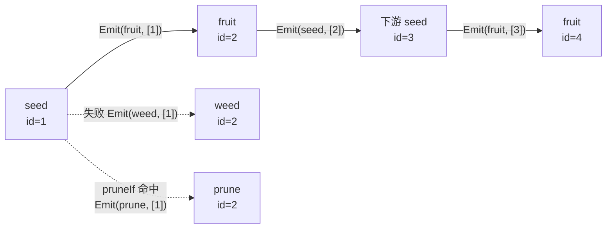
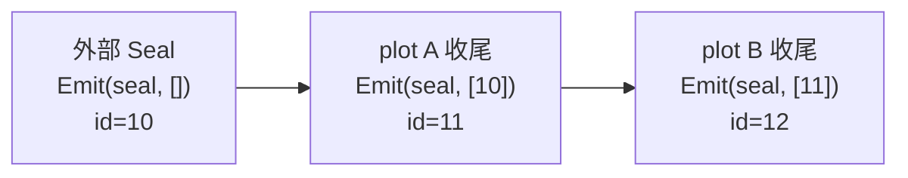
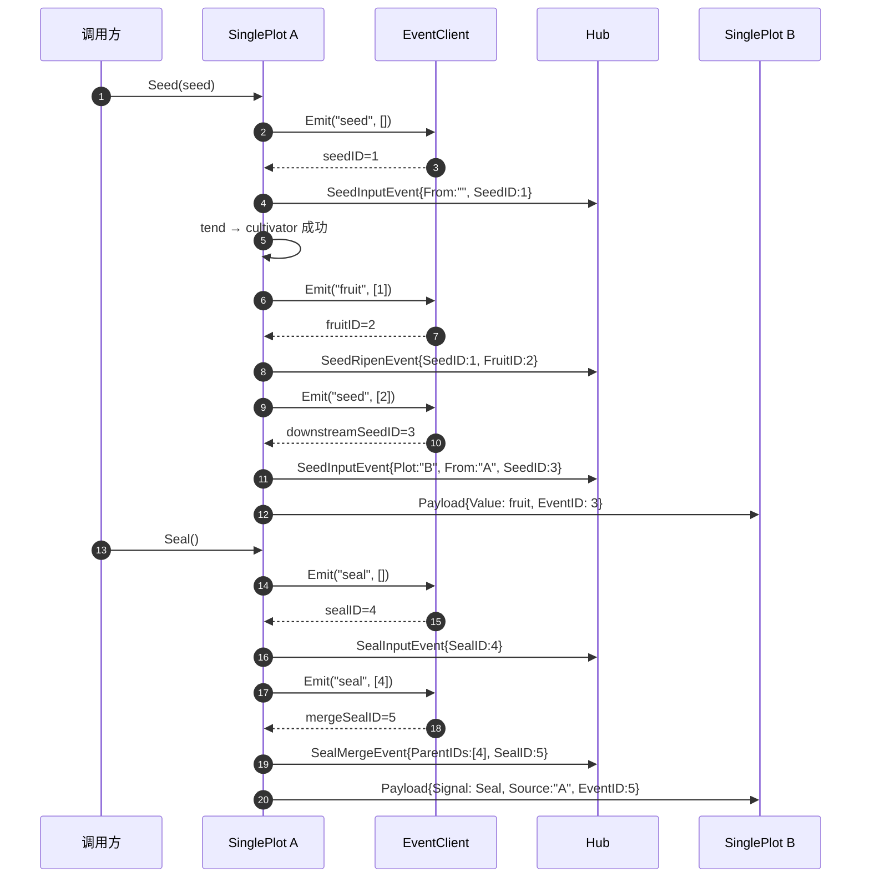
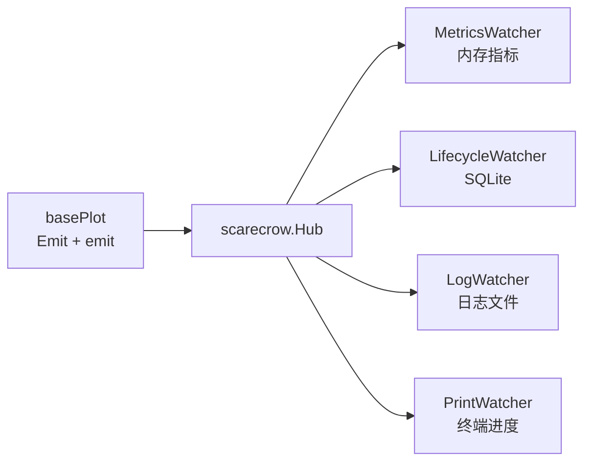

# pkg/runtime/event.go

> 📅 最后更新日期: 2026/11/13

`event.go` 定义运行期的**事件 ID 分配抽象**：接口 `EventClient` 只有 `Emit(type_ string, parents []int) int` 一个方法，默认实现 `LocalEventClient` 用互斥锁维护进程内单调递增的计数器。`pkg/plot` 的 `basePlot` 通过 `eventClient` 字段取得 ID，并在同一时刻把 ID 写进 `pkg/scarecrow` 的事件结构体（`SeedInputEvent.SeedID`、`SeedRipenEvent.FruitID`、`SeedWitherEvent.WeedID` 等），供指标、日志与生命周期观察者消费。

> 注意区分两个「事件」概念：本文件的 `EventClient` 只负责**分配整数 ID**；真正被观察者消费的是 `pkg/scarecrow/event.go` 中封闭定义的 `Event` 结构体，见 [`../scarecrow/event.md`](../scarecrow/event.md)。

## 作用

- 定义**事件 ID 分配器**的最小契约 `EventClient`，把「ID 怎么生成」从 plot 的调度逻辑中解耦。
- 提供进程内、并发安全的默认实现 `LocalEventClient`。
- 让 `Seed` / `Seal` / `witherSeed` / `pruneSeed` / `ripenSeed` / `sprout` 收尾等关键节点都能拿到单调递增的整数 ID，并用 `parents` 串起「seed → fruit → 下游 seed → …」的因果链。
- 这些 ID 随事件结构体进入 `scarecrow.Hub`，最终由 `persist.LifecycleWatcher` 写入 SQLite 的 `events` / `event_parents` 表。

> 本包**只有** `EventClient`、`LocalEventClient`、`NewLocalEventClient` 与 `(*LocalEventClient).Emit` 四个导出符号；没有 `EventKind` 枚举，也没有 `Event` 结构体。事件种类（`"seed"` / `"fruit"` / `"weed"` / `"prune"` / `"seal"`）以字符串字面量由 `pkg/plot` 传入 `Emit` 的 `type_` 参数。

## 核心对象

### `EventClient` 接口

事件客户端的最小发射能力。runtime 包只要求它能完成一件事——**分配一个事件 ID**。

```go
type EventClient interface {
	Emit(type_ string, parents []int) int
}
```

| 方法 | 用途 |
|------|------|
| `Emit(type_ string, parents []int) int` | 声明一次类型为 `type_`、直接父事件 ID 为 `parents` 的事件，并返回本次分配到的事件 ID |

> `type_` 与 `parents` 在 `LocalEventClient` 的实现里**只参与签名契约**：默认实现既不持久化 `type_`，也不存储 `parents`，只返回递增的本地 ID。二者的业务含义由调用方（`pkg/plot`）解释，并随 `scarecrow.Event` 传给观察者。这样设计允许未来用分布式 ID 生成器替换默认实现，而不必改动 plot 代码。

### `LocalEventClient` 结构

进程内的事件 ID 分配器。`newBasePlot` 在构造每个 plot 时默认创建并使用它；`Farm` 则在 `NewFarm` 中创建一份并注入所有已注册 plot。

```go
type LocalEventClient struct {
	mu     sync.Mutex
	nextID int
}
```

| 字段 | 类型 | 含义 |
|------|------|------|
| `mu` | `sync.Mutex` | 保护 `nextID` 的互斥锁，使 `Emit` 在并发调用下仍是原子的 |
| `nextID` | `int` | 已分配的事件 ID；零值表示尚未分配，首次 `Emit` 返回 `1` |

### 构造与发射

```go
func NewLocalEventClient() EventClient

func (e *LocalEventClient) Emit(type_ string, parents []int) int
```

| 函数 | 行为 |
|------|------|
| `NewLocalEventClient()` | 返回一个 `EventClient` 接口值，内部持有零值的 `*LocalEventClient`（`nextID = 0`） |
| `Emit(type_, parents)` | 加锁、`nextID++`、返回新的 `nextID`、解锁。并发安全，同一实例上单调递增 |

```go
c := runtime.NewLocalEventClient()
id1 := c.Emit("seed", []int{})      // 1
id2 := c.Emit("fruit", []int{id1})  // 2
```

> `LocalEventClient` 不存储历史记录——它只负责「分配 ID」，已分配过的 ID 无法通过它查询。需要追溯事件链时，应依赖观察者把 ID 与 `parents` 传递到 `pkg/persist`。

## 公开符号一览

| 符号 | 类型 | 说明 |
|------|------|------|
| `EventClient` | `interface` | 事件 ID 分配的最小契约 |
| `LocalEventClient` | `struct`（导出） | 进程内、并发安全的默认实现 |
| `NewLocalEventClient` | `func() EventClient` | 构造方法，返回接口值 |
| `(*LocalEventClient).Emit` | `func(string, []int) int` | 分配并返回新 ID |

## ID 分配的实际调用点

`basePlot` 的通用路径在 `pkg/plot/plot.go`，成功路径按节点类型分别位于 `pkg/plot/plot_single.go`、`plot_split.go`、`plot_route.go`。所有调用都使用当前 plot 的 `p.eventClient`，`Farm` 自身不调用 `Emit`。

| 触发方法 | 所在文件 / 类型 | `type_` | `parents` | 随后发出的 `scarecrow.Event` |
|---------|----------------|---------|-----------|------------------------------|
| `Seed` | `plot.go` / `basePlot` | `"seed"` | `[]int{}` | `SeedInputEvent`（`From` 为空、`Parents` 空） |
| `Seal` | `plot.go` / `basePlot` | `"seal"` | `[]int{}` | `SealInputEvent` |
| `witherSeed` | `plot.go` / `basePlot` | `"weed"` | `[]int{seedID}` | `SeedWitherEvent`（`WeedID`） |
| `pruneSeed` | `plot.go` / `basePlot` | `"prune"` | `[]int{seedID}` | `SeedPruneEvent`（`PruneID`） |
| `ripenSeed` | `plot_single.go` / `SinglePlot` | `"fruit"` | `[]int{seedID}` | `SeedRipenEvent`（`FruitID`） |
| `ripenSeed` | 同上，逐下游 | `"seed"` | `[]int{fruitID}` | `SeedInputEvent`（`Plot` 为下游名、`From` 为本节点名、`Parents = []int{fruitID}`） |
| `ripenSeed` | `plot_split.go` / `SplitPlot` | `"fruit"`（一次） | `[]int{seedID}` | `SeedRipenEvent` |
| `ripenSeed` | 同上，逐下游 × 逐果实 | `"seed"` | `[]int{fruitID}` | `SeedInputEvent`（每个产出各一条） |
| `ripenSeed` | `plot_route.go` / `RoutePlot` | `"fruit"`（一次） | `[]int{seedID}` | `SeedRipenEvent` |
| `ripenSeed` | 同上，逐条命中的路由 | `"seed"` | `[]int{fruitID}` | `SeedInputEvent`（未连接的目标被跳过） |
| `sprout` 收尾 | `plot.go` / `basePlot` | `"seal"` | 已收集的全部 seal ID | `SealMergeEvent`（`ParentIDs`） |

补充说明：

- `witherSeed` 同时覆盖三条失败路径：`cultivator` 返回 error、`retryIf` 拒绝重试、`tend` 中的 `recover` 捕获 panic（包装为 `cultivator panic: …`）。
- `pruneSeed` 由 `tend` 在调用 `cultivator` 之前命中 `pruneIf` 时触发，不产生 fruit，也不向下游转发。
- `SeedInputEvent` 由**投递方**发出：上游 `ripenSeed` 在把 `Payload` 写入下游通道之前发出，`Plot` 字段填下游名、`From` 填本节点名。下游 `sprout` 读到普通 `Payload` 时不会再补发一条输入事件。
- `sprout` 收尾时的 `parents` 来自 `sealedFrom` map 的取值，因此**顺序不稳定**；SQLite 中 `event_parents` 只记录边，不依赖顺序。

## 因果链

下面用单实例 `LocalEventClient`、单条链路举例（ID 从 1 开始连续分配）：



`fruit` → 多条下游 `seed` 时形成扇出（`SplitPlot` 的多颗果实、`RoutePlot` 的多个目标都如此）；`weed` / `prune` 是链路的终点，不会继续产出。seal 链则沿「上游合并 seal → 下游」传播：



（图中 A 是无上游的 source plot；若 A 还有其它上游，合并 seal 的 `parents` 会包含所有已收集的 seal ID。）

### 一次完整运行的事件时序



> 图中省略了等待过程：`sprout` 只有在 `inputClosed` 为真且所有在途种子通过 `done` 回报后才发出合并 seal（`SealMergeEvent`），因此 seal 总是在本节点已接收的种子全部处理完毕后才会向下游广播。

## 与观察者和持久化的关系

ID 本身不携带业务信息，落库完全由观察者完成：

- `scarecrow.MetricsWatcher` 按事件字段维护输入 / 成熟 / 枯萎 / 剪枝计数与上下游来源分布，不读取事件 ID。
- `persist.LifecycleWatcher` 把四类种子事件翻译成 `persist.LifecycleRecord`，再用 `InsertLifecycleEvent` 写入 `events` + `event_parents`，并更新 `status` 表。
- `persist.LogWatcher` 输出可读日志；`scarecrow.PrintWatcher` 打印进度。二者都不落库。
- `MetricsWatcher` / `LifecycleWatcher` / `LogWatcher` 由 `pkg/assembly` 在 `Run` / `Start` 时自动注册到 Hub；`PrintWatcher` 需要调用方通过 `AddWatcher` 手动挂载。



`type_` 与落库值的对应关系如下（`LifecycleRecord` 的 `Kind` 常量定义在 `pkg/persist/lifecycle.go`）：

| `Emit` 的 `type_` | 事件 | `LifecycleRecord.Kind` | `events.event_type` | `status.status` |
|-------------------|------|------------------------|---------------------|-----------------|
| `"seed"` | `SeedInputEvent` | `"seed"` | `"seed"` | `"seed"` |
| `"fruit"` | `SeedRipenEvent` | `"ripen"` | `"ripen"` | `"ripen"` |
| `"weed"` | `SeedWitherEvent` | `"wither"` | `"wither"` | `"wither"` |
| `"prune"` | `SeedPruneEvent` | `"prune"` | `"prune"` | `"prune"` |
| `"seal"` | `SealInputEvent` / `SealMergeEvent` | （不产生记录） | — | — |

> 命名分层：`Emit` 的 `type_` 用植物学隐喻（`fruit` / `weed`），`LifecycleRecord.Kind` 与落库值用状态语义（`ripen` / `wither`）。`LifecycleRecord.ParentIDs` 来自事件字段：种子输入用 `SeedInputEvent.Parents`，成熟 / 枯萎 / 剪枝各自使用 `[]int{SeedID}`。

## 使用示例

### 替换默认实现

如果要把本地自增 ID 换成雪花 ID、UUID 哈希或外部服务分配器，实现 `EventClient` 后通过 `SetEventClient` 注入即可：

```go
package main

import (
	"fmt"
	"sync/atomic"

	"github.com/Mr-xiaotian/CelestialGrow/pkg/farm"
	"github.com/Mr-xiaotian/CelestialGrow/pkg/plot"
)

// offsetClient 在本地自增序列上叠加固定偏移，便于和外部 ID 空间区分。
type offsetClient struct {
	base int
	next atomic.Int64
}

func (c *offsetClient) Emit(type_ string, parents []int) int {
	// type_ 与 parents 由调用方解释；此处只负责分配唯一 ID。
	return c.base + int(c.next.Add(1))
}

func main() {
	double := plot.NewSinglePlot("double", func(seed int) (int, error) {
		return seed * 2, nil
	})
	format := plot.NewSinglePlot("format", func(seed int) (string, error) {
		return fmt.Sprintf("result=%d", seed), nil
	})

	f := farm.NewFarm("demo_farm")
	if err := f.AddPlot(double, format); err != nil {
		panic(err)
	}
	if err := f.Connect([]plot.PlotNode{double}, []plot.PlotNode{format}); err != nil {
		panic(err)
	}

	client := &offsetClient{base: 1000}
	double.SetEventClient(client) // 覆盖 AddPlot 注入的默认 client
	format.SetEventClient(client) // 同一条链路必须共用同一实例

	if err := f.Run(map[string][]any{"double": {1, 2, 3}}, "INFO"); err != nil {
		panic(err)
	}
}
```

> `Emit` 的 `type_` / `parents` 参数必须出现在签名中。即使自定义实现不读取它们，也不能省略，否则无法实现 `runtime.EventClient`。

### 包装默认实现做统计

`LocalEventClient` 不提供 `Len()` / `Current()` 之类的查询方法；如需观察已分配数量，可在外面包一层：

```go
package main

import (
	"sync/atomic"

	"github.com/Mr-xiaotian/CelestialGrow/pkg/runtime"
)

type countedClient struct {
	inner runtime.EventClient
	n     atomic.Int64
}

func (c *countedClient) Emit(type_ string, parents []int) int {
	id := c.inner.Emit(type_, parents)
	c.n.Add(1)
	return id
}
```

## 重要细节

- **并发安全**：`LocalEventClient.Emit` 用 `sync.Mutex` 串行化 `nextID++`，多协程并发调用下返回的 ID 仍唯一且单调递增。
- **只分配、不存储**：可变状态只有 `nextID` 与保护它的 `mu`；`type_`、`parents`、时间戳都不进分配器。
- **ID 从 1 开始**：零值 `nextID == 0`，首次 `Emit` 返回 1；因此未显式设置 `EventID` 的 `Payload` 该字段为零值 `0`。
- **Farm 内共享**：`farm.NewFarm` 创建一个 `LocalEventClient`，`Farm.AddPlot` 对每个 plot 调用 `SetEventClient(f.eventClient)`，因此同一 Farm 内所有 plot 共用一个命名空间，跨 plot 链路不会出现 ID 复用。
- **standalone 各自为政**：不经 Farm、手工连接多个 plot 时，每个 plot 的 `newBasePlot` 各自创建一个 `LocalEventClient`，不同 plot 的 ID 可能重复；手工组网时应显式给所有节点注入同一实例。
- **seal 不落库**：`LifecycleWatcher` 忽略 `SealInputEvent` / `SealMergeEvent`，seal ID 不会写入 SQLite；它只在内存中的 `sealedFrom` 聚合、`SealMergeEvent` 字段与下游 `Payload` 中传递。
- **`parents` 是直接父事件**：不是因果路径上的全部祖先，SQLite 中每条边只连一层。

## 注意事项

- 不要在需要共享命名空间时混用两个 `LocalEventClient` 实例——同一逻辑任务会被分配两套 ID，破坏 `event_parents` 的边关系。
- `LocalEventClient` 的零值可用，但外部构造建议使用 `NewLocalEventClient()`，以便拿到 `EventClient` 接口值、后续无痛替换实现。
- 新增业务事件种类时，不能只改 `type_` 字面量：`scarecrow.Event` 是封闭集合，必须同步 `pkg/scarecrow/event.go` 以及 `MetricsWatcher` / `LifecycleWatcher` / `LogWatcher` / `PrintWatcher` 的 `type switch`，否则新事件会被静默忽略。
- 观察者运行在事件发送方的协程上且同步执行，`Hub` 不提供异步队列；不要在 `OnEvent` 中做阻塞操作，否则会拖慢 plot 的调度路径。
