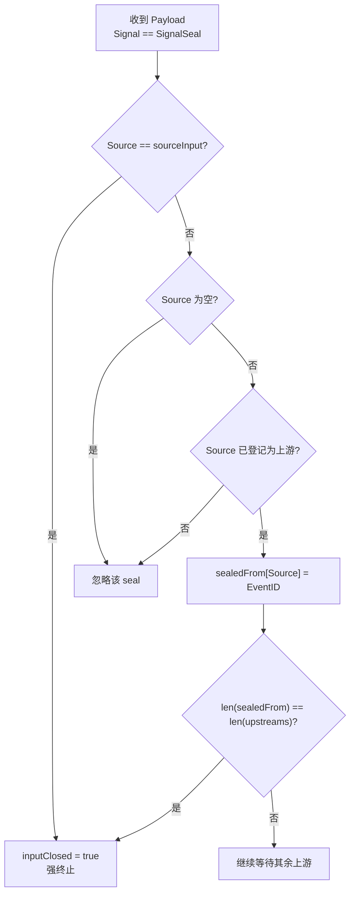

# pkg/runtime/type.go

> 📅 最后更新日期: 2026/11/13

`type.go` 定义跨包共享的运行时基础类型：管道阶段的统一数据载体 `Payload[V]`、控制信号常量 `SignalNone` / `SignalSeal`，以及「种子—果实」配对类型 `Karma[S, F]`。其中 `Payload` 是 `pkg/plot` 中节点间数据通道（`seedChan` / `yieldChans`）的元素类型；`Karma` 目前只是预留扩展点，未在运行时主流程中使用。

## 作用

- 把**数据**（seed、yield）与**控制信号**（seal）统一封装进同一个泛型类型，使 plot 之间的连接只需要一条 `chan runtime.Payload[X]`。
- 通过 `SignalNone` / `SignalSeal` 两个常量，让数据流与控制流共用一条通道，由接收方按 `Signal` 分流。
- 用 `Source` 标识 seal 的来源，使 `basePlot.markSealed` 能完成「等待所有上游」或「外部强终止」的聚合判断。
- 提供 `Karma`「种子—果实」配对类型，为上层可能需要的「回头看」接口留出空间。

> `pkg/runtime` 不包含 `Task` / `TaskResult` / `TaskStatus` 等任务模型；运行期信息全部通过 `pkg/scarecrow` 的事件结构体向外传递，持久化由 `pkg/persist` 的观察者完成（见 [`event.md`](./event.md)）。

## 核心对象

### 控制信号常量

```go
const (
	SignalNone = iota // 正常数据
	SignalSeal        // 终止信号，通知下游不再有新数据
)
```

| 常量 | 值 | 语义 |
|------|----|------|
| `SignalNone` | `0` | 这条 `Payload` 携带正常数据（seed 或 yield） |
| `SignalSeal` | `1` | 这条 `Payload` 是终止信号，通知下游「本 plot 不再产生新数据」 |

设计要点：

- 用**同一个 `chan Payload[V]`** 同时承载数据和控制流，避免为控制信号额外开一条通道。
- `Signal == SignalSeal` 时**不读取** `Value`，仅靠 `Signal` 与 `Source` 判定。
- 下游 `sprout` 读到 `SignalSeal` 时调用 `markSealed`，由 `Source` 决定是强终止还是等待上游聚合，详见本文「Seal 聚合与 `markSealed`」。

### `Payload[V]` 结构

```go
type Payload[V any] struct {
	// Signal与Seed通用
	Signal  int
	EventID int

	// Signal使用
	Source string

	// Seed使用
	Value V
}
```

| 字段 | 类型 | 用途 | 在 `SignalSeal` 下的语义 |
|------|------|------|--------------------------|
| `Signal` | `int` | `SignalNone`（正常数据）或 `SignalSeal`（终止信号） | 固定为 `SignalSeal` |
| `EventID` | `int` | 由 `EventClient.Emit` 分配的事件 ID（见 [`event.md`](./event.md)） | seal 事件 ID（仅内存使用，不落库） |
| `Source` | `string` | 信号来源：外部终止为 `sourceInput`，内部传播为上游 plot 名；正常数据不设置该字段 | seal 来自哪个 plot（或 `sourceInput`） |
| `Value` | `V` | 实际数据（seed 或 yield） | **不使用**，为零值 |

> 字段含义由 `Signal` 决定：
> - `Signal == SignalNone`：`Value` 是有效数据，`EventID` 是这条数据的事件 ID；当前实现中 `Source` 保持零值 `""`。
> - `Signal == SignalSeal`：`Value` 无意义；`Source` 供下游 `markSealed` 判来源。

### `Karma[S, F]` 结构

```go
type Karma[S any, F any] struct {
	Seed  S
	Fruit F
}
```

| 字段 | 类型 | 含义 |
|------|------|------|
| `Seed` | `S` | 一颗种子的原始输入 |
| `Fruit` | `F` | 这颗种子经过培育后产出的果实 |

> `Karma` 目前**未被 `pkg/plot` 或任何其他包使用**，`pkg/runtime` 把它作为预留扩展点暴露出来（例如：失败时也把 `Seed` 存下来做可重放缓存；或在 `Harvest` 时返回 `[]Karma`）。请避免在生产路径上依赖它。

## 公开符号一览

| 符号 | 类型 | 用途 |
|------|------|------|
| `SignalNone` | `const int` | `Payload.Signal` 取值：正常数据 |
| `SignalSeal` | `const int` | `Payload.Signal` 取值：终止信号 |
| `Payload[V any]` | `struct` | 管道阶段统一数据载体，同时承载数据与控制信号 |
| `Karma[S any, F any]` | `struct` | 种子—果实配对（预留扩展点） |

泛型参数语义：

| 参数 | 出现位置 | 含义 |
|------|---------|------|
| `V` | `Payload[V]` | 该管道阶段承载的数据类型；`seedChan` 用 `S`，`yieldChans` 用 `Y` |
| `S` | `Karma[S, F]` | 种子类型 |
| `F` | `Karma[S, F]` | 果实类型 |

## 跨包使用约定

`Payload[V]` 是 `pkg/plot` 节点间数据通道的元素类型（通道定义见 `pkg/plot/plot.go`）：

| 通道 | 元素类型 | 写入点 | 读取点 |
|------|----------|--------|--------|
| `basePlot.seedChan` | `chan runtime.Payload[S]` | `basePlot.Seed`、`basePlot.Seal`、上游 plot 的 `yieldChans` | 当前 plot 的 `sprout` |
| `basePlot.yieldChans[name]` | `chan runtime.Payload[Y]` | 当前 plot 的 `ripenSeed`、`sprout` 收尾 | 下游 plot 的 `seedChan` |

四处构造点（均在 `pkg/plot`）：

| 构造点 | 代码 | `Signal` | `Source` | `Value` |
|--------|------|----------|----------|---------|
| `basePlot.Seed` | `runtime.Payload[S]{Value: seed, EventID: seedID}` | `SignalNone`（零值，未显式设置） | `""`（未设置） | 种子 |
| `basePlot.Seal` | `runtime.Payload[S]{Signal: runtime.SignalSeal, Source: sourceInput, EventID: sealID}` | `SignalSeal` | `"__input__"` | 零值 |
| `ripenSeed` 转发下游 | `runtime.Payload[Y]{Value: yield, EventID: downstreamSeedID}` | `SignalNone`（零值） | `""`（未设置） | 果实 / 单颗产出 |
| `sprout` 收尾广播 | `runtime.Payload[Y]{Signal: runtime.SignalSeal, Source: p.name, EventID: sealID}` | `SignalSeal` | 当前 plot 名 | 零值 |

> `sourceInput` 是 `pkg/plot/constant.go` 中的未导出常量，字面量 `"__input__"`。外部包既不能引用它，也不应硬编码该字符串；判断「是否由外部终止」应通过 `Seal()` 的行为推理。详见 [`../plot/constant.md`](../plot/constant.md)。

> `ConnectTo` 会做类型断言 `next.GetSeedChanAny().(chan runtime.Payload[Y])`，因此上下游的 `Payload` 元素类型必须一致。这也是「不要为数据 / 信号拆成两种类型」的硬约束来源。

### 下游接收时不会重发输入事件

上游 `ripenSeed` 在写入下游通道之前，已经以自己的 Hub 发出 `scarecrow.SeedInputEvent`（`Plot` 为下游名、`From` 为本节点名、`Parents` 为 `[]int{fruitID}`）。下游 `sprout` 读到普通 `Payload` 后只做培育调度，不会补发输入事件。因此指标与生命周期观察者看到的每条输入，都只对应一条事件。

## Seal 聚合与 `markSealed`

`basePlot.sprout` 在 `select` 中收到 `SignalSeal` 时调用 `markSealed(source, sealID, sealedFrom)`，并用返回值**直接覆盖** `inputClosed`：

```go
func (p *basePlot[S, F, Y]) markSealed(source string, sealID int, sealedFrom map[string]int) bool {
	if source == sourceInput {
		sealedFrom[sourceInput] = sealID
		return true
	}
	if source == "" {
		return false
	}
	if _, ok := p.upstreams[source]; !ok {
		return false
	}
	sealedFrom[source] = sealID
	return len(sealedFrom) == len(p.upstreams)
}
```



各分支语义：

| `Source` | 行为 | 输入是否立即关闭 |
|----------|------|------------------|
| `sourceInput`（`"__input__"`） | 记录到 `sealedFrom[sourceInput]` | **是**：收到该 seal 时立即关闭输入，不再等待未到达的上游 seal |
| `""` | 直接忽略 | 否 |
| 未在 `upstreams` 中登记的名字 | 直接忽略 | 否 |
| 已登记的上游名 | 记录 `sealedFrom[Source] = EventID` | 当已收集的来源数等于上游数时关闭 |
| 同一上游重复发 seal | 覆盖同一个 key，不会重复计数 | 取决于其余上游是否已全部到达 |

`upstreams` 由上游在 `ConnectTo` 时调用 `AddUpstream(p.name)` 登记，建立连接后不再变化；因此当前实现中没有上游的 plot 只能靠外部 `Seal()` 关闭。

> `inputClosed` 不是「一旦为 `true` 就锁定」的粘性标记——它每次收到 seal 都会被 `markSealed` 的返回值覆盖。外部 `Seal()` 产生的 seal 会让当次 `markSealed` 返回 `true`，但如果此时仍有在途种子（`inFlight > 0`），`sprout` 会继续接收后续 seal，来自上游的 seal 可能把它重新置为 `false`。最终退出仍以下一轮 `shouldFinish()` 成立（`inputClosed && inFlight == 0`）为准。

### 收尾与 seal 事件

`sprout` 每轮循环开头检查：

```go
shouldFinish := func() bool {
	return ctxCancel || (inputClosed && inFlight == 0)
}
```

其中 `ctxCancel` 来自 `p.ctx.Done()`（当前 `basePlot` 保存了 `cancel` 但没有任何调用点，因此实际生效的只有后半段），`inFlight` 是已进入 `tend` 但尚未通过 `done` 回报的种子数。满足条件后：

1. 从 `sealedFrom` 的 value 收集 `parentIDs`，调用 `p.eventClient.Emit("seal", parentIDs)`；
2. 发出 `scarecrow.SealMergeEvent{Plot, ParentIDs, SealID, Time}`；
3. 向**所有** `yieldChans` 发送 `Payload[Y]{Signal: SignalSeal, Source: p.name, EventID: sealID}`，然后 `return`。

> `parentIDs` 来自 map 遍历，**顺序不稳定**；它可能包含 `sourceInput` 的 seal ID 以及关闭前收到的部分上游 seal ID。seal 事件不写入 SQLite，`LifecycleWatcher` 会忽略 `SealInputEvent` / `SealMergeEvent`。

## 使用示例

### 在 `seedChan` 上判别数据 / 信号

```go
package main

import (
	"context"

	"github.com/Mr-xiaotian/CelestialGrow/pkg/runtime"
)

func consume[S any](
	ctx context.Context,
	ch <-chan runtime.Payload[S],
	handle func(seed S, eventID int),
	handleSeal func(source string, sealID int),
) {
	for {
		select {
		case p := <-ch:
			switch p.Signal {
			case runtime.SignalNone:
				handle(p.Value, p.EventID)
			case runtime.SignalSeal:
				handleSeal(p.Source, p.EventID)
			}
		case <-ctx.Done():
			return
		}
	}
}
```

### 构造一条发往下游的 yield Payload

```go
package main

import "github.com/Mr-xiaotian/CelestialGrow/pkg/runtime"

func forward[Y any](
	client runtime.EventClient,
	fruitID int,
	yield Y,
	ch chan<- runtime.Payload[Y],
) {
	downstreamSeedID := client.Emit("seed", []int{fruitID})
	ch <- runtime.Payload[Y]{Value: yield, EventID: downstreamSeedID}
}
```

### 构造并广播一条 seal Payload

```go
package main

import "github.com/Mr-xiaotian/CelestialGrow/pkg/runtime"

func broadcastSeal[Y any](
	client runtime.EventClient,
	name string,
	parentIDs []int,
	chans map[string]chan runtime.Payload[Y],
) {
	sealID := client.Emit("seal", parentIDs)
	payload := runtime.Payload[Y]{
		Signal:  runtime.SignalSeal,
		Source:  name, // 外部终止时由 pkg/plot 填 sourceInput
		EventID: sealID,
	}
	for _, ch := range chans {
		ch <- payload
	}
}
```

### 用 `Karma` 缓存「种子—果实」对（占位用法）

```go
k := runtime.Karma[S, F]{Seed: seed, Fruit: fruit}
// 业务侧可以把它放进自己管理的回放缓存里
_ = k
```

## 重要细节

- **零值即「正常数据」**：`Signal` 的零值是 `SignalNone`，所以不写 `Signal` 字段的 `Payload{}` 自动表示一条正常数据。`Seed` / `ripenSeed` 都只设置 `Value` / `EventID`，不显式设置 `Signal`。
- **联合语义**：`Signal` / `Source` / `Value` 按 `Signal` 取值分别使用，不要假设所有字段都有意义。
- **`Source` 只服务于 seal**：当前 `pkg/plot` 的实现中，正常数据的 `Source` 始终是 `""`；上游投递信息记录在 `SeedInputEvent.From` 中，而不是 `Payload.Source`。
- **seal 只沿 `yieldChans` 广播**：`sprout` 收尾时向所有已连接下游各发一次；未连接的 plot 不会收到。
- **强终止受在途种子影响**：外部 `Seal()` 会在当次 `markSealed` 中立即返回 `true`，但 `inputClosed` 每次收到 seal 都会被重新赋值；若在途种子尚未结束、随后又收到不满足聚合条件的 seal，关闭状态可能被覆盖。最终退出以 `shouldFinish()`（`inputClosed && inFlight == 0`）为准。
- **`EventID` 由分配器决定**：`Payload` 只是携带者，不校验 ID 是否唯一；手工组网时必须保证整条链路共用一个 `runtime.EventClient`。

## 注意事项

- 不要为 `Payload` 拆分出「只能装数据 / 只能装信号」的多个类型——本框架的设计就是「同一条管道同时承载数据和控制流」，拆类型会破坏 `ConnectTo` 的类型断言。
- 不要把 `Payload.Value` 用于 `Signal == SignalSeal` 的情形；其内容是 `V` 的零值，语义未定义。
- seal 的 `Source` 一旦填错（例如内部传播误填 `sourceInput`，或用了未登记的上游名），会导致下游**提前收尾**或**永远等不到关闭**；自定义 plot 逻辑时应复用 `basePlot` 的 `Seal` / `sprout` 实现，而不要手写 seal。
- `Karma` 当前未在 plot 主流程中使用，引入它是预留扩展点，请避免在生产路径上依赖它。
- 若需要观察运行期指标，请使用 `scarecrow.MetricsWatcher`（通过事件流重建计数），不要试图在 `Payload` 上附加计数器或状态字段。
