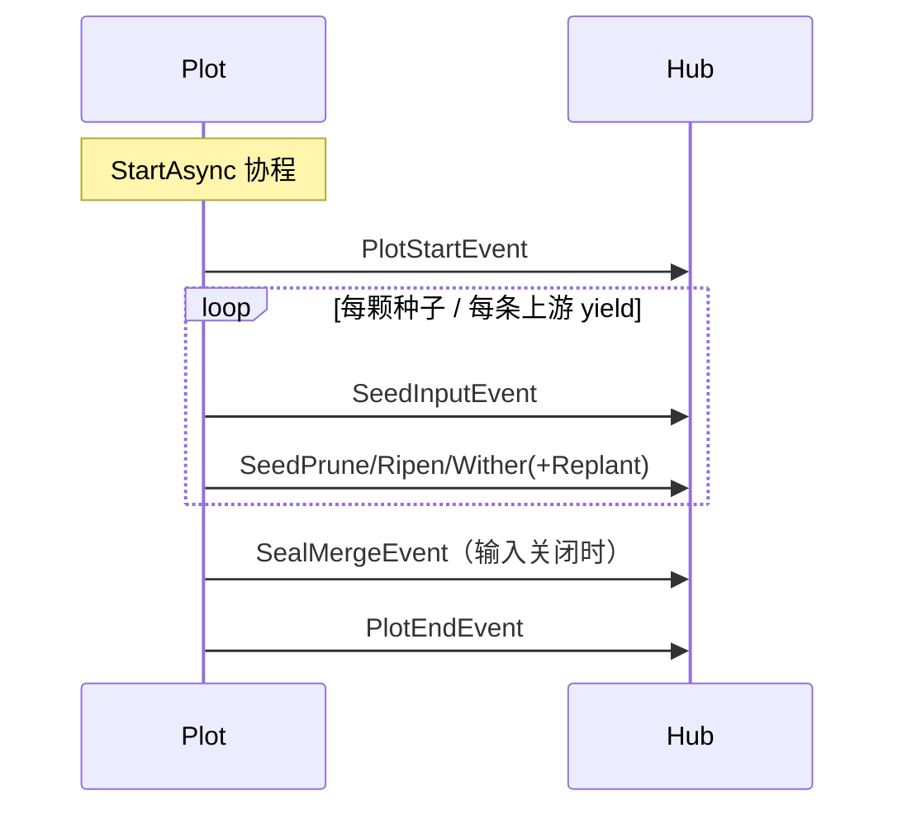

# pkg/scarecrow/event.go

> 📅 最后更新日期: 2026/11/13

## 作用

`pkg/scarecrow/event.go` 定义运行期事件的**封闭集合**：一个只含未导出方法 `isEvent()` 的事件接口 `Event`，以及 11 个具体事件结构体。`pkg/plot` 与 `pkg/farm` 在生命周期、种子进出与终止信号的关键时刻发出这些结构体值，观察者（`MetricsWatcher`、`PrintWatcher`、`persist.LogWatcher`、`persist.LifecycleWatcher` 等）通过 `type switch` 消费。

本文件只定义数据，不含分发逻辑——分发见 [`hub.md`](./hub.md)，接收方契约见 [`watcher.md`](./watcher.md)，指标重建见 [`metrics.md`](./metrics.md)。

## 核心对象

### `Event` 接口

```go
type Event interface {
    isEvent()
}
```

- 方法未导出，**包外无法新增事件类型**，因此所有 `type switch` 都能确信覆盖了全部事件；代价是新增事件必须修改本包，并同步所有消费方。
- 事件以**值**传递（`Hub.OnEvent(event Event)`），接口动态类型始终是上表中的结构体值，不是指针。

### 事件一览

| 事件 | 语义 | 生产方（源码位置） |
|------|------|--------------------|
| `FarmStartEvent` | Farm 启动 | `farm.Farm.start`，注入种子之前 |
| `FarmEndEvent` | Farm 结束 | `farm.Farm.start` 的 `defer`，所有 Plot 退出之后 |
| `PlotStartEvent` | Plot 进入 `running` | `basePlot.notifyStart`（`StartAsync` 协程内、`sprout` 之前） |
| `PlotEndEvent` | Plot 进入 `done` | `basePlot.notifyFinish`（`sprout` 返回后、同一协程） |
| `SeedInputEvent` | 种子进入某个 Plot | `basePlot.Seed`（外部注入）或上游 `ripenSeed`（投递） |
| `SeedRipenEvent` | 培育成功 | `ripenSeed` |
| `SeedWitherEvent` | 培育失败 | `witherSeed`（含 `cultivator` panic 被 `recover` 的路径） |
| `SeedPruneEvent` | 命中 `PruneIf`，跳过培育 | `pruneSeed` |
| `SeedReplantEvent` | 一次重试失败、即将再次尝试 | `tend` 的重试循环 |
| `SealInputEvent` | 外部终止信号进入 Plot | `basePlot.Seal` |
| `SealMergeEvent` | 输入关闭、广播终止信号 | `sprout` 退出前 |

### Farm 事件

```go
type FarmStartEvent struct {
    Farm        string              // Farm 名称
    IsDAG       bool                // 是否为有向无环图
    Plots       []string            // Plot 名称列表
    Edges       map[string][]string // 出边邻接表
    SourcePlots []string            // 源 Plot 名称列表
    Structure   []string            // 预先渲染的结构行
    StartTime   time.Time           // 启动时间
}

type FarmEndEvent struct {
    Farm    string        // Farm 名称
    EndTime time.Time     // 结束时间
    Elapsed time.Duration // 运行耗时
}
```

| 字段 | 说明 |
|------|------|
| `Plots` / `Edges` / `SourcePlots` | 来自 `Farm.Nodes()`、`Farm.OutEdges()`、`SourceNodes(OrderGraph)` 的快照 |
| `Structure` | `Farm.getStructureList()` 预渲染的图结构文本行，供日志/终端直接打印，避免观察者重复实现渲染 |
| `IsDAG` | `IsDAG(OrderGraph)` 的结果，非 DAG 拓扑下结构渲染语义不同 |

### Plot 事件

```go
type PlotStartEvent struct {
    Plot      string
    Tenders   int
    StartTime time.Time
}

type PlotEndEvent struct {
    Plot    string
    EndTime time.Time
    Elapsed time.Duration
}
```

| 字段 | 说明 |
|------|------|
| `Tenders` | 该 Plot 的并发处理协程数（`numTenders`），不代表实际已并发数 |
| `StartTime` / `EndTime` | 生产方取 `time.Now()`；`MetricsWatcher` 直接存入快照 |
| `Elapsed` | `time.Since(startTime)`，`startTime` 是 `StartAsync` 协程开始时取的基准，因此包含 `notifyStart` 与整个 `sprout` 的耗时 |

`PlotStartEvent` 在 `state.Store(1)` 之后发出，`PlotEndEvent` 在 `state.Store(2)` 之后发出，因此观察者在收到事件时 `GetState()` 已与新状态一致；但事件只保证在该 Plot 内「启动先于结束」，不保证与其他 Plot 的相对顺序。

### Seed 事件

```go
type SeedInputEvent struct {
    Plot     string
    From     string
    Seed     any
    SeedRepr string
    SeedID   int
    Parents  []int
    Time     time.Time
}

type SeedRipenEvent struct {
    Plot      string
    Seed      any
    SeedRepr  string
    Fruit     any
    FruitRepr string
    Elapsed   time.Duration
    SeedID    int
    FruitID   int
    Time      time.Time
}

type SeedWitherEvent struct {
    Plot     string
    Seed     any
    SeedRepr string
    Err      error
    Elapsed  time.Duration
    SeedID   int
    WeedID   int
    Time     time.Time
}

type SeedPruneEvent struct {
    Plot     string
    Seed     any
    SeedRepr string
    Elapsed  time.Duration
    SeedID   int
    PruneID  int
    Time     time.Time
}

type SeedReplantEvent struct {
    Plot     string
    Seed     any
    SeedRepr string
    Err      error
    Attempt  int
    SeedID   int
    Time     time.Time
}
```

| 字段 | 说明 |
|------|------|
| `Plot` | 事件归属的 Plot 名称。`SeedInputEvent` 中表示**接收方** Plot |
| `From` | 上游 Plot 名称；**空字符串表示由外部直接注入**（`Plot.Seed` / `Farm.InjectTasks`），非空表示由上游投递 |
| `Seed` / `Fruit` | 原始数据（`any`），保留完整对象，便于观察者自行提取业务字段 |
| `SeedRepr` / `FruitRepr` | 生产方用 `fmt.Sprintf("%+v", ...)` 生成的可读表示；超过 50 / 25 个 rune 时保留首尾、中间以 `...` 省略（`pkg/plot/helper.go` 的 `trunc`），因此**不保证完整** |
| `SeedID` | 该种子在进入当前 Plot 时分配的事件 ID；`SeedRipenEvent` / `SeedWitherEvent` / `SeedPruneEvent` / `SeedReplantEvent` 中的 `SeedID` 指回对应的 `SeedInputEvent` |
| `FruitID` / `WeedID` / `PruneID` | 分别由 `runtime.EventClient.Emit("fruit")` / `"weed"` / `"prune"` 生成，与 `SeedID` 不同 |
| `Parents` | 输入种子的父事件 ID。外部注入时未设置（`nil`）；上游投递时为 `[]int{FruitID}`（上游那次成熟事件的 ID） |
| `Attempt` | 已失败并触发重试的次数，**从 1 开始**；最多出现 `maxRetries` 条 |
| `Err` | 导致枯萎的最终错误，或导致本次重试的错误；`SeedWitherEvent` 中可能来自 `cultivator panic` 的包装错误 |
| `Elapsed` | 培育/判定耗时，从 `tend` 内取 `startTime` 起算；**包含**重试循环中的 `retryDelay` 等待，但**不包含**在 `seedChan` 排队与等待并发令牌的时间 |

### Seal 事件

```go
type SealInputEvent struct {
    Plot   string
    SealID int
    Time   time.Time
}

type SealMergeEvent struct {
    Plot      string
    ParentIDs []int
    SealID    int
    Time      time.Time
}
```

| 字段 | 说明 |
|------|------|
| `SealInputEvent.SealID` | 外部终止信号的事件 ID，会作为 `Source=sourceInput` 的 `SignalSeal` 载荷随 `seedChan` 传递 |
| `SealMergeEvent.ParentIDs` | 参与合并的终止信号 ID 集合：已收到的外部终止信号 ID 与各上游终止信号 ID |
| `SealMergeEvent.SealID` | 合并后新生成的事件 ID，随后随 `SignalSeal` 广播给所有下游 |

> 外部终止信号具有**强终止语义**：`Seal` 之后 Plot 不再等待剩余上游 seal。因此 `ParentIDs` 可能只包含部分上游的 ID。

## 关键流程

```mermaid
flowchart LR
    IN[SeedInputEvent<br/>From 为空=外部注入<br/>SeedID=1] --> TEND{tend<br/>PruneIf?}
    TEND -->|命中| PRUNE[SeedPruneEvent<br/>PruneID]
    TEND -->|失败且 retryIf 命中| REPLANT[SeedReplantEvent<br/>Attempt=1..maxRetries]
    REPLANT --> TEND
    TEND -->|cultivator 成功| RIPEN[SeedRipenEvent<br/>FruitID]
    TEND -->|最终失败| WITHER[SeedWitherEvent<br/>WeedID]
    RIPEN -->|Forward 给下游| DOWN[SeedInputEvent<br/>From=上游<br/>Parents=[FruitID]]
```

一个 Plot 内的整体顺序由 `StartAsync` 协程编排：



Farm 级顺序为 `FarmStartEvent` → 各 Plot 事件 → `FarmEndEvent`。Farm 只有把自身 Hub 注册进每个 Plot 的 Hub，Farm 级观察者才能看到全部 Plot 事件（见 `pkg/farm/farm.go`）。

## 重要细节

- **事件接口是封闭的**：任何 `type switch` 都不会遇到「未知事件」；新增事件类型时需要同步 `MetricsWatcher`、`PrintWatcher`、`persist.LogWatcher`、`persist.LifecycleWatcher` 中的分支，否则会静默落入默认分支。
- **切片与映射只读**：`Plots`、`Edges`、`Structure`、`Parents`、`ParentIDs` 都是生产方持有的底层数据，事件按值传递只复制了 header。观察者**不得修改**这些内容；`MetricsWatcher` 在快照中重建 `map`，正是为了避免把内部状态泄露出去。
- **`SeedReplantEvent` 不改变完成计数**：它是「还会再试」的中间态，重试成功与否由最终的 `SeedRipenEvent` / `SeedWitherEvent` 表达。
- **失败事件一定伴随结果**：`tend` 的 `recover` 会把 panic 转成 `SeedWitherEvent`，因此输入数 = 成熟 + 枯萎 + 剪枝 + 未完成，不会出现「静默丢失」的种子。
- **时间字段不单调**：多个 `tend` 协程并发执行，`Time` 与事件到达顺序无严格对应关系；只有 `PlotStartEvent` / `PlotEndEvent` 之间、`FarmStartEvent` / `FarmEndEvent` 之间存在明确的先后约束。

## 使用示例

自定义观察者按事件类型统计：

```go
package main

import (
    "fmt"

    "github.com/Mr-xiaotian/CelestialGrow/pkg/scarecrow"
)

// eventCounter 统计 Plot 级输入与结果数量。
type eventCounter struct {
    inputs   map[string]int
    ripened  map[string]int
    withered map[string]int
}

func (c *eventCounter) OnEvent(event scarecrow.Event) error {
    switch ev := event.(type) {
    case scarecrow.SeedInputEvent:
        c.inputs[ev.Plot]++
    case scarecrow.SeedRipenEvent:
        c.ripened[ev.Plot]++
    case scarecrow.SeedWitherEvent:
        c.withered[ev.Plot]++
    }
    return nil
}

func main() {
    hub := scarecrow.NewHub(scarecrow.WithErrorHandler(func(err error) {
        fmt.Println("watcher failed:", err)
    }))

    counter := &eventCounter{
        inputs:   map[string]int{},
        ripened:  map[string]int{},
        withered: map[string]int{},
    }
    if err := hub.AddWatcher(counter); err != nil {
        panic(err)
    }

    _ = hub.OnEvent(scarecrow.SeedInputEvent{Plot: "harvester", Seed: 1, SeedID: 1})
    _ = hub.OnEvent(scarecrow.SeedRipenEvent{Plot: "harvester", Seed: 1, SeedID: 1, FruitID: 2})

    fmt.Println(counter.inputs["harvester"], counter.ripened["harvester"]) // 1 1
}
```

把观察者挂到真实 Plot 上。在 `StartAsync` **之前**注册才能保证收到 `PlotStartEvent`；`Seed` 之前注册至少能收到该种子相关的事件：

```go
package main

import (
    "fmt"

    "github.com/Mr-xiaotian/CelestialGrow/pkg/plot"
    "github.com/Mr-xiaotian/CelestialGrow/pkg/scarecrow"
)

type Seed struct{ ID int }
type Fruit struct{ ID int }

func cultivate(s Seed) (Fruit, error) { return Fruit{ID: s.ID}, nil }

func main() {
    p := plot.NewSinglePlot[Seed, Fruit]("harvester", cultivate)

    if err := p.AddWatcher(scarecrow.WatcherFunc(func(event scarecrow.Event) error {
        if ripen, ok := event.(scarecrow.SeedRipenEvent); ok {
            fmt.Println("ripened:", ripen.FruitRepr)
        }
        return nil
    })); err != nil {
        panic(err)
    }

    p.StartAsync()
    p.Seed(Seed{ID: 1})
    p.Seal()
    p.WaitAsync()
}
```

## 注意事项

- 不要依赖 `SeedRepr` / `FruitRepr` 做业务判断：它们超过 50 / 25 个 rune 时会被「首尾保留 + 中间 `...`」方式省略，只适合展示。
- 事件以值发送，但不要假设深拷贝：`Seed` / `Fruit` 为 `any`，若装载指针或 `map`，观察者修改会影响生产方。
- `SeedInputEvent.From` 为空是判断「外部注入」的唯一可靠依据：`Parents` 只是血缘信息，手工构造 `Event`（如测试、回放）时不保证与 `From` 一致。
- 事件是**同步分发**的：观察者耗时直接计入生产方路径，长时间阻塞会拖慢 Plot/Farm 的执行。
