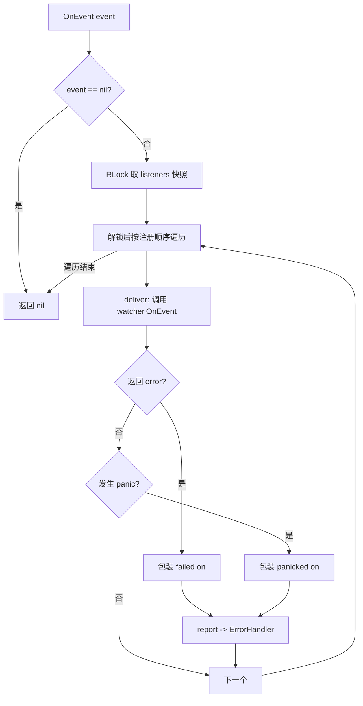
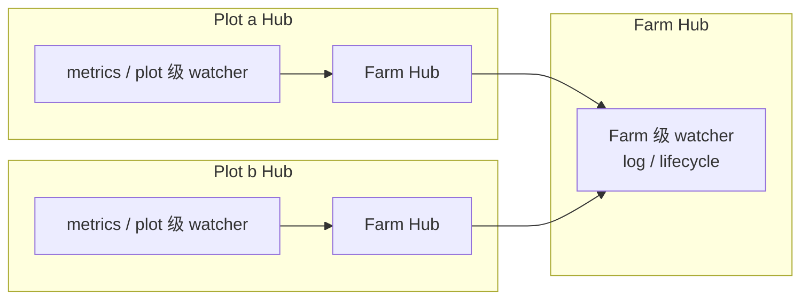

# pkg/scarecrow/hub.go

> 📅 最后更新日期: 2026/11/13

## 作用

`pkg/scarecrow/hub.go` 实现事件分发中心 `Hub`：把 `Event` 按注册顺序**同步**扇出给所有 `Watcher`，并把单个观察者的 `error` 与 `panic` 隔离、上报给可配置的 `ErrorHandler`。`Hub` 自身实现 `Watcher`，因此可以被注册到另一个 `Hub` 形成层级分发（Plot Hub → Farm Hub），并用泛型函数 `Find` 在层级中按类型检索观察者。

## 核心对象

### `HubOption` 与 `WithErrorHandler`

```go
type HubOption func(*Hub)

func WithErrorHandler(handler func(error)) HubOption
```

| 选项 | 说明 |
|------|------|
| `WithErrorHandler(handler)` | 设置观察者失败/panic 时的处理器。传入 `nil` 等价于不设置，回退到 `defaultErrorHandler` |

### `Hub`

```go
type Hub struct {
    mu        sync.RWMutex
    listeners []Watcher
    onError   func(error)
}
```

| 字段 | 说明 |
|------|------|
| `mu` | 保护 `listeners` 的读写锁：写入（`AddWatcher`）持写锁，分发只在取快照时持读锁 |
| `listeners` | 观察者列表，按注册顺序保存，允许重复 |
| `onError` | 错误处理器；零值 Hub 中为 `nil`，`report` 会退化为默认输出 |

### 构造函数与默认处理器

| 符号 | 签名 | 行为 |
|------|------|------|
| `NewHub` | `func NewHub(opts ...HubOption) *Hub` | 依次应用选项；`onError` 仍为 `nil` 时填 `defaultErrorHandler` |
| `defaultErrorHandler`（未导出） | `func(err error)` | `log.Printf("scarecrow: %v", err)`，默认落到标准错误 |

### `AddWatcher`

```go
func (h *Hub) AddWatcher(listener Watcher) error
```

| 错误 | 触发条件 |
|------|----------|
| `scarecrow: cannot add nil listener` | `listener == nil`（接口值本身为 nil） |
| `scarecrow: cannot add a hub to itself` | 把 Hub 注册到自己 |
| `scarecrow: cyclic hub registration rejected: target hub already contains this hub` | 目标 Hub 的嵌套层级中已经包含当前 Hub，注册后会形成环 |

- 允许**重复注册**同一实例，每次分发都会重复调用。
- 环检测 `rejectCycle` 在**加锁前**完成：对候选 Hub 做深度优先遍历，遇到当前 Hub 即拒绝；用 `seen` 集合防止异常拓扑下遍历不终止。

### `OnEvent`

```go
func (h *Hub) OnEvent(event Event) error
```

- `event == nil` 时直接返回 `nil`，不调用任何观察者。
- 在读锁下取一次 `listeners` 快照，随后**在锁外**遍历，因此 watcher 内部可以安全地再次注册 watcher。
- 单个观察者的错误或 panic 都被 `deliver` 包装后交给 `report`，其余观察者继续执行。
- **始终返回 `nil`**：观察者故障已由错误处理器消费，不回流到执行路径（`plot.emit` / `farm.emit` 因此可以忽略返回值）。

### `Find`

```go
func Find[T Watcher](hub *Hub) (T, bool)
```

泛型参数 `T` 是目标观察者类型（接口或具体类型，如 `*MetricsWatcher`）。

| 规则 | 说明 |
|------|------|
| 检索范围 | `hub` 及其嵌套 Hub（`Hub` 本身也是 `Watcher`） |
| 优先顺序 | 先匹配**直属**观察者（按注册顺序），再递归进入嵌套 Hub |
| 未找到 | 返回 `T` 的零值与 `false` |
| `hub == nil` | 直接返回零值与 `false` |
| 防御 | 用 `seen` 集合记录已访问 Hub，避免异常拓扑导致无限递归 |

### `deliver` / `report`（未导出）

| 函数 | 行为 |
|------|------|
| `deliver` | `defer recover()`；观察者返回错误时包装为 `scarecrow: %T failed on %T: %w`，panic 时包装为 `scarecrow: %T panicked on %T: %v` |
| `report` | 取 `h.onError`；为 `nil` 时用 `defaultErrorHandler`；处理器自身 panic 时再用 `defaultErrorHandler` 输出 `scarecrow: error handler panicked: %v` |

## 关键流程

### 分发



### 嵌套拓扑（项目实际用法）



`Farm.start` 通过 `plot.AddWatcher(f.hub)` 把 Farm Hub 注册进每个 Plot Hub，于是 Farm 级 watcher 能收到该 Farm 内所有 Plot 的事件；`Find` 也能从 Plot Hub 出发向上找到 Farm 级注册的 `MetricsWatcher`（`basePlot.currentMetrics` 即依赖此路径）。

## 重要细节

- **写时复制语义**：`AddWatcher` 在写锁内 `append`，只可能替换底层数组、不会改写已发布的元素；`OnEvent` 在读锁下取一次切片快照后在锁外遍历。因此并发追加期间快照依然完整，遍历无需持锁。
- **快照边界**：分发开始后才注册的 watcher 收不到当前这一条事件，从下一条开始接收（`Farm.AddWatcher` 的注释也强调「之后的事件才会送达」）。
- **注册顺序即调用顺序**：同一层级内严格按 `AddWatcher` 顺序串行调用，前一个 watcher 阻塞会推迟后续 watcher。
- **环检测的已知竞态**：检测在加锁前完成，两个 Hub 同时互相注册的极端并发场景仍可能绕过检测；源码注释明确「不建议在运行时并发构建 Hub 拓扑」。`Find` 中的 `seen` 是对异常拓扑的兜底。
- **零值可用**：`var h Hub` 可直接 `AddWatcher` / `OnEvent`；`onError` 为 `nil` 时 `report` 自动回退到默认处理器。
- **错误处理器也被保护**：`report` 内对处理器调用做了 `recover`，处理器 panic 不会击穿 `OnEvent` 的「始终返回 nil」承诺。

## 使用示例

### 基础分发与错误隔离

```go
package main

import (
    "errors"
    "fmt"

    "github.com/Mr-xiaotian/CelestialGrow/pkg/scarecrow"
)

func main() {
    hub := scarecrow.NewHub(scarecrow.WithErrorHandler(func(err error) {
        fmt.Println("reported:", err)
    }))

    _ = hub.AddWatcher(scarecrow.WatcherFunc(func(scarecrow.Event) error {
        return errors.New("boom")
    }))
    _ = hub.AddWatcher(scarecrow.WatcherFunc(func(scarecrow.Event) error {
        fmt.Println("healthy watcher still runs")
        return nil
    }))

    // OnEvent 永远返回 nil，故障通过 ErrorHandler 上报。
    fmt.Println(hub.OnEvent(scarecrow.PlotStartEvent{Plot: "harvester"}))
    // reported: scarecrow: scarecrow.WatcherFunc failed on scarecrow.PlotStartEvent: boom
    // healthy watcher still runs
    // <nil>
}
```

### 嵌套 Hub 与 `Find`

```go
package main

import (
    "fmt"

    "github.com/Mr-xiaotian/CelestialGrow/pkg/scarecrow"
)

func main() {
    metrics := scarecrow.NewMetricsWatcher()

    farmHub := scarecrow.NewHub()
    _ = farmHub.AddWatcher(metrics)

    plotHub := scarecrow.NewHub()
    _ = plotHub.AddWatcher(farmHub) // 把 Farm Hub 嵌套进 Plot Hub

    _ = plotHub.OnEvent(scarecrow.PlotStartEvent{Plot: "harvester", Tenders: 2})
    _ = plotHub.OnEvent(scarecrow.SeedInputEvent{Plot: "harvester", SeedID: 1})

    found, ok := scarecrow.Find[*scarecrow.MetricsWatcher](plotHub)
    if !ok {
        panic("metrics watcher not found")
    }
    snapshot, _ := found.GetPlot("harvester")
    fmt.Println(snapshot.Status, snapshot.InputTotal) // running 1
}
```

### 拒绝环

```go
package main

import (
    "fmt"

    "github.com/Mr-xiaotian/CelestialGrow/pkg/scarecrow"
)

func main() {
    a, b := scarecrow.NewHub(), scarecrow.NewHub()
    _ = a.AddWatcher(b)

    if err := b.AddWatcher(a); err != nil {
        // scarecrow: cyclic hub registration rejected: target hub already contains this hub
        fmt.Println(err)
    }
}
```

## 注意事项

- 环检测不是并发构建拓扑的安全保证；请在启动阶段一次性搭好 Hub 层级。
- `Find` 只返回**第一个**匹配项；同一类型注册多个实例时结果取决于注册顺序与层级（直属优先）。
- `WithErrorHandler(nil)` 不会禁用错误上报，而是回退到默认的 `log.Printf` 输出；若希望静默，传入空函数 `func(error) {}`。
- 默认处理器使用标准库 `log`，输出目标可通过 `log.SetOutput` 全局重定向（测试中常用 `io.Discard`）。
- `Hub` 是同步分发，watcher 的耗时直接叠加到事件生产路径；慢速 watcher 请自行转异步（参见 [`watcher.md`](./watcher.md)）。
