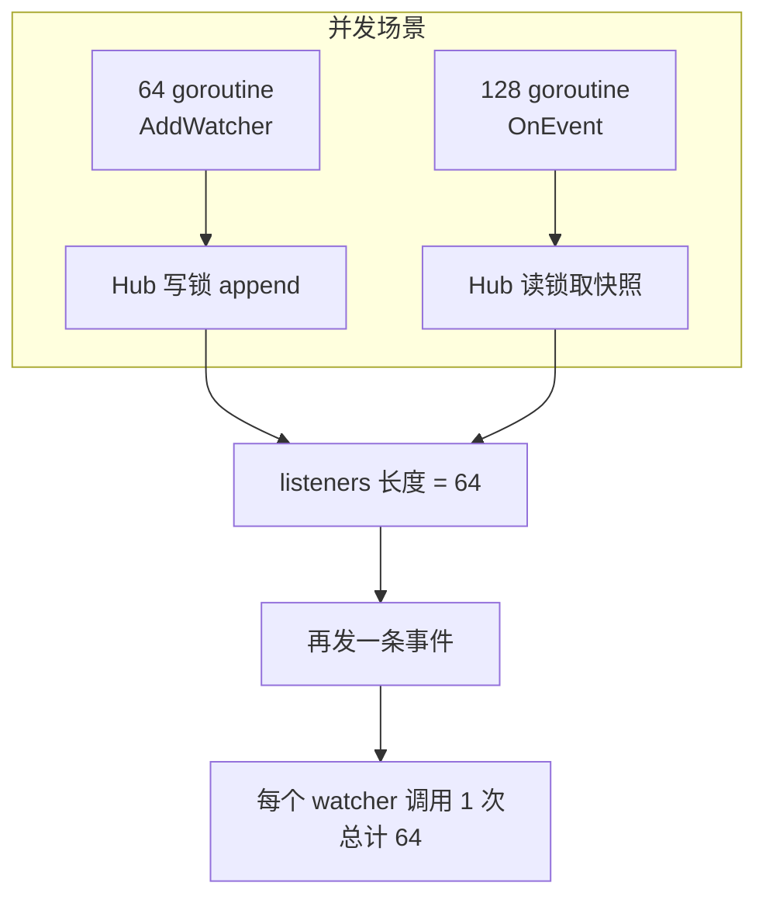

# pkg/scarecrow/hub_test.go

> 📅 最后更新日期: 2026/11/13

## 作用

`pkg/scarecrow/hub_test.go` 是 `Hub` 的行为契约测试：覆盖**分发顺序、注册规则、错误与 panic 隔离、嵌套拓扑、`Find` 检索优先级、以及并发注册/分发**。这些正是 [`hub.md`](./hub.md) 中各条语义的可执行证据。

## 测试分布

| 分组 | 测试 | 验证的行为 |
|------|------|-----------|
| 分发 | `TestHubFansOutInRegistrationOrder` | 三个 watcher 按注册顺序 `a, b, c` 被调用（用互斥锁保护收集切片） |
| 分发 | `TestHubAllowsDuplicateRegistration` | 同一实例注册两次，一次事件触发两次调用 |
| 分发 | `TestHubWithoutWatchers` | 空 Hub 分发返回 `nil`，不 panic |
| 分发 | `TestHubIgnoresNilEvent` | `OnEvent(nil)` 返回 `nil` 且**不调用**任何 watcher |
| 注册 | `TestHubRejectsNilWatcher` | `AddWatcher(nil)` 返回错误 |
| 注册 | `TestHubNestsChildHub` | 父 Hub 注册子 Hub 后，父事件能到达子 Hub 的 watcher，且只到达一次 |
| 注册 | `TestHubRejectsCyclicRegistration` | 自注册被拒；`a→b` 后 `b→a` 被拒 |
| 错误隔离 | `TestHubIsolatesWatcherError` | 失败的 watcher 不影响后续 watcher；错误恰好上报一次，`errors.Is` 可穿透包装，且文本包含 `scarecrow` 上下文 |
| 错误隔离 | `TestHubRecoversWatcherPanic` | watcher `panic("kaboom")` 被恢复，上报文本包含 `kaboom`，后续 watcher 照常执行 |
| 错误隔离 | `TestHubSurvivesErrorHandlerPanic` | `ErrorHandler` 自身 panic 不会中断分发（`log` 输出重定向到 `io.Discard`） |
| 错误隔离 | `TestZeroValueHubIsUsable` | `&Hub{}` 未调用 `NewHub` 也能注册、分发，并回退默认错误处理器 |
| 检索 | `TestFindFindsDirectWatcher` | `Find[*markerWatcher]` 命中直属实例 |
| 检索 | `TestFindSearchesNestedHub` | 命中嵌套子 Hub 中的实例 |
| 检索 | `TestFindPrefersDirectWatcher` | 直属 watcher 优先于嵌套 Hub 中的同类型实例 |
| 检索 | `TestFindMissingWatcher` | 空 Hub 与 `nil` Hub 都返回 `false` |
| 并发 | `TestHubConcurrentAddAndEmit` | 64 个并发注册 + 128 个并发分发后，注册数不丢失；再分发一次，64 个 watcher 全部被调用 |

## 关键流程



`TestHubConcurrentAddAndEmit` 用 `atomic.Int64` 统计调用次数，`sync.WaitGroup` 等待全部协程；结束后直接读 `hub.listeners`（同包测试）确认注册数量，然后 `calls.Store(0)` 清空计数、串行再发一条事件，断言调用数等于 watcher 数。这一步是**快照完整性**的关键验证：并发注册期间的分发可能看到不同的 watcher 子集，但最终状态必须包含全部注册项。

## 重要细节

- **错误断言是双层**：既要求 `errors.Is(reported[0], boom)`（说明 `%w` 包装保留了错误链），也要求 `strings.Contains(..., "scarecrow")`（说明错误带上下文，而不仅是原样透传）。
- **panic 断言只查子串**：`Hub.deliver` 用 `%v` 格式化 panic 值，因此测试断言上报文本包含 `kaboom`，而不比较完整格式。
- **日志重定向**：`TestHubSurvivesErrorHandlerPanic` 与 `TestZeroValueHubIsUsable` 临时 `log.SetOutput(io.Discard)` 并在 `defer` 中恢复，避免默认处理器把噪音写进测试输出。
- **`markerWatcher` 是包内测试类型**：只实现 `OnEvent`，用于验证泛型 `Find` 对「具体指针类型」的检索能力（而不是仅对接口类型）。
- **顺序断言使用 `slices.Equal`**：`TestHubFansOutInRegistrationOrder` 收集顺序到 `[]string` 后整体比较，比逐条断言更能暴露乱序。
- **`seen` 去重分支未被直接覆盖**：`rejectCycle` 在菱形拓扑（同一 Hub 经多条路径可达）时会命中 `seen` 去重，`Find` 的 `seen` 则用于防御异常拓扑；当前测试只覆盖自环与链式嵌套，没有构造菱形拓扑。

## 运行方式

```bash
# 全量（推荐带竞态检测）
go test ./pkg/scarecrow -race -v

# 只跑 Hub 与 Find
go test ./pkg/scarecrow -race -run 'TestHub|TestFind|TestZeroValueHub' -v
```

## 注意事项

- 并发测试的断言是**最终一致性**而非中间时序：它不保证某条事件被所有 watcher 收到，只保证注册不丢失、最终分发完整。
- 测试直接访问私有字段 `hub.listeners` 与 `hub.mu`，因此必须在同包（`package scarecrow`）内运行；改成外部测试包会失去这项能力。
- 若调整错误文案，需要同步 `hub_test.go` 中 `strings.Contains` 的断言（当前只依赖 `scarecrow` 前缀与 panic 值本身）。
- 环检测的跨 Hub 并发竞态没有被测试覆盖（源码注释已声明不支持该用法），新增相关测试时应先确认是否要收紧实现。
