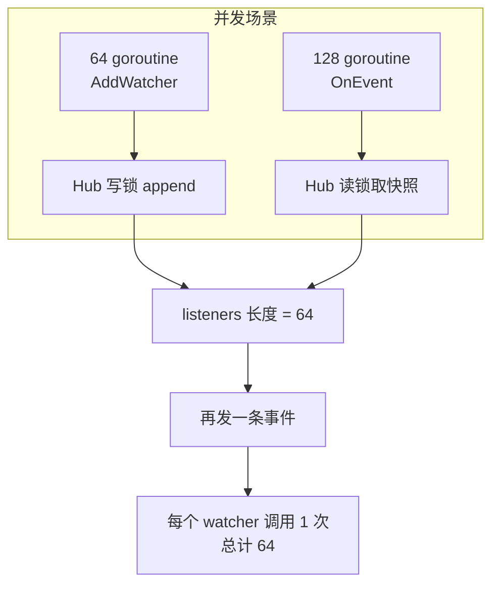
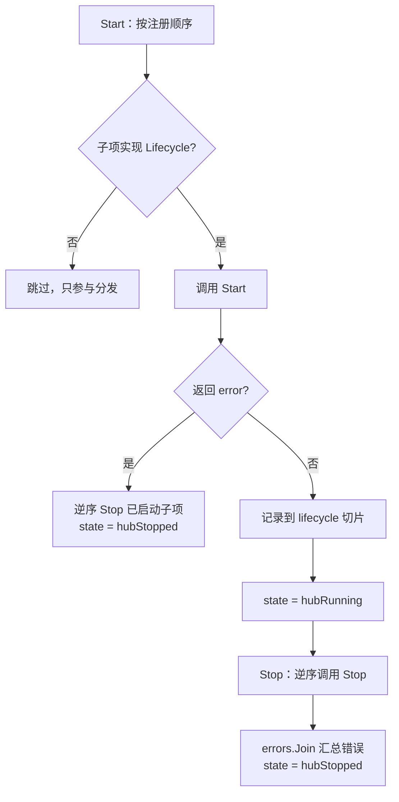

# pkg/scarecrow/hub_test.go

> 📅 最后更新日期: 2026/11/26

## 作用

`pkg/scarecrow/hub_test.go` 是 `Hub` 的行为契约测试：覆盖**分发顺序、注册规则、错误与 panic 隔离、生命周期启停、嵌套拓扑、`Find` 检索优先级、以及并发注册/分发**。这些正是 [`hub.md`](./hub.md) 中各条语义的可执行证据。

## 测试分布

| 分组 | 测试 | 验证的行为 |
|------|------|-----------|
| 分发 | `TestHubFansOutInRegistrationOrder` | 三个 watcher 按注册顺序 `a, b, c` 被调用（用互斥锁保护收集切片） |
| 分发 | `TestHubAllowsDuplicateRegistration` | 同一实例注册两次，一次事件触发两次调用 |
| 分发 | `TestHubWithoutWatchers` | 空 Hub 分发返回 `nil`，不 panic |
| 分发 | `TestHubIgnoresNilEvent` | `OnEvent(nil)` 返回 `nil` 且**不调用**任何 watcher |
| 注册 | `TestHubRejectsNilWatcher` | `AddWatcher(nil)` 返回错误 |
| 注册 | `TestHubNestsChildHub` | 父 Hub 注册子 Hub 后，父事件能到达子 Hub 的 watcher，且只到达一次 |
| 注册 | `TestHubRejectsCyclicRegistration` | 自注册被拒；`a→b` 后 `b→a` 被拒 |
| 错误隔离 | `TestHubIsolatesWatcherError` | 失败的 watcher 不影响后续 watcher；错误恰好上报一次，`errors.Is` 可穿透包装，且文本包含 `scarecrow` 上下文 |
| 错误隔离 | `TestHubRecoversWatcherPanic` | watcher `panic("kaboom")` 被恢复，上报文本包含 `kaboom`，后续 watcher 照常执行 |
| 错误隔离 | `TestHubSurvivesErrorHandlerPanic` | `ErrorHandler` 自身 panic 不会中断分发（`log` 输出重定向到 `io.Discard`） |
| 错误隔离 | `TestZeroValueHubIsUsable` | `&Hub{}` 未调用 `NewHub` 也能注册、分发，并回退默认错误处理器 |
| 生命周期 | `TestHubStartsAndStopsLifecycleInOrder` | 三个 `Lifecycle` 按 `a, b, c` 启动、按 `c, b, a` 停止；重复 `Start` / `Stop` 无副作用 |
| 生命周期 | `TestHubSkipsNonLifecycleWatcher` | 纯 `Watcher` 不参与启停，但 `Stop` 之后仍能收到分发的 `PlotStartEvent` |
| 生命周期 | `TestHubRollsBackOnStartFailure` | 第二个子项启动失败时回滚已启动的 `a`（记录 `stop:a`），错误包装 `boom` 且含 `start` 上下文；失败后 `Stop` 无副作用、再次 `Start` 报错 |
| 生命周期 | `TestHubStopBeforeStartIsNoop` | 未启动时 `Stop` 返回 `nil` 且不调用任何子项 |
| 生命周期 | `TestHubRejectsStartAfterStop` | `Stop` 后再次 `Start` 返回错误，且不重复调用任何生命周期方法 |
| 生命周期 | `TestHubStartsNestedHub` | 父 Hub 启动嵌套子 Hub：`start:child → start:parent → stop:parent → stop:child` |
| 生命周期 | `TestHubJoinsStopErrors` | 两个子项 `Stop` 都失败时，`errors.Is` 同时命中两个错误（`errors.Join`） |
| 检索 | `TestFindFindsDirectWatcher` | `Find[*markerWatcher]` 命中直属实例 |
| 检索 | `TestFindSearchesNestedHub` | 命中嵌套子 Hub 中的实例 |
| 检索 | `TestFindPrefersDirectWatcher` | 直属 watcher 优先于嵌套 Hub 中的同类型实例 |
| 检索 | `TestFindMissingWatcher` | 空 Hub 与 `nil` Hub 都返回 `false` |
| 并发 | `TestHubConcurrentAddAndEmit` | 64 个并发注册 + 128 个并发分发后，注册数不丢失；再分发一次，64 个 watcher 全部被调用 |

## 关键流程



`TestHubConcurrentAddAndEmit` 用 `atomic.Int64` 统计调用次数，`sync.WaitGroup` 等待全部协程；结束后直接读 `hub.listeners`（同包测试）确认注册数量，然后 `calls.Store(0)` 清空计数、串行再发一条事件，断言调用数等于 watcher 数。这一步是**快照完整性**的关键验证：并发注册期间的分发可能看到不同的 watcher 子集，但最终状态必须包含全部注册项。

### 生命周期：`Lifecycle` 契约

`lifecycleRecorder` 用互斥锁记录调用字符串，`lifecycleWatcherStub` 同时实现 `OnEvent` / `Start` / `Stop`，可注入 `startErr` 与 `stopErr`。相关用例覆盖：



关键断言：

| 用例 | 断言 |
|------|------|
| `TestHubStartsAndStopsLifecycleInOrder` | 调用序列恰为 `start:a, start:b, start:c, stop:c, stop:b, stop:a`；第二次 `Start` / `Stop` 不产生新记录 |
| `TestHubSkipsNonLifecycleWatcher` | 纯 `WatcherFunc` 不被启停；`Stop` 后 `OnEvent` 仍能调用它 |
| `TestHubRollsBackOnStartFailure` | 失败用例只留下 `start:a, stop:a`；`c` 从未启动；`errors.Is(err, boom)` 且文本含 `start`；失败后 `Start` 返回错误 |
| `TestHubStopBeforeStartIsNoop` | 未启动时 `Stop` 返回 `nil` 且记录为空 |
| `TestHubRejectsStartAfterStop` | 停止后 `Start` 报错，调用记录仍只有一对 `start:a` / `stop:a` |
| `TestHubStartsNestedHub` | 嵌套 Hub 递归启停，顺序为 `start:child, start:parent, stop:parent, stop:child` |
| `TestHubJoinsStopErrors` | `Stop` 同时返回 `a boom` 与 `b boom`，`errors.Is` 对两者都为真 |

## 重要细节

- **错误断言是双层**：既要求 `errors.Is(reported[0], boom)`（说明 `%w` 包装保留了错误链），也要求 `strings.Contains(..., "scarecrow")`（说明错误带上下文，而不仅是原样透传）。
- **panic 断言只查子串**：`Hub.deliver` 用 `%v` 格式化 panic 值，因此测试断言上报文本包含 `kaboom`，而不比较完整格式。
- **日志重定向**：`TestHubSurvivesErrorHandlerPanic` 与 `TestZeroValueHubIsUsable` 临时 `log.SetOutput(io.Discard)` 并在 `defer` 中恢复，避免默认处理器把噪音写进测试输出。
- **生命周期记录器**：`lifecycleRecorder` 自身加锁，`lifecycleWatcherStub.Start` 在返回注入错误时**不记录**启动，因此回滚断言只看到真正成功的 `start:a`；`Stop` 无论是否失败都会记录。
- **失败即终态**：`TestHubRollsBackOnStartFailure` 与 `TestHubRejectsStartAfterStop` 共同锁定“`hubStopped` 不可再次启动”的语义；`Stop` 在失败后的状态是 no-op。
- **嵌套 Hub 的递归启停**：`TestHubStartsNestedHub` 验证 `Hub` 作为 `Lifecycle` 被父 Hub 启动/停止；该用例只断言启停顺序，事件分发由 `TestHubNestsChildHub` 覆盖。
- **`markerWatcher` 是包内测试类型**：只实现 `OnEvent`，用于验证泛型 `Find` 对「具体指针类型」的检索能力（而不是仅对接口类型）。
- **顺序断言使用 `slices.Equal`**：`TestHubFansOutInRegistrationOrder` 收集顺序到 `[]string` 后整体比较，比逐条断言更能暴露乱序。
- **`seen` 去重分支未被直接覆盖**：`rejectCycle` 在菱形拓扑（同一 Hub 经多条路径可达）时会命中 `seen` 去重，`Find` 的 `seen` 则用于防御异常拓扑；当前测试只覆盖自环与链式嵌套，没有构造菱形拓扑。

## 运行方式

```bash
# 全量（推荐带竞态检测）
go test ./pkg/scarecrow -race -v

# 只跑 Hub 与 Find
go test ./pkg/scarecrow -race -run 'TestHub|TestFind|TestZeroValueHub' -v
```

## 注意事项

- 并发测试的断言是**最终一致性**而非中间时序：它不保证某条事件被所有 watcher 收到，只保证注册不丢失、最终分发完整。
- 测试直接访问私有字段 `hub.listeners` 与 `hub.mu`，因此必须在同包（`package scarecrow`）内运行；改成外部测试包会失去这项能力。
- 若调整错误文案，需要同步 `hub_test.go` 中 `strings.Contains` 的断言（当前只依赖 `scarecrow` 前缀与 panic 值本身）。
- 环检测的跨 Hub 并发竞态没有被测试覆盖（源码注释已声明不支持该用法），新增相关测试时应先确认是否要收紧实现。
