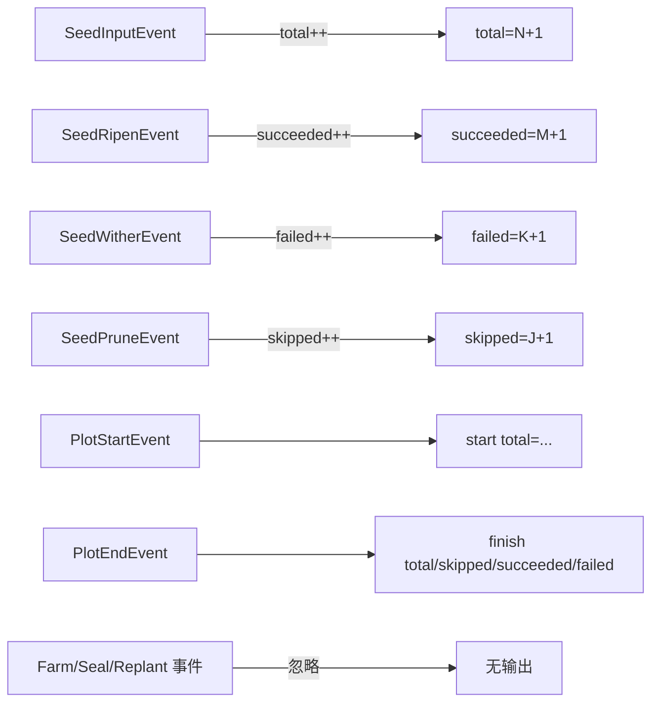

# pkg/scarecrow/print.go

> 📅 最后更新日期: 2026/11/13

## 作用

`pkg/scarecrow/print.go` 提供轻量的终端进度观察者 `PrintWatcher`：把种子输入、成熟、枯萎、剪枝与 Plot 起止事件打印到标准输出，便于本地调试与演示。它**自行维护计数**，不依赖 `MetricsWatcher`，因此可以单独挂到任意 Plot 或 Farm 的 Hub 上。

## 核心对象

### `PrintWatcher`

```go
type PrintWatcher struct {
    mu        sync.Mutex
    name      string
    out       io.Writer
    total     int
    succeeded int
    failed    int
    skipped   int
}
```

| 字段 | 说明 |
|------|------|
| `mu` | 互斥锁，保护所有计数字段与输出调用；事件可能来自多个协程，计数与打印必须成对串行 |
| `name` | 输出前缀，形如 `[harvester] ...` |
| `out` | 输出目标；`NewPrintWatcher` 固定为 `os.Stdout` |
| `total` | 收到的 `SeedInputEvent` 数（含外部注入与上游投递） |
| `succeeded` / `failed` / `skipped` | 分别对应成熟、枯萎、剪枝事件数 |

### 构造函数

| 符号 | 签名 | 行为 |
|------|------|------|
| `NewPrintWatcher` | `func NewPrintWatcher(name string) *PrintWatcher` | 输出到 `os.Stdout`，`name` 作为前缀 |
| `newPrintWatcher`（未导出） | `func newPrintWatcher(out io.Writer, name string) *PrintWatcher` | 指定输出目标，供包内测试用 `bytes.Buffer` 捕获输出 |

### `OnEvent` 的打印契约

每收到一个事件输出一行，格式为 `[<name>] <内容>\n`：

| 事件 | 计数变化 | 输出 |
|------|----------|------|
| `PlotStartEvent` | 无 | `start total=<total>` |
| `PlotEndEvent` | 无 | `finish total=<total>, skipped=<skipped>, succeeded=<succeeded>, failed=<failed>` |
| `SeedInputEvent` | `total++` | `total=<total>(+1)` |
| `SeedRipenEvent` | `succeeded++` | `succeeded=<succeeded>(+1), total=<total>` |
| `SeedWitherEvent` | `failed++` | `failed=<failed>(+1), total=<total>` |
| `SeedPruneEvent` | `skipped++` | `skipped=<skipped>(+1), total=<total>` |
| `FarmStartEvent` / `FarmEndEvent` / `SeedReplantEvent` / `SealInputEvent` / `SealMergeEvent` | 无 | **不输出** |

`total` 只统计 `SeedInputEvent`，不包含成熟/枯萎/剪枝；`succeeded + failed + skipped` 与 `total` 的差值就是尚在处理中的种子数。

### `printf`（未导出）

```go
func (p *PrintWatcher) printf(format string, args ...any) {
    _, _ = fmt.Fprintf(p.out, "[%s] %s\n", p.name, fmt.Sprintf(format, args...))
}
```

调用方需自行持锁；写错误被显式丢弃（终端输出失败不应影响主流程）。

## 关键流程



## 重要细节

- **计数范围取决于挂载位置**：挂到单个 Plot 的 Hub 上，只统计该 Plot 的事件；挂到 Farm 的 Hub 上，因为 Farm 把自身 Hub 注册进了每个 Plot 的 Hub，所以会统计整个 Farm 的累计进度。挂到两类 Hub 上会各自打印一份。
- **自带计数，不复用指标**：即使没有注册 `MetricsWatcher`，`PrintWatcher` 也能工作；反之，`MetricsWatcher` 的存在与否不影响它的输出。
- **只关注节点与任务进度**：Farm 起止、重试、终止信号都被忽略（源码注释说明与 CelestialFlow 的 `PrintObserver` 行为保持一致）。
- **会在事件发生时立即输出**：`SeedInputEvent` 的打印发生在种子真正被处理之前，因此 `total` 会先增长，`succeeded/failed/skipped` 随后追上。
- **输出介质固定**：公开构造函数只写 `os.Stdout`；`newPrintWatcher` 未导出，包外无法替换 `io.Writer`。需要写入文件或缓冲区时，应实现自己的 `Watcher`。
- **零值不可用**：`PrintWatcher{}` 的 `out` 为 `nil`，任何打印都会在 `fmt.Fprintf` 处 panic（`name` 为空只会输出 `[] `）。请始终通过 `NewPrintWatcher` 构造（包内测试用 `newPrintWatcher`）。

## 使用示例

### 挂到单个 Plot

```go
package main

import (
    "github.com/Mr-xiaotian/CelestialGrow/pkg/plot"
    "github.com/Mr-xiaotian/CelestialGrow/pkg/scarecrow"
)

type Seed struct{ ID int }
type Fruit struct{ ID int }

func cultivate(s Seed) (Fruit, error) { return Fruit{ID: s.ID}, nil }

func main() {
    p := plot.NewSinglePlot[Seed, Fruit]("harvester", cultivate)
    if err := p.AddWatcher(scarecrow.NewPrintWatcher("harvester")); err != nil {
        panic(err)
    }

    p.StartAsync()
    p.Seed(Seed{ID: 1})
    p.Seed(Seed{ID: 2})
    p.Seal()
    p.WaitAsync()
}
```

输出类似：

```text
[harvester] start total=0
[harvester] total=1(+1)
[harvester] total=2(+1)
[harvester] succeeded=1(+1), total=2
[harvester] succeeded=2(+1), total=2
[harvester] finish total=2, skipped=0, succeeded=2, failed=0
```

> 这段输出只是示意，不能作为稳定契约：`Seed` 在调用方协程直接发事件，而 `PlotStartEvent` 在 `StartAsync` 的协程内发出，二者存在竞态。实际运行中 `start` 行可能出现在若干 `total` 行之后，且其 `total` 可能已大于 0；结果行也可能交错。判读时以每行自身内容为准，不要依赖跨行顺序。

### 挂到 Farm 汇总全部 Plot

```go
package main

import (
    "github.com/Mr-xiaotian/CelestialGrow/pkg/farm"
    "github.com/Mr-xiaotian/CelestialGrow/pkg/plot"
    "github.com/Mr-xiaotian/CelestialGrow/pkg/scarecrow"
)

type Seed struct{ ID int }
type Fruit struct{ ID int }

func cultivate(s Seed) (Fruit, error) { return Fruit{ID: s.ID}, nil }

func main() {
    p := plot.NewSinglePlot[Seed, Fruit]("harvester", cultivate)

    f := farm.NewFarm("garden")
    if err := f.AddPlot(p); err != nil {
        panic(err)
    }
    if err := f.AddWatcher(scarecrow.NewPrintWatcher("garden")); err != nil {
        panic(err)
    }
    if err := f.Run(map[string][]any{"harvester": {Seed{ID: 1}}}, "INFO"); err != nil {
        panic(err)
    }
}
```

Farm 级 `PrintWatcher` 会收到所有 Plot 的事件，`total` 为全 Farm 的输入累计；`PlotStartEvent` / `PlotEndEvent` 每行分别对应一个 Plot，但输出中没有 Plot 名称（前缀只有 `name`），多 Plot 场景下只能靠行序与上下文区分。

## 注意事项

- 输出是**每事件一行**，高频运行（数万种子）会显著拖慢执行路径并刷屏；生产环境请改用日志或指标观察者。
- 输出到 `os.Stdout`，会与业务自身的标准输出混在一起；需要干净输出时应重定向进程 stdout 或自实现 `Watcher`。
- 没有重置接口：计数随实例单调增长，复用同一实例跨多次运行会延续上一次的累计值。
- 输出顺序不是事件全序的可靠来源；需要精确血缘与顺序请使用 `pkg/persist` 或 `MetricsWatcher`。
