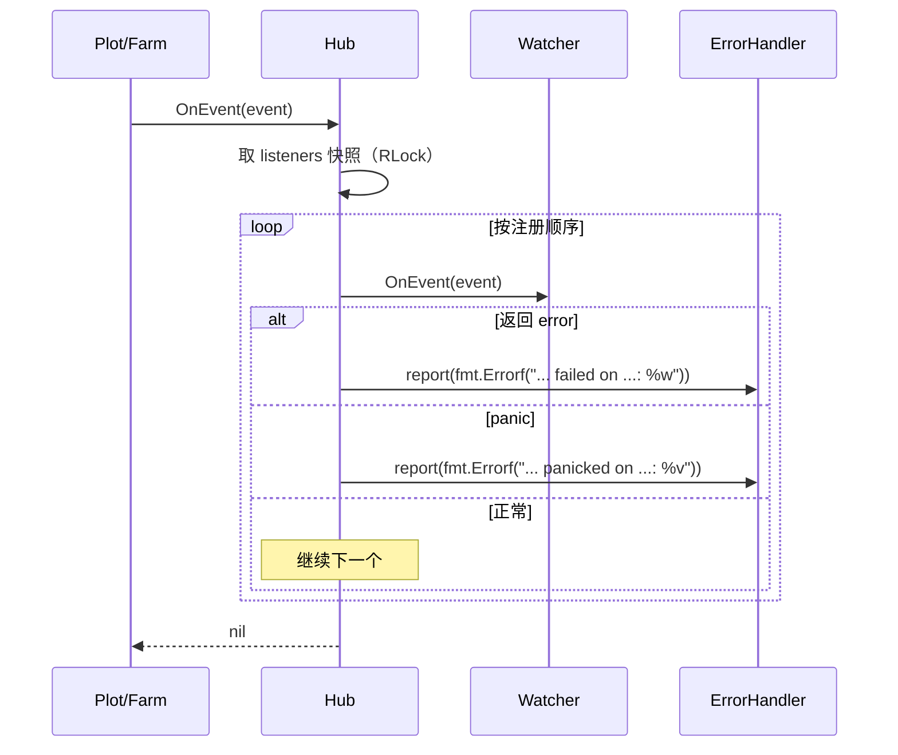

# pkg/scarecrow/watcher.go

> 📅 最后更新日期: 2026/11/13

## 作用

`pkg/scarecrow/watcher.go` 是 `scarecrow` 包的文件入口（包注释所在文件），同时定义运行期事件的**接收方契约** `Watcher` 与轻量适配器 `WatcherFunc`。`Hub` 只认这一个接口，因此指标统计、日志落盘、生命周期记录、终端打印可以统一注册、统一分发。

## 核心对象

### `Watcher` 接口

```go
type Watcher interface {
    OnEvent(event Event) error
}
```

| 方法 | 契约 |
|------|------|
| `OnEvent(Event) error` | 处理一个事件。返回的 `error` 由 `Hub` 捕获并交给 `ErrorHandler` 上报，**不会中断其他 Watcher，也不会回流到执行路径**（`Hub.OnEvent` 始终返回 `nil`） |

实现方需要遵守的约定（源码注释明确要求）：

1. **并发安全自负**：事件可能来自多个并发协程（多个 Plot 的 `tend` 协程、多个 Plot 的 Hub），实现方必须自行加锁或使用原子量。`MetricsWatcher` / `PrintWatcher` 内部都用互斥锁保护状态。
2. **快速返回**：`Hub` 同步调用 `OnEvent`，Watcher 的耗时直接串在执行路径上。需要慢速 I/O 的实现（如 `persist.LogWatcher`、`persist.LifecycleWatcher`）应把记录投递到 `funnel` 队列，由后台 Spout 消费。
3. **只读事件**：`Event` 以值传递，但内部切片/映射与生产方共享，不得修改。

### `WatcherFunc` 适配器

```go
type WatcherFunc func(event Event) error

func (f WatcherFunc) OnEvent(event Event) error {
    return f(event)
}
```

把普通函数适配成 `Watcher`，等价于 `http.HandlerFunc` 的惯用法。适合测试、一次性回调与示例代码。

### 本包与项目内的实现

| 实现 | 位置 | 说明 |
|------|------|------|
| `Hub` | [`hub.md`](./hub.md) | 自身实现 `Watcher`，可嵌套注册到另一个 Hub |
| `MetricsWatcher` | [`metrics.md`](./metrics.md) | 从事件流重建各 Plot 指标 |
| `PrintWatcher` | [`print.md`](./print.md) | 打印累计进度到 `os.Stdout` |
| `persist.LogWatcher` | `pkg/persist/log.go` | 运行日志异步落盘，读取 `MetricsWatcher` 补全计数 |
| `persist.LifecycleWatcher` | `pkg/persist/lifecycle.go` | 种子血缘写入 SQLite |

## 关键流程



## 重要细节

- **接口是隐式的**：任何实现了 `OnEvent(Event) error` 的类型都满足 `Watcher`，不需要显式声明；`plot.AddWatcher` / `farm.AddWatcher` / `hub.AddWatcher` 都直接接收该接口。
- **错误语义**：`Watcher` 的 `error` 只用于**上报**，不是控制流。看到 `OnEvent` 返回 `nil` 不代表所有 Watcher 都成功，只代表分发流程本身没有中断。
- **`WatcherFunc` 为 nil 时**：`var f WatcherFunc; f.OnEvent(...)` 会因调用 nil 函数而 panic。若通过 `Hub` 分发，panic 会被 `Hub.deliver` 捕获并转成 `scarecrow: ... panicked on ...` 的上报错误；直接调用则没有保护。
- **类型为 nil 的接口值**：`hub.AddWatcher(nil)` 会被拒绝，但 `var p *PrintWatcher; hub.AddWatcher(p)` 传入的是**非 nil 接口**（动态类型非空、值为 nil），注册会通过，调用时在 nil 接收者上操作而 panic，最终同样被 `Hub` 捕获上报。若需要「可选注册」，请显式判断指针是否为 nil。

## 使用示例

### 用 `WatcherFunc` 做一次性回调

```go
package main

import (
    "fmt"

    "github.com/Mr-xiaotian/CelestialGrow/pkg/scarecrow"
)

func main() {
    hub := scarecrow.NewHub()

    err := hub.AddWatcher(scarecrow.WatcherFunc(func(event scarecrow.Event) error {
        fmt.Printf("%T\n", event)
        return nil
    }))
    if err != nil {
        panic(err)
    }

    _ = hub.OnEvent(scarecrow.PlotStartEvent{Plot: "harvester", Tenders: 4})
    // 输出：scarecrow.PlotStartEvent
}
```

### 实现并发安全的自定义 Watcher

```go
package main

import (
    "sync"

    "github.com/Mr-xiaotian/CelestialGrow/pkg/plot"
    "github.com/Mr-xiaotian/CelestialGrow/pkg/scarecrow"
)

// ripenCounter 统计成熟数，可被多个 Plot 协程并发调用。
type ripenCounter struct {
    mu    sync.Mutex
    count int
}

func (c *ripenCounter) OnEvent(event scarecrow.Event) error {
    if _, ok := event.(scarecrow.SeedRipenEvent); !ok {
        return nil
    }
    c.mu.Lock()
    c.count++
    c.mu.Unlock()
    return nil
}

func (c *ripenCounter) Count() int {
    c.mu.Lock()
    defer c.mu.Unlock()
    return c.count
}

type Seed struct{ ID int }
type Fruit struct{ ID int }

func cultivate(s Seed) (Fruit, error) { return Fruit{ID: s.ID}, nil }

func main() {
    counter := &ripenCounter{}

    p := plot.NewSinglePlot[Seed, Fruit]("harvester", cultivate)
    if err := p.AddWatcher(counter); err != nil {
        panic(err)
    }

    p.StartAsync()
    p.Seed(Seed{ID: 1})
    p.Seal()
    p.WaitAsync()

    _ = counter.Count()
}
```

`Farm.AddWatcher` 注册的 watcher 会同时收到 Farm 事件与所有 Plot 事件（Farm 把自己的 Hub 注册进每个 Plot 的 Hub）。

## 注意事项

- 不要在 `OnEvent` 里长时间阻塞：它会拖慢事件生产方（Plot 的 `tend` 协程或 Farm 的启动/收尾路径）。
- 不要把 `OnEvent` 的错误当作重试信号：`Hub` 不会重投事件，错误只会上报。
- `Watcher` 没有「注销」方法，注册后持续接收事件直到运行结束；重复注册同一实例会收到多次。
- 需要按类型检索已注册的 Watcher（例如拿到 `MetricsWatcher` 读取计数）时，使用 `scarecrow.Find[T](hub)`，见 [`hub.md`](./hub.md)。
